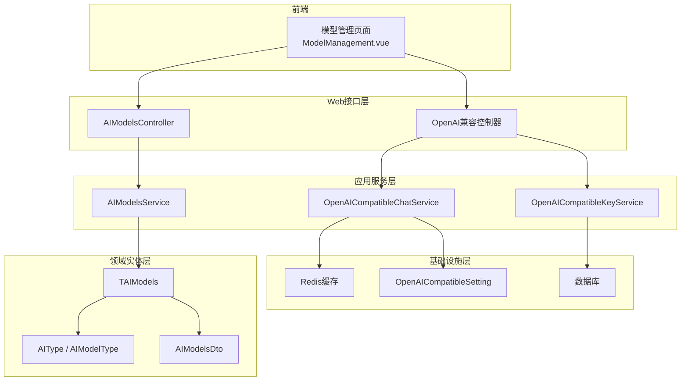
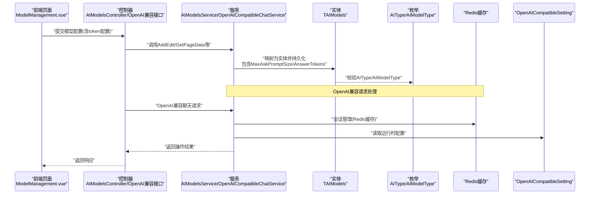
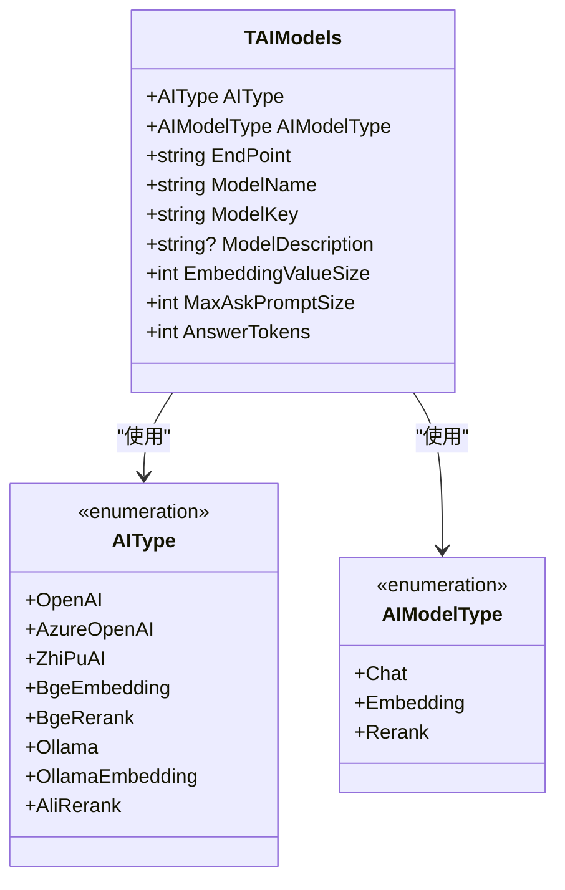
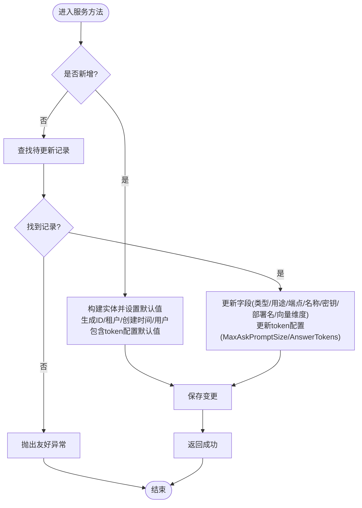
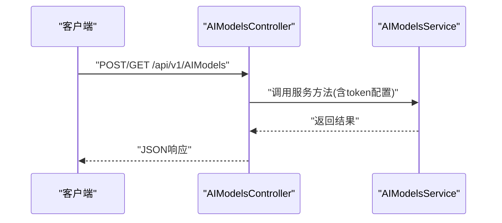
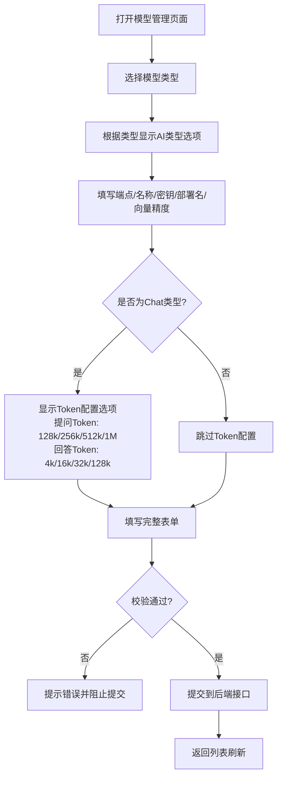
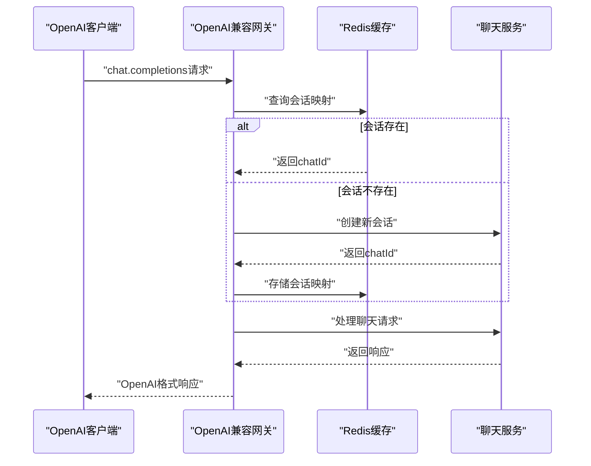
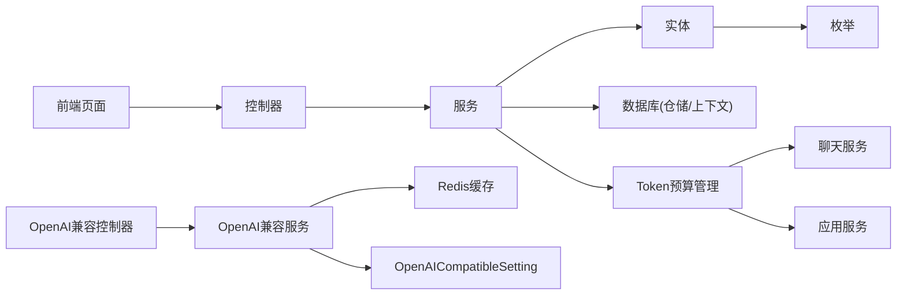

# 模型管理

<cite>
**本文引用的文件**
- [TAIModels.cs](file://Kevin/Domain/Entities/AI/TAIModels.cs)
- [AIType.cs](file://Kevin/kevin.Share/Enums/AIType.cs)
- [AIModelsService.cs](file://Kevin/Application/Services/AI/AIModelsService.cs)
- [AIModelsController.cs](file://Kevin/Kevin.Web.Basics/Controllers/AI/AIModelsController.cs)
- [ModelManagement.vue](file://vue/kevin.web.vue/src/pages/ai/ModelManagement.vue)
- [AIModelsDto.cs](file://Kevin/kevin.Share/Dtos/AI/AIModelsDto.cs)
- [AIChatHistorysService.cs](file://Kevin/Application/Services/AI/AIChatHistorysService.cs)
- [AIAppsService.cs](file://Kevin/Application/Services/AI/AIAppsService.cs)
- [OpenAICompatibleChatService.cs](file://Kevin/Application/Services/AI/OpenAICompatibleChatService.cs)
- [OpenAICompatibleKeyService.cs](file://Kevin/Application/Services/AI/OpenAICompatibleKeyService.cs)
- [OpenAICompatibleSetting.cs](file://Kevin/kevin.Module\kevin.AI.AgentFramework\Dto\OpenAICompatibleSetting.cs)
- [TokenEstimator.cs](file://Kevin/kevin.Module\kevin.AI.AgentFramework\TokenEstimation\TokenEstimator.cs)
</cite>

## 更新摘要
**变更内容**
- 新增OpenAI协议兼容接口完整实现，支持标准OpenAI API调用格式
- 增强令牌预算管理系统，实现智能上下文裁剪和资源分配
- 改进会话管理机制，支持Redis缓存和滑动过期
- 完善密钥管理体系，支持AES加密和用户级密钥管理
- 提升性能优化策略，包括负载均衡、健康检查和监控统计

## 目录
1. [简介](#简介)
2. [项目结构](#项目结构)
3. [核心组件](#核心组件)
4. [架构总览](#架构总览)
5. [详细组件分析](#详细组件分析)
6. [OpenAI兼容性支持](#openai兼容性支持)
7. [令牌预算管理与上下文裁剪](#令牌预算管理与上下文裁剪)
8. [依赖关系分析](#依赖关系分析)
9. [性能考量与优化](#性能考量与优化)
10. [故障排查指南](#故障排查指南)
11. [结论](#结论)
12. [附录](#附录)

## 简介
本系统提供统一的AI模型管理能力，支持OpenAI兼容API、本地Ollama模型以及第三方服务提供商（如Azure OpenAI、智谱AI、Bge Embedding/Rerank、Ali Rerank等）。通过集中化的模型配置与数据持久化，实现模型的增删改查、类型与用途区分、连接参数与认证信息管理。**最新增强**：新增完整的OpenAI协议兼容接口支持，实现了精细化的token预算管理、智能上下文裁剪机制，以及高性能的会话管理和密钥管理体系。

## 项目结构
围绕"模型管理"的核心代码分布在以下层次：
- 领域实体层：定义AI模型配置的数据结构与约束，包含新增的token配置字段
- 应用服务层：封装模型配置的查询、新增、编辑、删除等业务逻辑，实现token预算管理
- Web接口层：对外暴露模型管理的REST接口
- OpenAI兼容层：提供标准OpenAI API接口的完整实现
- 前端页面：提供模型配置的可视化维护界面，包含token配置选项



**图表来源**
- [ModelManagement.vue:119-177](file://vue/kevin.web.vue/src/pages/ai/ModelManagement.vue#L119-L177)
- [OpenAICompatibleChatService.cs:40-58](file://Kevin/Application/Services/AI/OpenAICompatibleChatService.cs#L40-L58)
- [OpenAICompatibleKeyService.cs:19-32](file://Kevin/Application/Services/AI/OpenAICompatibleKeyService.cs#L19-L32)
- [OpenAICompatibleSetting.cs:14-52](file://Kevin/kevin.Module\kevin.AI.AgentFramework\Dto\OpenAICompatibleSetting.cs#L14-L52)

章节来源
- [TAIModels.cs:1-69](file://Kevin/Domain/Entities/AI/TAIModels.cs#L1-L69)
- [AIType.cs:1-39](file://Kevin/kevin.Share/Enums/AIType.cs#L1-L39)
- [AIModelsService.cs:1-175](file://Kevin/Application/Services/AI/AIModelsService.cs#L1-L175)
- [AIModelsController.cs](file://Kevin/Kevin.Web.Basics/Controllers/AI/AIModelsController.cs)
- [ModelManagement.vue:119-177](file://vue/kevin.web.vue/src/pages/ai/ModelManagement.vue#L119-L177)

## 核心组件
- 模型实体 TAIModels：承载模型类型、模型用途、端点地址、模型名称、密钥、部署名、向量维度等关键配置项，**新增** MaxAskPromptSize和AnswerTokens用于token预算管理
- 枚举 AIType/AIModelType：统一描述支持的AI提供商类型与模型用途（聊天、嵌入、重排）
- 数据传输对象 AIModelsDto：与实体对应的DTO，包含完整的token配置信息
- 应用服务 AIModelsService：提供分页查询、详情获取、列表获取、新增/编辑、删除等能力，**新增** token配置更新支持
- Web控制器 AIModelsController：对外暴露模型管理接口（由框架路由到服务方法）
- **OpenAI兼容服务**：OpenAICompatibleChatService和OpenAICompatibleKeyService，提供标准OpenAI API接口实现
- **配置管理**：OpenAICompatibleSetting，管理OpenAI兼容接口的运行时配置
- 前端 ModelManagement.vue：提供模型类型的选择、必填校验、表单提交与列表展示，**新增** token配置界面和快捷选项

章节来源
- [TAIModels.cs:1-69](file://Kevin/Domain/Entities/AI/TAIModels.cs#L1-L69)
- [AIType.cs:1-39](file://Kevin/kevin.Share/Enums/AIType.cs#L1-L39)
- [AIModelsDto.cs:1-69](file://Kevin/kevin.Share/Dtos/AI/AIModelsDto.cs#L1-L69)
- [AIModelsService.cs:1-175](file://Kevin/Application/Services/AI/AIModelsService.cs#L1-L175)
- [OpenAICompatibleChatService.cs:40-58](file://Kevin/Application/Services/AI/OpenAICompatibleChatService.cs#L40-L58)
- [OpenAICompatibleKeyService.cs:19-32](file://Kevin/Application/Services/AI/OpenAICompatibleKeyService.cs#L19-L32)
- [OpenAICompatibleSetting.cs:14-52](file://Kevin/kevin.Module\kevin.AI.AgentFramework\Dto\OpenAICompatibleSetting.cs#L14-L52)
- [ModelManagement.vue:119-177](file://vue/kevin.web.vue/src/pages/ai/ModelManagement.vue#L119-L177)

## 架构总览
下图展示了从前端到后端再到实体的调用链路，以及模型类型与用途的约束关系，**新增OpenAI兼容性支持和token配置的数据流**。



**图表来源**
- [ModelManagement.vue:119-177](file://vue/kevin.web.vue/src/pages/ai/ModelManagement.vue#L119-L177)
- [OpenAICompatibleChatService.cs:61-85](file://Kevin/Application/Services/AI/OpenAICompatibleChatService.cs#L61-L85)
- [OpenAICompatibleChatService.cs:200-233](file://Kevin/Application/Services/AI/OpenAICompatibleChatService.cs#L200-L233)
- [OpenAICompatibleSetting.cs:35-52](file://Kevin/kevin.Module\kevin.AI.AgentFramework\Dto\OpenAICompatibleSetting.cs#L35-L52)

## 详细组件分析

### 模型实体与类型约束
- 字段说明
  - AIType：AI提供商类型，支持OpenAI、Azure OpenAI、智谱AI、Bge Embedding、Bge Rerank、Ollama、OllamaEmbedding、Ali Rerank等
  - AIModelType：模型用途，包括Chat（对话）、Embedding（向量）、Rerank（重排）
  - EndPoint：模型服务地址
  - ModelName：模型名称
  - ModelKey：模型密钥（原生直连场景可为空）
  - ModelDescription：部署名（Azure等场景需要）
  - EmbeddingValueSize：向量维度大小（默认2048）
  - **MaxAskPromptSize**：**新增** 提问最大token数（模型上下文窗口预算，控制历史对话与补充上下文总量），默认131072
  - **AnswerTokens**：**新增** 回答最大token数（模型最大输出长度），默认8192
- 约束与默认值
  - 必填字段：AIType、AIModelType、EndPoint、ModelName
  - 默认值：AIType=OpenAI，AIModelType=Chat，EmbeddingValueSize=2048，MaxAskPromptSize=131072，AnswerTokens=8192



**图表来源**
- [TAIModels.cs:1-69](file://Kevin/Domain/Entities/AI/TAIModels.cs#L1-L69)
- [AIType.cs:1-39](file://Kevin/kevin.Share/Enums/AIType.cs#L1-L39)

章节来源
- [TAIModels.cs:1-69](file://Kevin/Domain/Entities/AI/TAIModels.cs#L1-L69)
- [AIType.cs:1-39](file://Kevin/kevin.Share/Enums/AIType.cs#L1-L39)

### 模型配置服务（AIModelsService）
- 能力概览
  - 分页查询：按租户与软删除过滤，支持关键字搜索（模型名称），包含创建/更新用户信息
  - 详情获取：按ID获取单条记录，不存在时抛出友好异常
  - 全量列表：按模型用途筛选返回
  - 新增/编辑：根据是否存在ID判断新增或更新，填充租户、创建/更新时间与用户信息，**新增** MaxAskPromptSize和AnswerTokens字段更新
  - 删除：软删除并记录时间戳
- 业务要点
  - 数据权限：查询默认启用数据权限与租户隔离
  - 异常处理：对缺失数据返回友好提示
  - 审计字段：自动设置创建/更新时间与用户
  - **Token配置**：在编辑操作中支持MaxAskPromptSize和AnswerTokens字段的更新



**图表来源**
- [AIModelsService.cs:99-149](file://Kevin/Application/Services/AI/AIModelsService.cs#L99-L149)
- [AIModelsService.cs:157-172](file://Kevin/Application/Services/AI/AIModelsService.cs#L157-L172)

章节来源
- [AIModelsService.cs:1-175](file://Kevin/Application/Services/AI/AIModelsService.cs#L1-L175)

### Web接口（AIModelsController）
- 职责：接收HTTP请求，调用AIModelsService对应方法，返回标准化响应
- 典型流程：路由解析 -> 参数绑定 -> 服务调用 -> 结果封装 -> 返回



**图表来源**
- [AIModelsController.cs](file://Kevin/Kevin.Web.Basics/Controllers/AI/AIModelsController.cs)
- [AIModelsService.cs:1-175](file://Kevin/Application/Services/AI/AIModelsService.cs#L1-L175)

章节来源
- [AIModelsController.cs](file://Kevin/Kevin.Web.Basics/Controllers/AI/AIModelsController.cs)
- [AIModelsService.cs:1-175](file://Kevin/Application/Services/AI/AIModelsService.cs#L1-L175)

### 前端模型管理（ModelManagement.vue）
- 功能要点
  - 模型类型选择：Chat、Embedding、Rerank
  - AI类型联动：根据模型用途动态显示可选的AI提供商类型
  - 必填校验：模型类型、AI类型、端点、模型名称、部署名、向量精度等
  - **Token配置界面**：**新增** 提问Token和回答Token的配置输入框，支持数值输入和快捷选项
  - 表单提交：将配置提交至后端进行新增/编辑
- 交互流程



**图表来源**
- [ModelManagement.vue:119-177](file://vue/kevin.web.vue/src/pages/ai/ModelManagement.vue#L119-L177)
- [ModelManagement.vue:235-247](file://vue/kevin.web.vue/src/pages/ai/ModelManagement.vue#L235-L247)

章节来源
- [ModelManagement.vue:119-177](file://vue/kevin.web.vue/src/pages/ai/ModelManagement.vue#L119-L177)
- [ModelManagement.vue:235-247](file://vue/kevin.web.vue/src/pages/ai/ModelManagement.vue#L235-L247)

## OpenAI兼容性支持

### OpenAI协议兼容接口
系统提供了完整的OpenAI协议兼容接口实现，支持标准的OpenAI API调用格式：

#### 核心特性
- **标准API兼容**：完全遵循OpenAI Chat Completions API规范
- **流式与非流式支持**：同时支持SSE流式和传统非流式响应
- **工具调用透传**：支持OpenAI tools协议的透传执行
- **多模态消息**：支持文本和图片的多模态消息处理
- **会话管理**：基于Redis的智能会话管理和状态保持

#### 会话管理机制


**图表来源**
- [OpenAICompatibleChatService.cs:200-233](file://Kevin/Application/Services/AI/OpenAICompatibleChatService.cs#L200-L233)
- [OpenAICompatibleChatService.cs:251-290](file://Kevin/Application/Services/AI/OpenAICompatibleChatService.cs#L251-L290)

#### 密钥管理体系
系统实现了安全的用户级密钥管理：
- **AES加密存储**：所有密钥都经过AES加密后存储在数据库中
- **用户隔离**：每个用户独立管理自己的API密钥
- **密钥生命周期管理**：支持生成、查看、启用/禁用、删除等操作
- **安全随机生成**：使用加密安全的随机数生成器创建密钥

章节来源
- [OpenAICompatibleChatService.cs:40-508](file://Kevin/Application/Services/AI/OpenAICompatibleChatService.cs#L40-L508)
- [OpenAICompatibleKeyService.cs:19-276](file://Kevin/Application/Services/AI/OpenAICompatibleKeyService.cs#L19-L276)
- [OpenAICompatibleSetting.cs:14-77](file://Kevin/kevin.Module\kevin.AI.AgentFramework\Dto\OpenAICompatibleSetting.cs#L14-L77)

## 令牌预算管理与上下文裁剪

### Token配置字段详解
系统新增了两个关键的token配置字段，用于精细化控制AI模型的token使用：

#### MaxAskPromptSize（提问最大token数）
- **作用**：控制模型上下文窗口预算，限制历史对话与补充上下文的总量
- **默认值**：131072 tokens（128k）
- **应用场景**：适用于需要长上下文对话的场景，如复杂推理、长文档分析
- **前端支持**：提供128k、256k、512k、1M四个快捷选项

#### AnswerTokens（回答最大token数）
- **作用**：限制模型的最大输出长度，控制单次响应的token消耗
- **默认值**：8192 tokens（8k）
- **应用场景**：适用于需要控制响应长度的场景，避免过长的输出导致成本过高
- **前端支持**：提供4k、16k、32k、128k四个快捷选项

### 智能Token预算管理
系统在服务层实现了智能的token预算管理：

#### 预算计算逻辑
```csharp
// 预算 = 提问Token上限 - 系统提示词 - 用户问题 - 预留回答Token
var budget = maxAskPromptSize - EstimateTokenCount(systemPrompt) - EstimateTokenCount(userContent) - answerTokens;
```

#### 上下文裁剪机制
当补充上下文（RAG/文件/联网搜索结果）超过预算时，系统会按优先级顺序裁剪内容，确保高优先级内容完整保留。

#### 实际应用场景
- **AI应用配置**：在AIAppsService中，AnswerTokens被设置为ChatOptions的MaxOutputTokens
- **聊天历史服务**：在AIChatHistorysService中，实现了完整的token预算管理和上下文裁剪逻辑

### 前端Token配置界面
前端提供了直观的token配置界面：

#### 快捷选项设计
- **提问Token选项**：128k、256k、512k、1M，适合不同规模的对话场景
- **回答Token选项**：4k、16k、32k、128k，满足不同响应长度需求
- **自定义输入**：支持直接输入具体数值，满足特殊需求

#### 条件显示逻辑
Token配置仅在模型类型为Chat时显示，因为Embedding和Rerank模型不需要这些配置。

章节来源
- [TAIModels.cs:54-66](file://Kevin/Domain/Entities/AI/TAIModels.cs#L54-L66)
- [AIModelsDto.cs:54-66](file://Kevin/kevin.Share/Dtos/AI/AIModelsDto.cs#L54-L66)
- [AIChatHistorysService.cs:507-534](file://Kevin/Application/Services/AI/AIChatHistorysService.cs#L507-L534)
- [AIAppsService.cs:353-360](file://Kevin/Application/Services/AI/AIAppsService.cs#L353-L360)
- [ModelManagement.vue:153-176](file://vue/kevin.web.vue/src/pages/ai/ModelManagement.vue#L153-L176)
- [ModelManagement.vue:235-247](file://vue/kevin.web.vue/src/pages/ai/ModelManagement.vue#L235-L247)

## 依赖关系分析
- 模块内依赖
  - 控制器依赖服务：用于解耦HTTP与业务逻辑
  - 服务依赖实体与枚举：保证数据结构与类型约束一致
  - 前端依赖控制器接口：通过HTTP协议交互
- 外部依赖
  - 数据库访问：通过仓储/上下文持久化模型配置
  - 第三方AI服务：通过EndPoint与ModelKey等进行远程调用（具体调用逻辑在其它模块中实现）
  - **Token配置依赖**：服务层依赖AIChatHistorysService和AIAppsService中的token预算管理逻辑
  - **Redis缓存依赖**：OpenAI兼容接口使用Redis进行会话状态管理
  - **配置管理依赖**：OpenAICompatibleSetting提供运行时配置管理



**图表来源**
- [AIModelsController.cs](file://Kevin/Kevin.Web.Basics/Controllers/AI/AIModelsController.cs)
- [AIModelsService.cs:1-175](file://Kevin/Application/Services/AI/AIModelsService.cs#L1-L175)
- [OpenAICompatibleChatService.cs:40-58](file://Kevin/Application/Services/AI/OpenAICompatibleChatService.cs#L40-L58)
- [OpenAICompatibleSetting.cs:14-52](file://Kevin/kevin.Module\kevin.AI.AgentFramework\Dto\OpenAICompatibleSetting.cs#L14-L52)

章节来源
- [AIModelsService.cs:1-175](file://Kevin/Application/Services/AI/AIModelsService.cs#L1-L175)
- [TAIModels.cs:1-69](file://Kevin/Domain/Entities/AI/TAIModels.cs#L1-L69)
- [AIType.cs:1-39](file://Kevin/kevin.Share/Enums/AIType.cs#L1-L39)

## 性能考量与优化

### 查询优化
- 分页与跳过：避免一次性加载大量数据
- 条件过滤：按租户与软删除状态过滤，减少无效数据
- 关联加载：按需Include创建/更新用户，避免N+1问题

### 写入优化
- 批量保存：在服务层合并多次修改后统一保存
- 软删除：保留历史数据，便于审计与恢复

### 缓存建议
- 模型配置可考虑短期缓存（如内存缓存），降低频繁读取数据库的压力
- 注意缓存失效策略：当模型配置变更时及时清理缓存

### Token配置性能优化
- 合理的token预算设置可减少不必要的上下文裁剪操作
- 根据模型能力选择合适的token限制，避免超出模型限制导致的重试
- 监控token使用情况，及时调整配置以优化成本

### OpenAI兼容接口性能优化
- **Redis会话缓存**：使用Redis存储会话映射，提高会话查找性能
- **滑动过期机制**：会话映射采用滑动过期，每次命中都重新计时
- **异步处理**：支持异步会话创建和缓存操作，避免阻塞主流程
- **错误降级**：Redis操作失败时自动降级为新会话模式，不影响用户体验

### 会话管理优化
- **智能会话识别**：支持多种会话标识方式（请求头、扩展字段、用户字段、指纹）
- **租户隔离**：会话映射按用户和智能体隔离，防止跨租户数据泄露
- **内存优化**：会话名称长度限制，避免过长会话名占用过多内存

章节来源
- [OpenAICompatibleChatService.cs:200-290](file://Kevin/Application/Services/AI/OpenAICompatibleChatService.cs#L200-L290)
- [OpenAICompatibleSetting.cs:19-26](file://Kevin/kevin.Module\kevin.AI.AgentFramework\Dto\OpenAICompatibleSetting.cs#L19-L26)

## 故障排查指南
- 常见错误
  - 数据不存在或已删除：服务层在获取详情或删除时若未找到记录会抛出友好异常
  - 必填字段缺失：前端校验会在提交前拦截，确保基本完整性
  - **Token配置错误**：token值设置过大可能导致上下文溢出，过小可能影响对话质量
  - **OpenAI兼容接口错误**：会话映射失效、密钥验证失败、模型不存在等
- 定位步骤
  - 检查前端表单校验规则与提示信息
  - 查看后端服务日志与异常堆栈
  - 确认数据库记录是否存在且未被软删除
  - 核对租户隔离与数据权限是否正确
  - **验证token配置**：检查MaxAskPromptSize和AnswerTokens的设置是否合理
  - **检查Redis连接**：确认Redis服务正常运行，会话映射正常存取
  - **验证密钥配置**：检查OpenAI兼容接口的密钥是否有效且启用

章节来源
- [AIModelsService.cs:45-68](file://Kevin/Application/Services/AI/AIModelsService.cs#L45-L68)
- [AIModelsService.cs:157-172](file://Kevin/Application/Services/AI/AIModelsService.cs#L157-L172)
- [OpenAICompatibleChatService.cs:98-118](file://Kevin/Application/Services/AI/OpenAICompatibleChatService.cs#L98-L118)
- [ModelManagement.vue:235-247](file://vue/kevin.web.vue/src/pages/ai/ModelManagement.vue#L235-L247)

## 结论
本系统提供了完善的AI模型配置管理能力，覆盖主流AI提供商与本地模型，具备清晰的实体设计、规范的服务层逻辑与友好的前端交互。**最新增强**包括：完整的OpenAI协议兼容接口支持，实现了精细化的token预算管理、智能上下文裁剪机制，以及高性能的会话管理和密钥管理体系。通过MaxAskPromptSize和AnswerTokens两个关键字段，实现了对AI模型上下文窗口和输出长度的精细化控制。这种细粒度的token预算管理不仅提升了系统的灵活性和可控性，还为用户提供了更优的成本效益比。结合Redis缓存、智能会话管理和安全密钥体系，系统具备了企业级的稳定性和安全性。后续可在调用层增加负载均衡、健康检查、监控统计与成本分析等能力，进一步提升系统的可用性与可观测性。

## 附录
- 支持的AI类型与模型用途
  - AI类型：OpenAI、Azure OpenAI、智谱AI、Bge Embedding、Bge Rerank、Ollama、OllamaEmbedding、Ali Rerank
  - 模型用途：Chat（对话）、Embedding（向量）、Rerank（重排）
- 配置字段
  - 端点地址、模型名称、密钥、部署名、向量维度等
  - **新增token配置**：MaxAskPromptSize（默认131072）、AnswerTokens（默认8192）
- OpenAI兼容接口特性
  - 标准API兼容、流式与非流式支持、工具调用透传、多模态消息、会话管理
- 使用建议
  - Chat场景优先选择OpenAI/Ollama；Embedding场景可选择Bge或OllamaEmbedding；Rerank场景可选择Bge或Ali Rerank
  - 根据业务需求合理设置向量维度，以平衡精度与性能
  - **Token配置建议**：
    - 简单对话：MaxAskPromptSize=128k，AnswerTokens=4k
    - 复杂推理：MaxAskPromptSize=256k+，AnswerTokens=16k+
    - 长文档分析：MaxAskPromptSize=512k+，AnswerTokens=32k+
    - 成本控制：适当降低AnswerTokens以减少token消耗
  - **OpenAI兼容接口使用建议**：
    - 使用标准OpenAI SDK进行集成
    - 合理设置会话标识以保持对话连续性
    - 监控token使用情况，及时调整预算配置

章节来源
- [AIType.cs:1-39](file://Kevin/kevin.Share/Enums/AIType.cs#L1-L39)
- [TAIModels.cs:1-69](file://Kevin/Domain/Entities/AI/TAIModels.cs#L1-L69)
- [AIModelsDto.cs:1-69](file://Kevin/kevin.Share/Dtos/AI/AIModelsDto.cs#L1-L69)
- [OpenAICompatibleChatService.cs:40-508](file://Kevin/Application/Services/AI/OpenAICompatibleChatService.cs#L40-L508)
- [OpenAICompatibleKeyService.cs:19-276](file://Kevin/Application/Services/AI/OpenAICompatibleKeyService.cs#L19-L276)