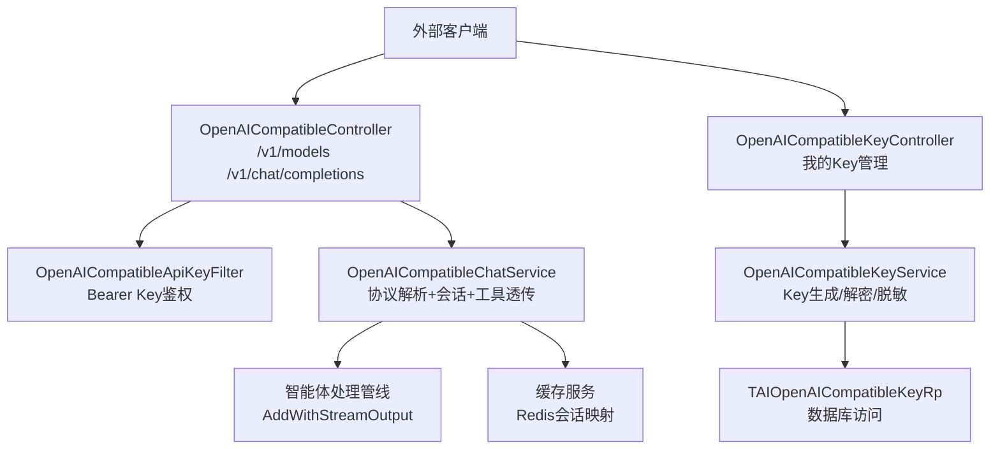
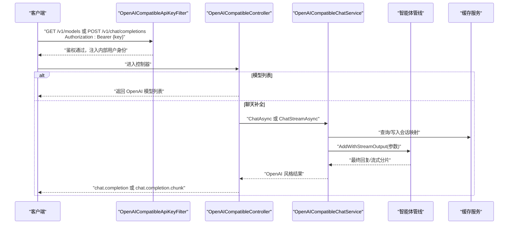
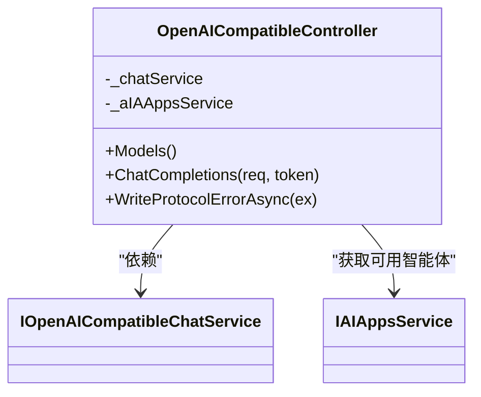
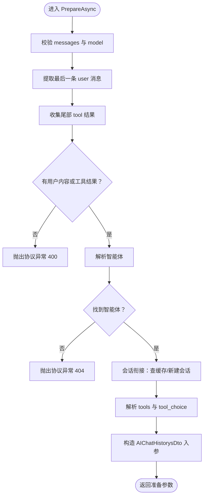
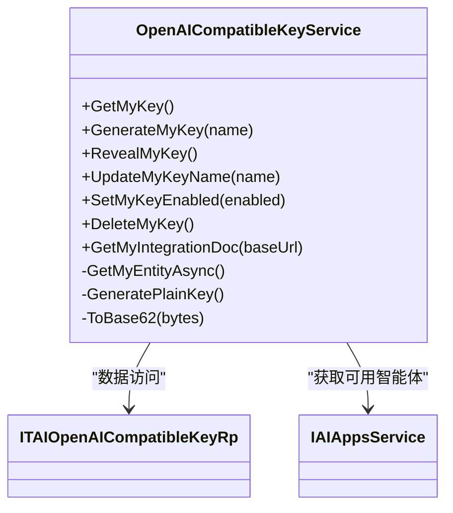
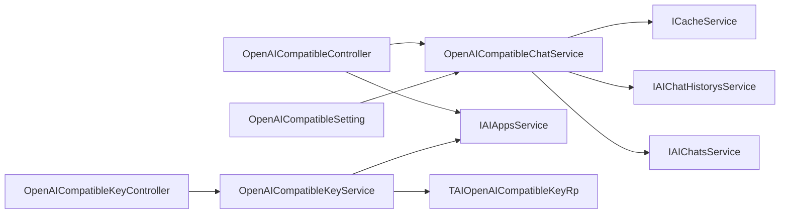

# OpenAI协议兼容API

<cite>
**本文引用的文件**   
- [OpenAICompatibleController.cs](file://Kevin/ Kevin.Web.Basics/Controllers/AI/OpenAI/OpenAICompatibleController.cs)
- [OpenAICompatibleKeyController.cs](file://Kevin/ Kevin.Web.Basics/Controllers/AI/OpenAI/OpenAICompatibleKeyController.cs)
- [OpenAICompatibleApiKeyFilter.cs](file://Kevin/ Kevin.Web.Basics/Filters/OpenAICompatibleApiKeyFilter.cs)
- [OpenAICompatibleChatService.cs](file://Kevin/Application/Services/AI/OpenAICompatibleChatService.cs)
- [OpenAICompatibleKeyService.cs](file://Kevin/Application/Services/AI/OpenAICompatibleKeyService.cs)
- [OpenAICompatibleChatDtos.cs](file://Kevin/Domain/Share/Dtos/AI/OpenAICompatibleChatDtos.cs)
- [OpenAICompatibleKeyDto.cs](file://Kevin/Domain/Share/Dtos/AI/OpenAICompatibleKeyDto.cs)
- [TAIOpenAICompatibleKey.cs](file://Kevin/Domain/Entities/AI/TAIOpenAICompatibleKey.cs)
- [OpenAICompatibleSetting.cs](file://Kevin/kevin.Module/kevin.AI.AgentFramework/Dto/OpenAICompatibleSetting.cs)
</cite>

## 目录
1. [简介](#简介)
2. [项目结构定位](#项目结构定位)
3. [核心组件](#核心组件)
4. [架构总览](#架构总览)
5. [详细组件分析](#详细组件分析)
6. [依赖关系分析](#依赖关系分析)
7. [性能与扩展性](#性能与扩展性)
8. [故障排查指南](#故障排查指南)
9. [结论](#结论)

## 简介
本仓库实现了一套“OpenAI 协议兼容 API”，让外部客户端以 OpenAI Chat Completions 的语义接入平台智能体。整体能力包括：
- 模型列表接口，暴露当前身份可用的智能体作为 OpenAI 模型条目。
- 聊天补全接口，支持流式与非流式两种模式，复用平台内部智能体处理管线。
- 用户级 API Key 管理，用于外部调用鉴权；Key 落库加密，前端仅展示脱敏片段。
- 会话衔接、工具透传、多模态消息解析、Token 用量统计等增强能力。

该功能横跨 Web 层控制器、应用层服务、领域 DTO、实体以及配置模块，形成从 HTTP 协议到智能体管线的完整链路。

## 项目结构定位
OpenAI 协议兼容 API 主要位于以下模块：
- Web 控制层：`Kevin/.../Controllers/AI/OpenAI/`
- 过滤器（网关鉴权）：`Kevin/.../Filters/OpenAICompatibleApiKeyFilter.cs`
- 应用服务层：`Kevin/Application/Services/AI/OpenAICompatible*.cs`
- 领域 DTO：`Kevin/Domain/Share/Dtos/AI/OpenAICompatible*.cs`
- 领域实体：`Kevin/Domain/Entities/AI/TAIOpenAICompatibleKey.cs`
- 配置项：`Kevin/.../kevin.AI.AgentFramework/Dto/OpenAICompatibleSetting.cs`

**图表来源**
- [OpenAICompatibleController.cs:27-33](file://Kevin/ Kevin.Web.Basics/Controllers/AI/OpenAI/OpenAICompatibleController.cs#L27-L33)
- [OpenAICompatibleKeyController.cs:17-103](file://Kevin/ Kevin.Web.Basics/Controllers/AI/OpenAI/OpenAICompatibleKeyController.cs#L17-L103)
- [OpenAICompatibleApiKeyFilter.cs](file://Kevin/ Kevin.Web.Basics/Filters/OpenAICompatibleApiKeyFilter.cs)
- [OpenAICompatibleChatService.cs:40-119](file://Kevin/Application/Services/AI/OpenAICompatibleChatService.cs#L40-L119)
- [OpenAICompatibleKeyService.cs:19-141](file://Kevin/Application/Services/AI/OpenAICompatibleKeyService.cs#L19-L141)

**章节来源**
- [OpenAICompatibleController.cs:1-63](file://Kevin/ Kevin.Web.Basics/Controllers/AI/OpenAI/OpenAICompatibleController.cs#L1-L63)
- [OpenAICompatibleKeyController.cs:17-119](file://Kevin/ Kevin.Web.Basics/Controllers/AI/OpenAI/OpenAICompatibleKeyController.cs#L17-L119)

## 核心组件
- OpenAICompatibleController：对外暴露 `/v1/models` 与 `/v1/chat/completions`，负责 HTTP 协议输入输出、错误包装、JSON 编码策略。
- OpenAICompatibleApiKeyFilter：对 Bearer Token 进行 Key 校验并换发内部用户身份，使后续权限、MCP、落库行为与网页端一致。
- OpenAICompatibleChatService：解析 OpenAI 请求、定位智能体、维护会话、透传工具、组装非流式结果或流式分片。
- OpenAICompatibleKeyService：生成、查看、启用/禁用、删除用户级 Key，并提供对接文档示例。
- OpenAICompatibleChatDtos：定义 OpenAI 风格请求、响应、流式分片、错误体、模型列表等 DTO。
- TAIOpenAICompatibleKey：存储用户级 Key，明文 AES 加密，前缀与后缀用于脱敏展示。
- OpenAICompatibleSetting：进程内缓存的配置项，包含会话过期时间、思考过程输出开关、对话隐藏策略等。

**章节来源**
- [OpenAICompatibleController.cs:16-50](file://Kevin/ Kevin.Web.Basics/Controllers/AI/OpenAI/OpenAICompatibleController.cs#L16-L50)
- [OpenAICompatibleChatService.cs:11-58](file://Kevin/Application/Services/AI/OpenAICompatibleChatService.cs#L11-L58)
- [OpenAICompatibleKeyService.cs:11-32](file://Kevin/Application/Services/AI/OpenAICompatibleKeyService.cs#L11-L32)
- [OpenAICompatibleChatDtos.cs:6-47](file://Kevin/Domain/Share/Dtos/AI/OpenAICompatibleChatDtos.cs#L6-L47)
- [TAIOpenAICompatibleKey.cs:3-60](file://Kevin/Domain/Entities/AI/TAIOpenAICompatibleKey.cs#L3-L60)
- [OpenAICompatibleSetting.cs:6-27](file://Kevin/kevin.Module/kevin.AI.AgentFramework/Dto/OpenAICompatibleSetting.cs#L6-L27)

## 架构总览
OpenAI 协议兼容 API 的整体流程如下：
- 外部客户端通过 `Authorization: Bearer {api_key}` 调用 `/v1/models` 或 `/v1/chat/completions`。
- 过滤器校验 Key，将外部调用转换为平台内部用户身份。
- 控制器根据请求路由到模型列表或聊天补全逻辑。
- 聊天补全由服务层完成协议解析、智能体定位、会话衔接、工具透传，并调用智能体管线产出回答。
- 流式模式下直接写入 SSE 帧；非流式模式组装完整响应。
- Key 管理接口由独立控制器提供服务，返回脱敏信息或明文（仅在生成/查看时）。

**图表来源**
- [OpenAICompatibleController.cs:52-63](file://Kevin/ Kevin.Web.Basics/Controllers/AI/OpenAI/OpenAICompatibleController.cs#L52-L63)
- [OpenAICompatibleChatService.cs:60-119](file://Kevin/Application/Services/AI/OpenAICompatibleChatService.cs#L60-L119)
- [OpenAICompatibleChatService.cs:194-298](file://Kevin/Application/Services/AI/OpenAICompatibleChatService.cs#L194-L298)

## 详细组件分析

### 控制器层：OpenAICompatibleController
职责：
- 暴露 `/v1/models` 与 `/v1/chat/completions`。
- 使用自定义 JSON 编码器避免中文转义。
- 将协议异常统一转为 OpenAI 风格错误响应。
- 委托服务层完成业务逻辑。

关键点：
- 控制器标注允许匿名访问、跳过权限过滤、跳过结果包装，并由 `OpenAICompatibleApiKeyFilter` 做 Key 鉴权。
- 模型列表把平台智能体映射为 OpenAI 模型条目，供客户端选择 model。
- 聊天补全根据 Stream 字段决定走非流式还是流式路径。

**图表来源**
- [OpenAICompatibleController.cs:27-50](file://Kevin/ Kevin.Web.Basics/Controllers/AI/OpenAI/OpenAICompatibleController.cs#L27-L50)
- [OpenAICompatibleController.cs:52-63](file://Kevin/ Kevin.Web.Basics/Controllers/AI/OpenAI/OpenAICompatibleController.cs#L52-L63)

**章节来源**
- [OpenAICompatibleController.cs:16-63](file://Kevin/ Kevin.Web.Basics/Controllers/AI/OpenAI/OpenAICompatibleController.cs#L16-L63)

### 过滤器层：OpenAICompatibleApiKeyFilter
职责：
- 校验 Authorization Header 中的 Bearer Token。
- 匹配用户级 Key，必要时更新最近使用时间。
- 将外部 Key 转换为平台内部用户身份，使后续权限、MCP、落库行为与网页端一致。

注意：
- 该过滤器作用于 OpenAI 兼容接口的控制器，确保外部调用具备与内部登录用户相同的上下文。

**章节来源**
- [OpenAICompatibleApiKeyFilter.cs](file://Kevin/ Kevin.Web.Basics/Filters/OpenAICompatibleApiKeyFilter.cs)

### 应用服务层：OpenAICompatibleChatService
职责：
- 解析 OpenAI Chat Completions 请求。
- 定位智能体（按名称或兼容 Id）。
- 会话衔接（Redis 映射 + 新建隐藏会话）。
- 工具透传（tools/tool_choice/tool_calls）。
- 非流式返回完整结果，流式直接写 SSE 帧。

关键方法：
- `ChatAsync`：非流式，组装 `OpenAICompatibleChatOutcome`。
- `ChatStreamAsync`：流式，按 `chat.completion.chunk` 输出。
- `PrepareAsync`：请求校验、消息提取、智能体定位、会话衔接、工具透传。
- `ResolveOrCreateSessionAsync`：会话键构建、缓存命中、会话创建。
- `ParseExternalTools` / `ApplyToolChoice`：工具声明与选择策略。
- `ExtractContent`：文本与图片内容解析。

**图表来源**
- [OpenAICompatibleChatService.cs:121-181](file://Kevin/Application/Services/AI/OpenAICompatibleChatService.cs#L121-L181)
- [OpenAICompatibleChatService.cs:301-441](file://Kevin/Application/Services/AI/OpenAICompatibleChatService.cs#L301-L441)

**章节来源**
- [OpenAICompatibleChatService.cs:40-119](file://Kevin/Application/Services/AI/OpenAICompatibleChatService.cs#L40-L119)
- [OpenAICompatibleChatService.cs:121-181](file://Kevin/Application/Services/AI/OpenAICompatibleChatService.cs#L121-L181)
- [OpenAICompatibleChatService.cs:194-298](file://Kevin/Application/Services/AI/OpenAICompatibleChatService.cs#L194-L298)
- [OpenAICompatibleChatService.cs:301-441](file://Kevin/Application/Services/AI/OpenAICompatibleChatService.cs#L301-L441)

### 应用服务层：OpenAICompatibleKeyService
职责：
- 生成用户级 Key（AES 加密存储，Base62 随机数）。
- 查看 Key 明文（用户主动点击显示）。
- 更新备注名、启用/禁用、软删除。
- 提供对接文档（Base URL、模型列表、cURL/Python/Node.js 示例）。

关键点：
- Key 格式为 `sk-kv-{Base62(48字节随机)}`。
- 每次生成新 Key 会作废旧 Key（保留审计痕迹）。
- 脱敏展示使用 Key 前缀与末尾片段。

**图表来源**
- [OpenAICompatibleKeyService.cs:19-141](file://Kevin/Application/Services/AI/OpenAICompatibleKeyService.cs#L19-L141)
- [OpenAICompatibleKeyService.cs:190-216](file://Kevin/Application/Services/AI/OpenAICompatibleKeyService.cs#L190-L216)

**章节来源**
- [OpenAICompatibleKeyService.cs:19-141](file://Kevin/Application/Services/AI/OpenAICompatibleKeyService.cs#L19-L141)
- [OpenAICompatibleKeyService.cs:143-168](file://Kevin/Application/Services/AI/OpenAICompatibleKeyService.cs#L143-L168)
- [OpenAICompatibleKeyService.cs:190-216](file://Kevin/Application/Services/AI/OpenAICompatibleKeyService.cs#L190-L216)

### 控制器层：OpenAICompatibleKeyController
职责：
- 提供当前用户的 Key 管理接口：获取、生成、查看明文、更新名称、启用/禁用、删除。
- 提供对接文档接口，返回 Base URL、模型列表与代码示例。

关键点：
- 所有接口需要登录用户身份。
- 生成/查看明文仅在服务端返回一次，数据库不存明文。

**章节来源**
- [OpenAICompatibleKeyController.cs:36-103](file://Kevin/ Kevin.Web.Basics/Controllers/AI/OpenAI/OpenAICompatibleKeyController.cs#L36-L103)

### 领域 DTO：OpenAICompatibleChatDtos
职责：
- 定义 OpenAI 风格的请求模型（model、messages、stream、user、conversation_id、tools、tool_choice）。
- 定义消息、工具定义、工具调用、流式分片、完整响应、用法统计、模型列表、错误体等。

关键点：
- 请求只解析必要字段，其余交由智能体自身配置决定。
- 流式分片支持 reasoning_content 与 tool_calls 增量。
- 错误体遵循 OpenAI 风格 error 结构。

**章节来源**
- [OpenAICompatibleChatDtos.cs:6-47](file://Kevin/Domain/Share/Dtos/AI/OpenAICompatibleChatDtos.cs#L6-L47)
- [OpenAICompatibleChatDtos.cs:120-328](file://Kevin/Domain/Share/Dtos/AI/OpenAICompatibleChatDtos.cs#L120-L328)

### 领域 DTO：OpenAICompatibleKeyDto
职责：
- 定义当前用户 Key 信息（不含明文），包括是否存在、脱敏 Key、备注名、启用状态、创建时间、最近使用时间。
- 定义对接文档数据：Base URL、模型列表、代码示例。

**章节来源**
- [OpenAICompatibleKeyDto.cs:6-31](file://Kevin/Domain/Share/Dtos/AI/OpenAICompatibleKeyDto.cs#L6-L31)
- [OpenAICompatibleKeyDto.cs:33-64](file://Kevin/Domain/Share/Dtos/AI/OpenAICompatibleKeyDto.cs#L33-L64)

### 领域实体：TAIOpenAICompatibleKey
职责：
- 存储用户级 Key，明文 AES 加密，前缀与后缀用于脱敏展示。
- 记录是否启用、最近使用时间等元数据。

**章节来源**
- [TAIOpenAICompatibleKey.cs:3-60](file://Kevin/Domain/Entities/AI/TAIOpenAICompatibleKey.cs#L3-L60)

### 配置项：OpenAICompatibleSetting
职责：
- 提供 OpenAI 兼容接口的非鉴权设置项，如会话过期时间、思考过程输出开关、对话隐藏策略。
- 进程内缓存配置，支持热重载。

**章节来源**
- [OpenAICompatibleSetting.cs:6-27](file://Kevin/kevin.Module/kevin.AI.AgentFramework/Dto/OpenAICompatibleSetting.cs#L6-L27)
- [OpenAICompatibleSetting.cs:32-74](file://Kevin/kevin.Module/kevin.AI.AgentFramework/Dto/OpenAICompatibleSetting.cs#L32-L74)

## 依赖关系分析
- 控制器依赖服务接口，服务依赖领域服务与缓存。
- Key 服务依赖数据访问层与智能体服务。
- 配置项通过进程内缓存读取 appsettings 配置。

**图表来源**
- [OpenAICompatibleController.cs:41-50](file://Kevin/ Kevin.Web.Basics/Controllers/AI/OpenAI/OpenAICompatibleController.cs#L41-L50)
- [OpenAICompatibleChatService.cs:42-58](file://Kevin/Application/Services/AI/OpenAICompatibleChatService.cs#L42-L58)
- [OpenAICompatibleKeyService.cs:21-32](file://Kevin/Application/Services/AI/OpenAICompatibleKeyService.cs#L21-L32)

**章节来源**
- [OpenAICompatibleController.cs:41-50](file://Kevin/ Kevin.Web.Basics/Controllers/AI/OpenAI/OpenAICompatibleController.cs#L41-L50)
- [OpenAICompatibleChatService.cs:42-58](file://Kevin/Application/Services/AI/OpenAICompatibleChatService.cs#L42-L58)
- [OpenAICompatibleKeyService.cs:21-32](file://Kevin/Application/Services/AI/OpenAICompatibleKeyService.cs#L21-L32)

## 性能与扩展性
- 会话映射使用 Redis 缓存，滑动过期提升复用率，失败不影响本轮对话。
- 流式输出直接写入 HTTP 响应，减少中间对象开销。
- 配置项进程内缓存，避免频繁读取配置文件。
- 工具透传避免网关执行，降低额外计算成本。

建议：
- 合理设置 `SessionExpirationHours`，平衡会话复用与资源占用。
- 在高频场景下关注 Redis 与数据库压力，必要时增加连接池或读写分离。
- 对于大模型长对话，注意历史裁剪与指纹变化对会话识别的影响。

[本节为通用指导，不直接分析具体文件]

## 故障排查指南
常见问题与定位思路：
- 400 错误：messages 为空或未找到有效 user 内容，检查请求体结构与 content 类型。
- 404 错误：model 不存在或无权使用，确认 GET /v1/models 返回列表与当前 Key 绑定用户权限。
- 流式中途错误：服务层已按 OpenAI 流式约定下发 error 帧，检查客户端对 error 帧的处理。
- Key 解密失败：检查密钥配置与数据库密文完整性，必要时重新生成 Key。
- 会话未复用：检查 Redis 可用性与会话标识传递（header、conversation_id、user、首条消息指纹）。

**章节来源**
- [OpenAICompatibleChatService.cs:60-119](file://Kevin/Application/Services/AI/OpenAICompatibleChatService.cs#L60-L119)
- [OpenAICompatibleChatService.cs:121-181](file://Kevin/Application/Services/AI/OpenAICompatibleChatService.cs#L121-L181)
- [OpenAICompatibleKeyService.cs:92-109](file://Kevin/Application/Services/AI/OpenAICompatibleKeyService.cs#L92-L109)

## 结论
OpenAI 协议兼容 API 在本仓库中实现了从 HTTP 协议到智能体管线的完整闭环，既保留了 OpenAI 客户端的易用性，又复用了平台内部的权限、MCP、落库与流式输出能力。通过用户级 Key 管理、会话衔接、工具透传与多模态消息解析，系统能够稳定支撑外部集成场景。后续可根据业务需求扩展更多 OpenAI 协议字段，同时保持与现有智能体管线的兼容性。

[本节为总结性内容，不直接分析具体文件]