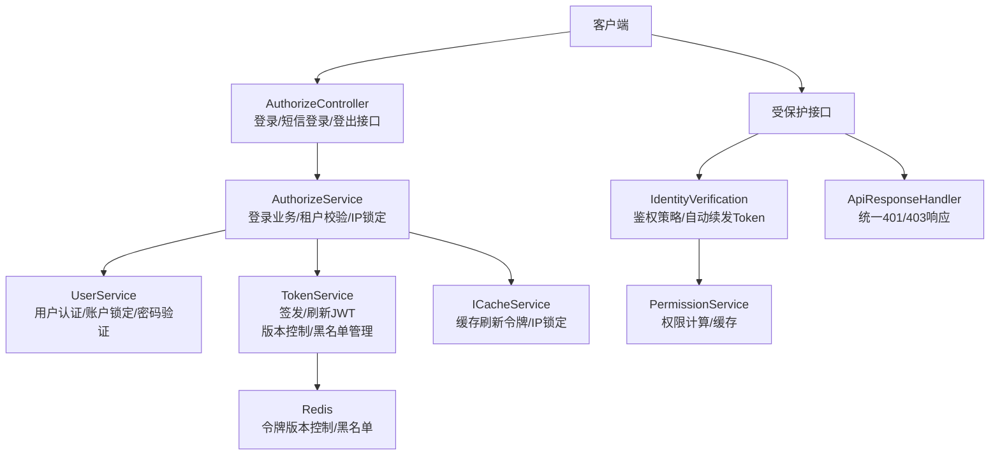
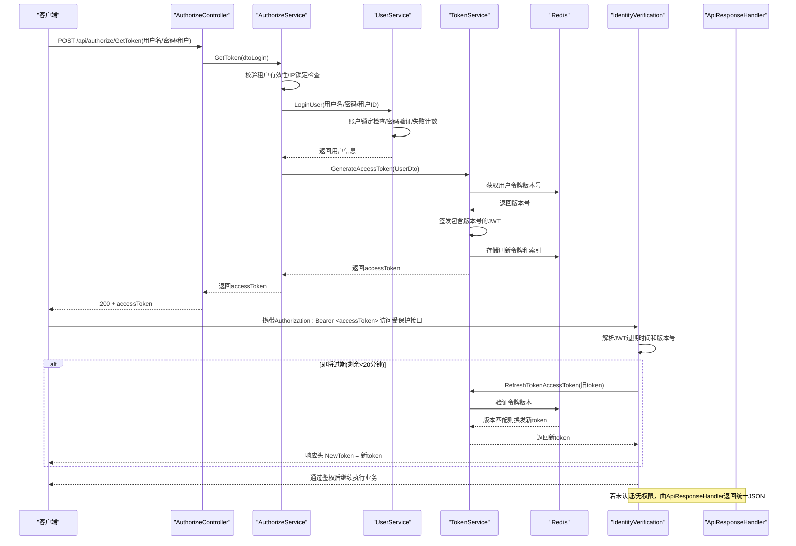
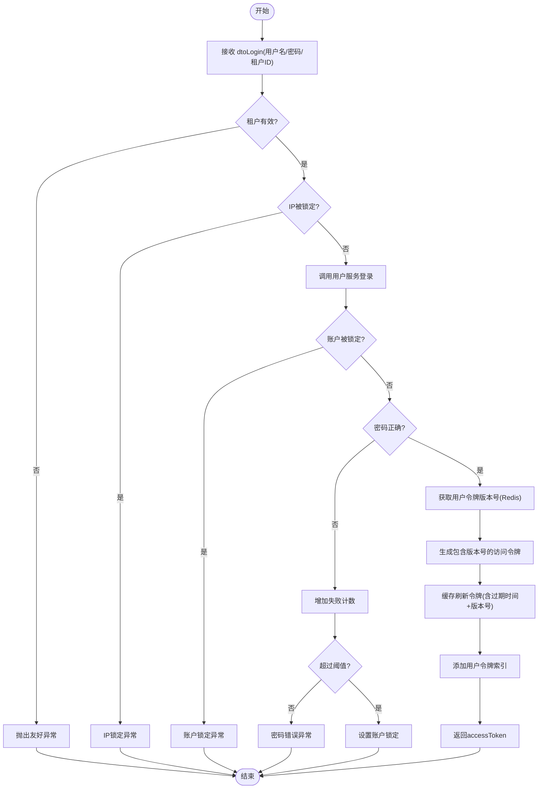
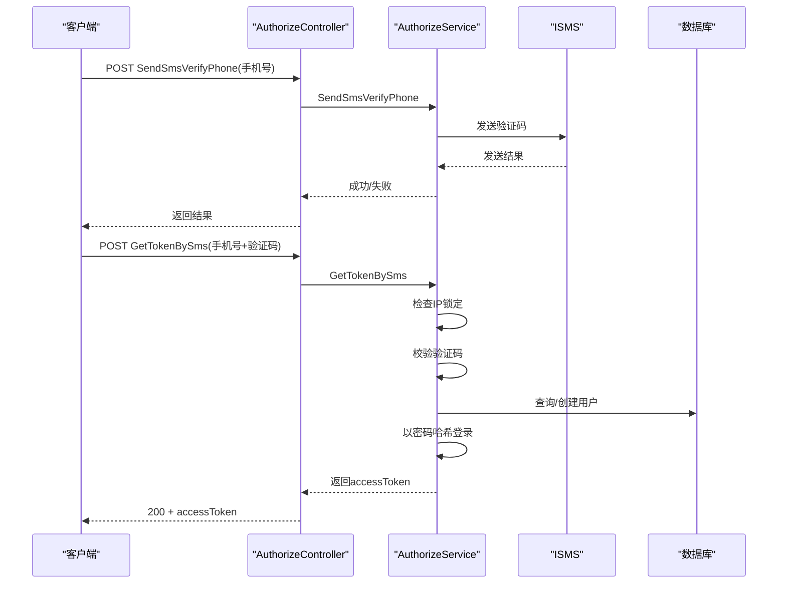
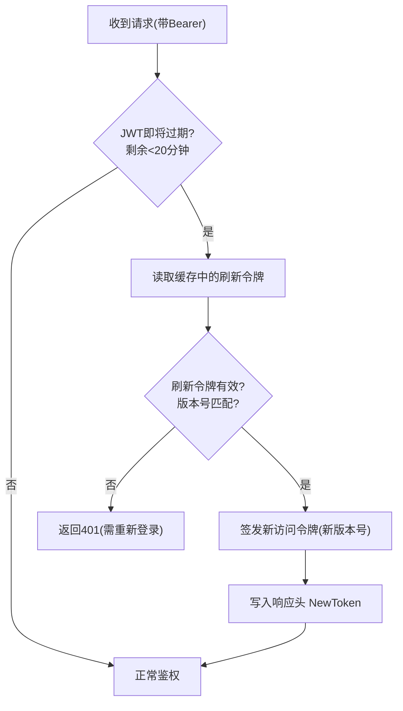
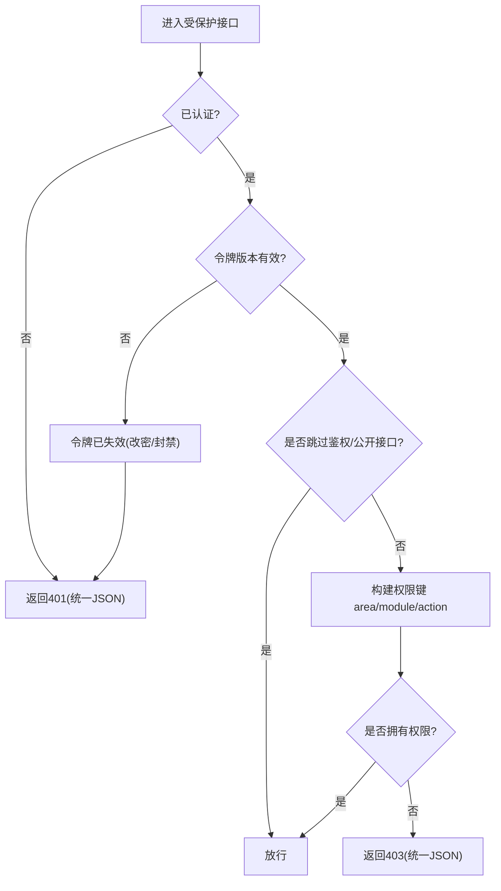
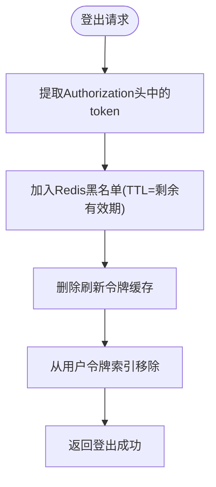
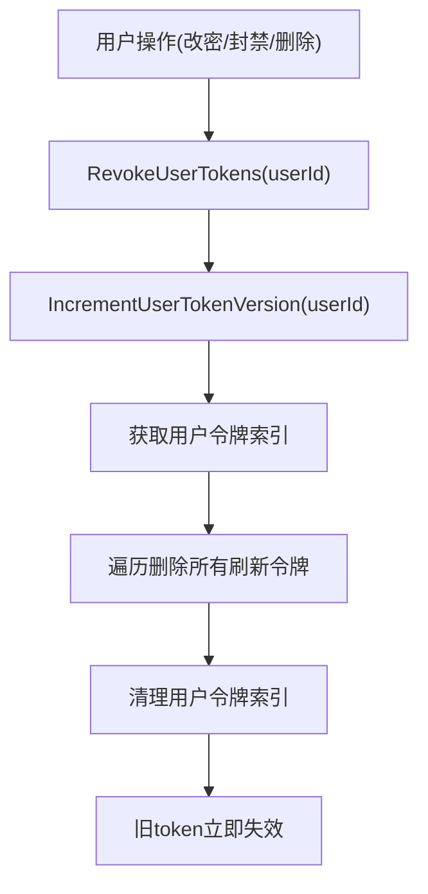
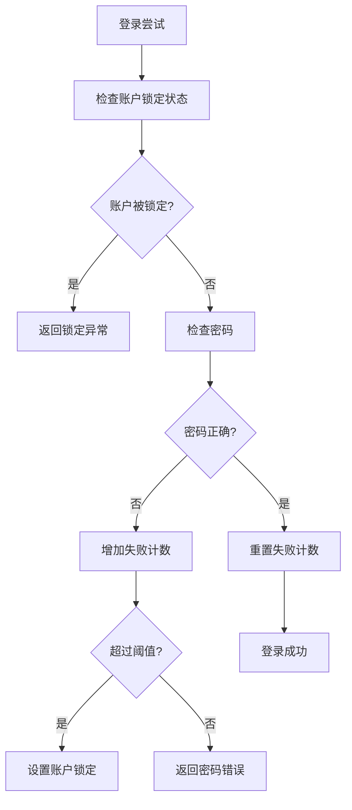
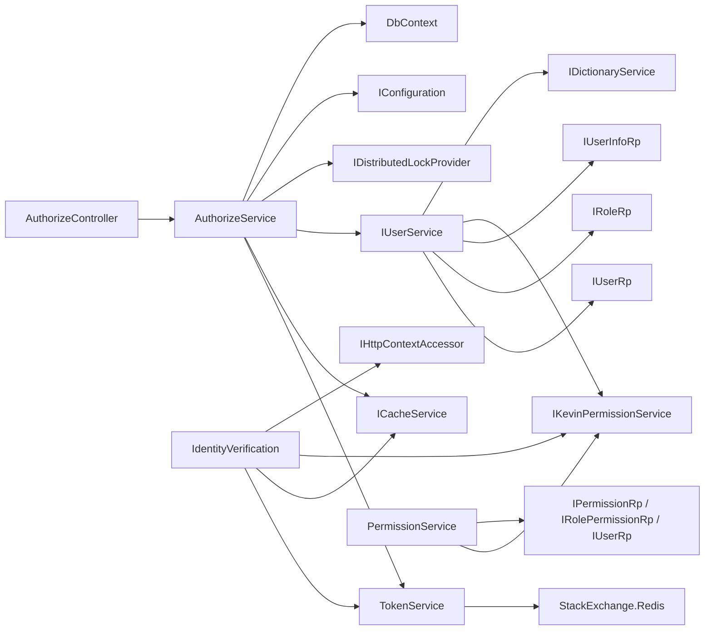

# 认证授权管理

<cite>
**本文引用的文件**
- [AuthorizeController.cs](file://Kevin/ Kevin.Web.Basics/Controllers/AuthorizeController.cs)
- [AuthorizeService.cs](file://Kevin/Application/Services/AuthorizeService.cs)
- [ITokenService.cs](file://Kevin/kevin.Module/Kevin.Authentication.Jwt/IService/ITokenService.cs)
- [TokenService.cs](file://Kevin/kevin.Module/Kevin.Authentication.Jwt/Service/TokenService.cs)
- [UserDto.cs](file://Kevin/kevin.Module/Kevin.Authentication.Jwt/Dto/UserDto.cs)
- [RefreshTokenDto.cs](file://Kevin/kevin.Module/Kevin.Authentication.Jwt/Dto/RefreshTokenDto.cs)
- [IdentityVerification.cs](file://Kevin/kevin.Module/kevin.Permission/Permission/Action/IdentityVerification.cs)
- [PermissionService.cs](file://Kevin/Application/Services/PermissionService.cs)
- [ApiResponseHandler.cs](file://Kevin/Domain/Auth/ApiResponseHandler.cs)
- [dtoLogin.cs](file://Kevin/kevin.Share/Dtos/dtoLogin.cs)
- [UserService.cs](file://Kevin/Application/Services/UserService.cs)
- [TUser.cs](file://Kevin/Domain/Entities/TUser.cs)
</cite>

## 更新摘要
**变更内容**   
- 增强了用户登录安全机制，新增账户锁定功能和密码复杂度验证
- 实现了JWT令牌版本控制和Redis分布式撤销机制
- 新增了登出接口实现令牌立即失效功能
- 完善了IP地址锁定和失败计数机制

## 目录
1. [简介](#简介)
2. [项目结构](#项目结构)
3. [核心组件](#核心组件)
4. [架构总览](#架构总览)
5. [详细组件分析](#详细组件分析)
6. [依赖关系分析](#依赖关系分析)
7. [性能考虑](#性能考虑)
8. [故障排查指南](#故障排查指南)
9. [结论](#结论)
10. [附录：API调用示例与错误处理](#附录api调用示例与错误处理)

## 简介
本文件面向后端认证授权子系统，覆盖登录流程、Token生成与刷新、权限校验（路由守卫与接口级）、用户信息缓存以及登出清理策略。文档以代码为依据，提供流程图与时序图，帮助读者快速理解并落地集成。

**更新** 系统现已支持基于Redis的分布式令牌版本控制和完整的登出功能，包括即时令牌黑名单和分布式令牌撤销机制。同时增强了账户安全机制，支持账户锁定和密码复杂度验证。

## 项目结构
认证授权相关能力分布在以下模块：
- Web层控制器：对外暴露登录、短信登录、登出等接口
- 应用服务：实现登录业务、租户校验、Token签发入口
- JWT模块：负责访问令牌签发与刷新、刷新令牌缓存、令牌版本控制
- 权限模块：基于自定义鉴权策略进行接口级权限控制，支持自动续发新Token
- 统一响应处理器：将未认证/无权限场景返回为统一的JSON格式

图表来源
- [AuthorizeController.cs:11-74](file://Kevin/ Kevin.Web.Basics/Controllers/AuthorizeController.cs#L11-L74)
- [AuthorizeService.cs:13-298](file://Kevin/Application/Services/AuthorizeService.cs#L13-L298)
- [TokenService.cs:13-407](file://Kevin/kevin.Module/Kevin.Authentication.Jwt/Service/TokenService.cs#L13-L407)
- [IdentityVerification.cs:15-198](file://Kevin/kevin.Module/kevin.Permission/Permission/Action/IdentityVerification.cs#L15-L198)
- [PermissionService.cs:7-434](file://Kevin/Application/Services/PermissionService.cs#L7-L434)
- [ApiResponseHandler.cs:13-35](file://Kevin/Domain/Auth/ApiResponseHandler.cs#L13-L35)

章节来源
- [AuthorizeController.cs:11-74](file://Kevin/ Kevin.Web.Basics/Controllers/AuthorizeController.cs#L11-L74)
- [AuthorizeService.cs:13-298](file://Kevin/Application/Services/AuthorizeService.cs#L13-L298)
- [TokenService.cs:13-407](file://Kevin/kevin.Module/Kevin.Authentication.Jwt/Service/TokenService.cs#L13-L407)
- [IdentityVerification.cs:15-198](file://Kevin/kevin.Module/kevin.Permission/Permission/Action/IdentityVerification.cs#L15-L198)
- [PermissionService.cs:7-434](file://Kevin/Application/Services/PermissionService.cs#L7-L434)
- [ApiResponseHandler.cs:13-35](file://Kevin/Domain/Auth/ApiResponseHandler.cs#L13-L35)

## 核心组件
- 登录控制器与接口
  - 提供用户名密码登录、短信验证码登录、发送短信验证码、登出等接口
- 登录服务
  - 校验租户有效性、执行用户登录、生成访问令牌、IP地址锁定管理
- 用户服务
  - 用户认证、账户锁定机制、密码复杂度验证、失败计数管理
- JWT令牌服务
  - 签发访问令牌，并将刷新令牌写入缓存；支持用旧令牌换取新令牌
  - **新增** 令牌版本控制、黑名单管理、分布式令牌撤销
- 鉴权策略
  - 在请求进入时校验身份与权限，必要时自动续发新令牌
- 权限服务
  - 维护权限定义、角色-权限映射、用户权限集合
- 统一响应处理器
  - 将401/403转换为统一JSON结构

章节来源
- [AuthorizeController.cs:11-74](file://Kevin/ Kevin.Web.Basics/Controllers/AuthorizeController.cs#L11-L74)
- [AuthorizeService.cs:13-298](file://Kevin/Application/Services/AuthorizeService.cs#L13-L298)
- [UserService.cs:140-227](file://Kevin/Application/Services/UserService.cs#L140-L227)
- [TokenService.cs:13-407](file://Kevin/kevin.Module/Kevin.Authentication.Jwt/Service/TokenService.cs#L13-L407)
- [IdentityVerification.cs:15-198](file://Kevin/kevin.Module/kevin.Permission/Permission/Action/IdentityVerification.cs#L15-L198)
- [PermissionService.cs:7-434](file://Kevin/Application/Services/PermissionService.cs#L7-L434)
- [ApiResponseHandler.cs:13-35](file://Kevin/Domain/Auth/ApiResponseHandler.cs#L13-L35)

## 架构总览
下图展示从登录到受保护接口访问的完整链路，包括自动续发新令牌的机制和新的令牌版本控制。

图表来源
- [AuthorizeController.cs:32-71](file://Kevin/ Kevin.Web.Basics/Controllers/AuthorizeController.cs#L32-L71)
- [AuthorizeService.cs:73-106](file://Kevin/Application/Services/AuthorizeService.cs#L73-L106)
- [UserService.cs:140-227](file://Kevin/Application/Services/UserService.cs#L140-L227)
- [TokenService.cs:43-60](file://Kevin/kevin.Module/Kevin.Authentication.Jwt/Service/TokenService.cs#L43-L60)
- [IdentityVerification.cs:22-139](file://Kevin/kevin.Module/kevin.Permission/Permission/Action/IdentityVerification.cs#L22-L139)
- [ApiResponseHandler.cs:13-35](file://Kevin/Domain/Auth/ApiResponseHandler.cs#L13-L35)

## 详细组件分析

### 登录流程（用户名/密码）
- 控制器接收登录参数，委托应用服务完成登录与租户校验
- 应用服务验证租户存在且有效，检查IP是否被锁定，调用用户服务完成认证
- 用户服务进行账户锁定检查、密码验证、失败计数管理
- 成功后使用JWT服务签发访问令牌，并将刷新令牌写入缓存
- **新增** 令牌版本控制：每次签发令牌时获取当前用户版本号，确保令牌安全性
- 前端保存accessToken用于后续请求；同时可保存refresh token以便刷新

图表来源
- [AuthorizeController.cs:32-37](file://Kevin/ Kevin.Web.Basics/Controllers/AuthorizeController.cs#L32-L37)
- [AuthorizeService.cs:73-88](file://Kevin/Application/Services/AuthorizeService.cs#L73-L88)
- [UserService.cs:140-227](file://Kevin/Application/Services/UserService.cs#L140-L227)
- [TokenService.cs:43-60](file://Kevin/kevin.Module/Kevin.Authentication.Jwt/Service/TokenService.cs#L43-L60)
- [dtoLogin.cs:9-36](file://Kevin/kevin.Share/Dtos/dtoLogin.cs#L9-L36)

章节来源
- [AuthorizeController.cs:32-37](file://Kevin/ Kevin.Web.Basics/Controllers/AuthorizeController.cs#L32-L37)
- [AuthorizeService.cs:73-88](file://Kevin/Application/Services/AuthorizeService.cs#L73-L88)
- [UserService.cs:140-227](file://Kevin/Application/Services/UserService.cs#L140-L227)
- [TokenService.cs:43-60](file://Kevin/kevin.Module/Kevin.Authentication.Jwt/Service/TokenService.cs#L43-L60)
- [dtoLogin.cs:9-36](file://Kevin/kevin.Share/Dtos/dtoLogin.cs#L9-L36)

### 登录流程（短信验证码）
- 发送短信验证码：服务端生成验证码并缓存，设置短过期时间
- 短信登录：校验验证码通过后，查找或创建用户，直接以密码哈希登录并签发令牌
- **新增** IP锁定检查和账户锁定检查

图表来源
- [AuthorizeController.cs:43-58](file://Kevin/ Kevin.Web.Basics/Controllers/AuthorizeController.cs#L43-L58)
- [AuthorizeService.cs:216-259](file://Kevin/Application/Services/AuthorizeService.cs#L216-L259)

章节来源
- [AuthorizeController.cs:43-58](file://Kevin/ Kevin.Web.Basics/Controllers/AuthorizeController.cs#L43-L58)
- [AuthorizeService.cs:216-259](file://Kevin/Application/Services/AuthorizeService.cs#L216-L259)

### Token管理机制（本地存储、自动刷新、过期处理）
- 访问令牌：包含用户标识、是否超级管理员、姓名、创建时间、租户ID、**令牌版本号**等声明；过期时间由配置决定
- 刷新令牌：以访问令牌为键，缓存刷新信息（过期时间、用户信息、**令牌版本号**），用于换发新访问令牌
- 自动续发：当请求中JWT即将过期（剩余不足20分钟）时，鉴权阶段自动调用刷新接口，并在响应头中回传新令牌
- **新增** 令牌版本控制：每个用户有独立的令牌版本号存储在Redis中，改密/封禁时版本号自增，旧令牌立即失效
- **新增** 用户令牌索引：维护用户所有活跃刷新令牌的索引，便于批量吊销和管理
- 前端建议：
  - 将accessToken存入内存或安全存储，每次请求附加到Authorization头
  - 监听响应头NewToken，更新本地令牌
  - 若收到401/403，引导重新登录

图表来源
- [IdentityVerification.cs:107-139](file://Kevin/kevin.Module/kevin.Permission/Permission/Action/IdentityVerification.cs#L107-L139)
- [TokenService.cs:66-99](file://Kevin/kevin.Module/Kevin.Authentication.Jwt/Service/TokenService.cs#L66-L99)

章节来源
- [IdentityVerification.cs:107-139](file://Kevin/kevin.Module/kevin.Permission/Permission/Action/IdentityVerification.cs#L107-L139)
- [TokenService.cs:66-99](file://Kevin/kevin.Module/Kevin.Authentication.Jwt/Service/TokenService.cs#L66-L99)

### 权限验证流程（路由守卫、接口权限控制、用户信息缓存）
- 路由守卫：基于自定义鉴权策略，根据控制器/动作上的特性判断是否跳过鉴权或仅要求已登录
- 接口权限控制：构造权限键 area/module/action，结合角色-权限映射判断是否允许访问
- 用户信息缓存：可通过权限服务获取当前用户权限集合，便于前端菜单/按钮级控制
- 超级管理员：具备全部权限，可直接放行
- **新增** 令牌版本校验：鉴权时检查令牌版本号是否与Redis中最新版本一致

图表来源
- [IdentityVerification.cs:22-104](file://Kevin/kevin.Module/kevin.Permission/Permission/Action/IdentityVerification.cs#L22-L104)
- [PermissionService.cs:419-430](file://Kevin/Application/Services/PermissionService.cs#L419-L430)
- [ApiResponseHandler.cs:13-35](file://Kevin/Domain/Auth/ApiResponseHandler.cs#L13-L35)

章节来源
- [IdentityVerification.cs:22-104](file://Kevin/kevin.Module/kevin.Permission/Permission/Action/IdentityVerification.cs#L22-L104)
- [PermissionService.cs:419-430](file://Kevin/Application/Services/PermissionService.cs#L419-L430)
- [ApiResponseHandler.cs:13-35](file://Kevin/Domain/Auth/ApiResponseHandler.cs#L13-L35)

### 登出处理逻辑（清理本地数据与重置应用状态）
- **新增** 服务端登出接口：`POST /api/authorize/Logout`
- 登出流程：
  1. 将当前access token加入Redis黑名单（TTL与令牌剩余有效期一致）
  2. 删除对应的刷新令牌缓存
  3. 从用户令牌索引中移除该令牌记录
- 黑名单机制：被拉黑的token在有效期内无法再次使用，到期后自动清理
- 分布式令牌撤销：支持批量吊销用户所有令牌（改密/封禁/删除用户时调用）
- 客户端侧建议：
  - 清除本地存储的accessToken与refresh token
  - 清空用户信息缓存（如权限列表、用户资料）
  - 跳转至登录页并重置应用状态

图表来源
- [AuthorizeController.cs:65-71](file://Kevin/ Kevin.Web.Basics/Controllers/AuthorizeController.cs#L65-L71)
- [TokenService.cs:154-184](file://Kevin/kevin.Module/Kevin.Authentication.Jwt/Service/TokenService.cs#L154-L184)

章节来源
- [AuthorizeController.cs:65-71](file://Kevin/ Kevin.Web.Basics/Controllers/AuthorizeController.cs#L65-L71)
- [TokenService.cs:154-184](file://Kevin/kevin.Module/Kevin.Authentication.Jwt/Service/TokenService.cs#L154-L184)

### 令牌版本控制与分布式撤销
- **新增** Redis令牌版本控制：
  - 每个用户有独立的令牌版本号存储在Redis中
  - 改密/封禁/删除用户时版本号自增，使旧令牌立即失效
  - 多实例共享，容器重启后不丢失
- **新增** 用户令牌索引：
  - 维护用户所有活跃刷新令牌的JSON数组
  - 支持批量吊销和自动清理失效令牌
- **新增** 令牌黑名单：
  - 退出登录时将token加入黑名单
  - TTL与token剩余有效期一致，自动清理
  - 支持分布式环境下的即时令牌失效

图表来源
- [TokenService.cs:240-266](file://Kevin/kevin.Module/Kevin.Authentication.Jwt/Service/TokenService.cs#L240-L266)

章节来源
- [TokenService.cs:240-266](file://Kevin/kevin.Module/Kevin.Authentication.Jwt/Service/TokenService.cs#L240-L266)

### 账户锁定与安全机制
- **新增** 账户锁定机制：
  - 连续密码错误达到阈值后自动锁定账户
  - 锁定时长可配置，默认15分钟
  - 锁定期间拒绝所有登录尝试
- **新增** IP地址锁定机制：
  - 同一IP连续登录失败达到阈值后锁定IP
  - 锁定时长可配置，默认30分钟
  - 防止暴力破解攻击
- **新增** 密码复杂度验证：
  - 支持正则表达式验证密码强度
  - 默认要求至少三种字符类型组合
  - 可配置自定义复杂度规则
- **新增** 失败计数管理：
  - 记录用户登录失败次数
  - 达到阈值后设置账户锁定截止时间
  - 登录成功后重置失败计数

图表来源
- [UserService.cs:140-227](file://Kevin/Application/Services/UserService.cs#L140-L227)
- [TUser.cs:94-107](file://Kevin/Domain/Entities/TUser.cs#L94-L107)

章节来源
- [UserService.cs:140-227](file://Kevin/Application/Services/UserService.cs#L140-L227)
- [TUser.cs:94-107](file://Kevin/Domain/Entities/TUser.cs#L94-L107)

## 依赖关系分析
- AuthorizeController 依赖 IAuthorizeService 与 ICacheService
- AuthorizeService 依赖 IUserService、ITokenService、ICacheService、IDistributedLockProvider、IConfiguration、DbContext
- UserService 依赖 IUserRp、IRoleRp、IUserInfoRp、IKevinPermissionService、ITokenService、IDictionaryService
- TokenService 依赖 IConfiguration、ICacheService、StackExchange.Redis
- IdentityVerification 依赖 ITokenService、ICacheService、IKevinPermissionService、HttpContextAccessor
- PermissionService 依赖 IKevinPermissionService、IPermissionRp、IRolePermissionRp、IUserRp

图表来源
- [AuthorizeController.cs:19-24](file://Kevin/ Kevin.Web.Basics/Controllers/AuthorizeController.cs#L19-L24)
- [AuthorizeService.cs:16-35](file://Kevin/Application/Services/AuthorizeService.cs#L16-L35)
- [UserService.cs:15-52](file://Kevin/Application/Services/UserService.cs#L15-L52)
- [TokenService.cs:16-37](file://Kevin/kevin.Module/Kevin.Authentication.Jwt/Service/TokenService.cs#L16-L37)
- [IdentityVerification.cs:15-22](file://Kevin/kevin.Module/kevin.Permission/Permission/Action/IdentityVerification.cs#L15-L22)
- [PermissionService.cs:9-23](file://Kevin/Application/Services/PermissionService.cs#L9-L23)

章节来源
- [AuthorizeController.cs:19-24](file://Kevin/ Kevin.Web.Basics/Controllers/AuthorizeController.cs#L19-L24)
- [AuthorizeService.cs:16-35](file://Kevin/Application/Services/AuthorizeService.cs#L16-L35)
- [UserService.cs:15-52](file://Kevin/Application/Services/UserService.cs#L15-L52)
- [TokenService.cs:16-37](file://Kevin/kevin.Module/Kevin.Authentication.Jwt/Service/TokenService.cs#L16-L37)
- [IdentityVerification.cs:15-22](file://Kevin/kevin.Module/kevin.Permission/Permission/Action/IdentityVerification.cs#L15-L22)
- [PermissionService.cs:9-23](file://Kevin/Application/Services/PermissionService.cs#L9-L23)

## 性能考虑
- 刷新令牌缓存：使用分布式缓存承载刷新令牌，注意合理设置过期时间与容量
- 自动续发：仅在接近过期时触发，减少不必要的刷新开销
- 权限计算：对高频接口可结合缓存降低权限查询压力
- 并发登录：分布式锁可用于防止同一账号并发登录导致的令牌竞争
- **新增** Redis连接优化：令牌版本号和黑名单使用懒加载连接，连接失败时降级处理
- **新增** 令牌索引维护：自动清理失效令牌记录，避免索引无限增长
- **新增** 账户锁定优化：使用数据库字段存储锁定状态，避免频繁缓存操作
- **新增** IP锁定优化：使用分布式锁保证原子性，锁失败时降级跳过

[本节为通用指导，不直接分析具体文件]

## 故障排查指南
- 401 未认证
  - 检查请求是否携带正确的Authorization头
  - 确认JWT未过期；若即将过期，关注响应头NewToken是否被正确更新
  - 检查令牌版本是否匹配（改密/封禁后旧令牌会失效）
  - 查看统一响应处理器返回的JSON结构
- 403 无权限
  - 检查当前用户是否拥有对应area/module/action权限
  - 确认控制器/动作未误标为公开或跳过鉴权
- 刷新失败
  - 检查缓存中是否存在有效的刷新令牌
  - 确认刷新令牌版本号与Redis中最新版本一致
  - 确认刷新令牌已被消费（一次性策略）
- 登出失败
  - 检查Redis连接是否正常
  - 确认黑名单机制是否正常工作
  - 验证用户令牌索引是否正确维护
- 账户锁定问题
  - 检查账户锁定截止时间是否在未来
  - 确认失败计数是否超过阈值
  - 验证锁定时长配置是否正确
- IP锁定问题
  - 检查IP锁定缓存是否存在
  - 确认IP失败计数是否超过阈值
  - 验证分布式锁是否正常工作

章节来源
- [ApiResponseHandler.cs:13-35](file://Kevin/Domain/Auth/ApiResponseHandler.cs#L13-L35)
- [IdentityVerification.cs:107-139](file://Kevin/kevin.Module/kevin.Permission/Permission/Action/IdentityVerification.cs#L107-L139)
- [TokenService.cs:66-99](file://Kevin/kevin.Module/Kevin.Authentication.Jwt/Service/TokenService.cs#L66-L99)
- [TokenService.cs:154-184](file://Kevin/kevin.Module/Kevin.Authentication.Jwt/Service/TokenService.cs#L154-L184)
- [UserService.cs:140-227](file://Kevin/Application/Services/UserService.cs#L140-L227)
- [AuthorizeService.cs:132-208](file://Kevin/Application/Services/AuthorizeService.cs#L132-L208)

## 结论
该认证授权方案以JWT为核心，结合缓存的刷新令牌与鉴权阶段的自动续发机制，实现了良好的用户体验与安全边界。**新增的Redis令牌版本控制、黑名单管理和分布式令牌撤销功能**进一步增强了系统的安全性和可管理性。同时，**账户锁定机制、IP地址锁定和密码复杂度验证**提供了全面的安全防护。权限体系通过area/module/action维度进行细粒度控制，配合统一响应处理器，形成一致的交互体验。建议在客户端完善令牌管理与错误处理，确保系统稳定运行。

[本节为总结性内容，不直接分析具体文件]

## 附录：API调用示例与错误处理

- 登录（用户名/密码）
  - 方法：POST
  - 路径：/api/authorize/GetToken
  - 请求体：dtoLogin（用户名、密码、租户ID）
  - 成功响应：字符串（accessToken）
  - 失败响应：统一JSON（401/403）

- 发送短信验证码
  - 方法：POST
  - 路径：/api/authorize/SendSmsVerifyPhone
  - 请求体：dtoKeyValue（key=手机号）
  - 成功响应：布尔值

- 短信登录
  - 方法：POST
  - 路径：/api/authorize/GetTokenBySms
  - 请求体：dtoKeyValue（key=手机号，value=验证码）
  - 成功响应：字符串（accessToken）
  - 失败响应：统一JSON（401/403）

- **新增** 登出
  - 方法：POST
  - 路径：/api/authorize/Logout
  - 请求头：Authorization: Bearer <accessToken>
  - 成功响应：布尔值（true表示登出成功）
  - 失败响应：布尔值（false表示登出失败）

- 自动续发新令牌
  - 触发条件：JWT剩余有效期小于20分钟
  - 响应头：NewToken（新accessToken）
  - 客户端行为：更新本地accessToken

- 错误处理建议
  - 捕获401：提示重新登录，并清理本地令牌
  - 捕获403：提示权限不足，联系管理员
  - 网络异常：重试与降级策略
  - **新增** 令牌版本不匹配：提示用户重新登录，因为可能发生了密码修改或账户被封禁
  - **新增** 账户锁定：提示用户稍后再试，显示锁定剩余时间
  - **新增** IP锁定：提示IP被锁定，联系管理员解锁

章节来源
- [AuthorizeController.cs:32-71](file://Kevin/ Kevin.Web.Basics/Controllers/AuthorizeController.cs#L32-L71)
- [AuthorizeService.cs:73-298](file://Kevin/Application/Services/AuthorizeService.cs#L73-L298)
- [IdentityVerification.cs:107-139](file://Kevin/kevin.Module/kevin.Permission/Permission/Action/IdentityVerification.cs#L107-L139)
- [ApiResponseHandler.cs:13-35](file://Kevin/Domain/Auth/ApiResponseHandler.cs#L13-L35)