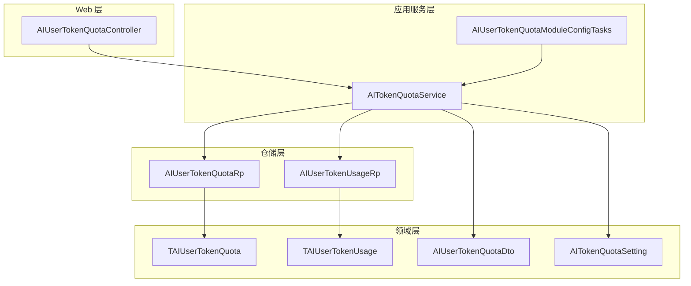
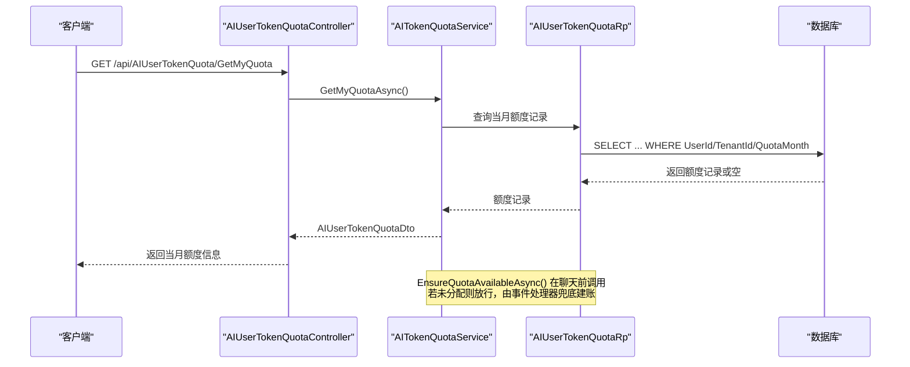
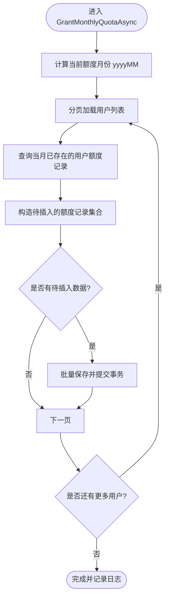
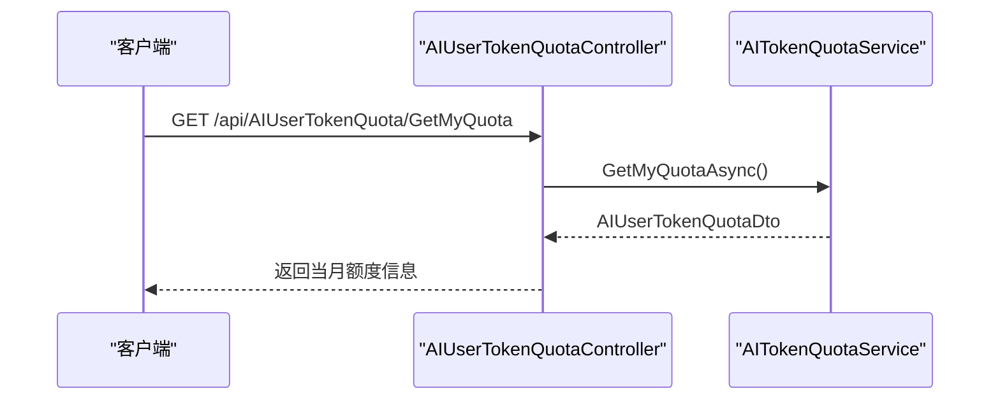
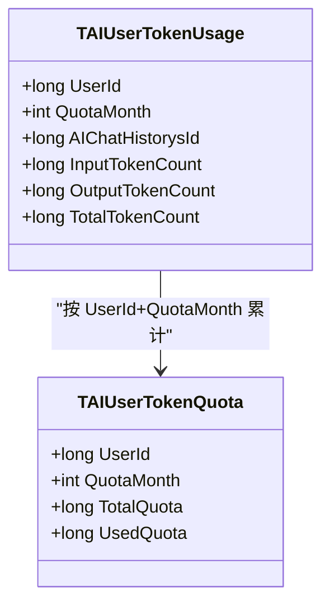
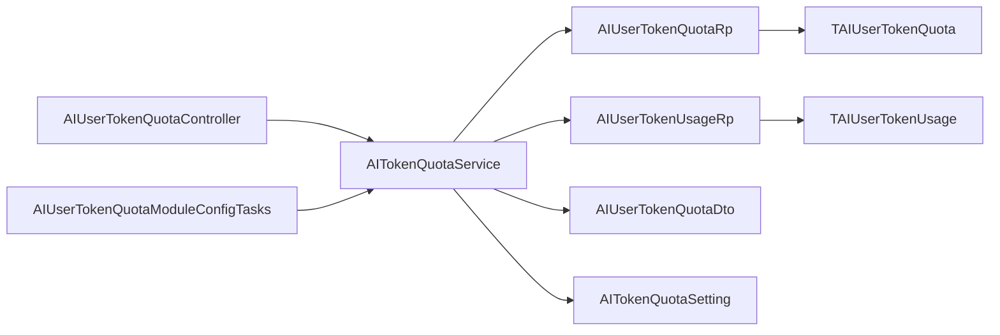

# AI令牌配额管理

<cite>
**本文引用的文件**   
- [AITokenQuotaService.cs](file://Kevin/Application/Services/AI/AITokenQuotaService.cs)
- [AIUserTokenQuotaController.cs](file://Kevin/Kevin.Web.Basics/Controllers/AI/AIUserTokenQuotaController.cs)
- [TAIUserTokenQuota.cs](file://Kevin/Domain/Entities/AI/TAIUserTokenQuota.cs)
- [AIUserTokenQuotaDto.cs](file://Kevin/Domain/Share/Dtos/AI/AIUserTokenQuotaDto.cs)
- [AIUserTokenQuotaRp.cs](file://Kevin/RepositorieRps/Repositories/AI/AIUserTokenQuotaRp.cs)
- [AIUserTokenUsageRp.cs](file://Kevin/RepositorieRps/Repositories/AI/AIUserTokenUsageRp.cs)
- [TAIUserTokenUsage.cs](file://Kevin/Domain/Entities/AI/TAIUserTokenUsage.cs)
- [AITokenQuotaSetting.cs](file://Kevin/kevin.Module/kevin.AI.AgentFramework/Dto/AITokenQuotaSetting.cs)
- [AIUserTokenQuotaModuleConfigTasks.cs](file://Kevin/Application/TaskModuleConfigs/AIUserTokenQuotaModuleConfigTasks.cs)
</cite>

## 目录
1. [简介](#简介)
2. [项目结构](#项目结构)
3. [核心组件](#核心组件)
4. [架构总览](#架构总览)
5. [详细组件分析](#详细组件分析)
6. [依赖关系分析](#依赖关系分析)
7. [性能考虑](#性能考虑)
8. [故障排查指南](#故障排查指南)
9. [结论](#结论)
10. [附录](#附录)

## 简介
本模块实现“用户月度 AI Token 额度”的完整生命周期：配置、按月颁发、聊天前校验、聊天后累计用量，并提供对外查询接口。系统以“租户 + 用户 + 月份”为维度维护额度与使用明细，支持通过配置文件热重载调整默认额度，并通过定时任务在每月 1 日自动为所有用户颁发当月额度。

## 项目结构
围绕“AI 令牌配额管理”的相关代码分布在应用服务层、控制器层、领域实体层、仓储层以及配置与任务调度模块中：
- 应用服务层：负责额度查询、校验与批量颁发逻辑
- Web 控制器层：暴露获取当前用户当月额度的 API
- 领域实体层：定义额度主表与使用明细表
- 仓储层：提供对额度与使用明细的数据访问
- 配置模块：提供可热重载的默认额度配置
- 任务调度：按 Cron 表达式每月 1 日执行额度颁发

图表来源
- [AIUserTokenQuotaController.cs:1-41](file://Kevin/Kevin.Web.Basics/Controllers/AI/AIUserTokenQuotaController.cs#L1-L41)
- [AITokenQuotaService.cs:1-168](file://Kevin/Application/Services/AI/AITokenQuotaService.cs#L1-L168)
- [AIUserTokenQuotaModuleConfigTasks.cs:1-30](file://Kevin/Application/TaskModuleConfigs/AIUserTokenQuotaModuleConfigTasks.cs#L1-L30)
- [TAIUserTokenQuota.cs:1-38](file://Kevin/Domain/Entities/AI/TAIUserTokenQuota.cs#L1-L38)
- [TAIUserTokenUsage.cs:1-51](file://Kevin/Domain/Entities/AI/TAIUserTokenUsage.cs#L1-L51)
- [AIUserTokenQuotaDto.cs:1-24](file://Kevin/Domain/Share/Dtos/AI/AIUserTokenQuotaDto.cs#L1-L24)
- [AITokenQuotaSetting.cs:1-81](file://Kevin/kevin.Module/kevin.AI.AgentFramework/Dto/AITokenQuotaSetting.cs#L1-L81)
- [AIUserTokenQuotaRp.cs:1-16](file://Kevin/RepositorieRps/Repositories/AI/AIUserTokenQuotaRp.cs#L1-L16)
- [AIUserTokenUsageRp.cs:1-16](file://Kevin/RepositorieRps/Repositories/AI/AIUserTokenUsageRp.cs#L1-L16)

章节来源
- [AIUserTokenQuotaController.cs:1-41](file://Kevin/Kevin.Web.Basics/Controllers/AI/AIUserTokenQuotaController.cs#L1-L41)
- [AITokenQuotaService.cs:1-168](file://Kevin/Application/Services/AI/AITokenQuotaService.cs#L1-L168)
- [AIUserTokenQuotaModuleConfigTasks.cs:1-30](file://Kevin/Application/TaskModuleConfigs/AIUserTokenQuotaModuleConfigTasks.cs#L1-L30)

## 核心组件
- AITokenQuotaService：提供当月额度查询、额度可用性校验、格式化提示文案、按月批量颁发额度等能力
- AIUserTokenQuotaController：对外暴露“获取当前用户当月额度”的 HTTP 接口
- TAIUserTokenQuota：存储“租户 + 用户 + 月份”维度的额度主记录
- TAIUserTokenUsage：记录每轮对话的输入/输出 Token 消耗，用于累计已用额度
- AIUserTokenQuotaRp / AIUserTokenUsageRp：对应实体的仓储实现
- AIUserTokenQuotaDto：面向前端展示的 DTO
- AITokenQuotaSetting：从配置节读取默认月度额度，支持热重载
- AIUserTokenQuotaModuleConfigTasks：基于 Hangfire 的定时任务，每月 1 日 00:00 触发额度颁发

章节来源
- [AITokenQuotaService.cs:1-168](file://Kevin/Application/Services/AI/AITokenQuotaService.cs#L1-L168)
- [AIUserTokenQuotaController.cs:1-41](file://Kevin/Kevin.Web.Basics/Controllers/AI/AIUserTokenQuotaController.cs#L1-L41)
- [TAIUserTokenQuota.cs:1-38](file://Kevin/Domain/Entities/AI/TAIUserTokenQuota.cs#L1-L38)
- [TAIUserTokenUsage.cs:1-51](file://Kevin/Domain/Entities/AI/TAIUserTokenUsage.cs#L1-L51)
- [AIUserTokenQuotaRp.cs:1-16](file://Kevin/RepositorieRps/Repositories/AI/AIUserTokenQuotaRp.cs#L1-L16)
- [AIUserTokenUsageRp.cs:1-16](file://Kevin/RepositorieRps/Repositories/AI/AIUserTokenUsageRp.cs#L1-L16)
- [AIUserTokenQuotaDto.cs:1-24](file://Kevin/Domain/Share/Dtos/AI/AIUserTokenQuotaDto.cs#L1-L24)
- [AITokenQuotaSetting.cs:1-81](file://Kevin/kevin.Module/kevin.AI.AgentFramework/Dto/AITokenQuotaSetting.cs#L1-L81)
- [AIUserTokenQuotaModuleConfigTasks.cs:1-30](file://Kevin/Application/TaskModuleConfigs/AIUserTokenQuotaModuleConfigTasks.cs#L1-L30)

## 架构总览
下图展示了从 Web 请求到数据持久化的端到端流程，包括额度查询、可用性校验与按月颁发任务。

图表来源
- [AIUserTokenQuotaController.cs:28-38](file://Kevin/Kevin.Web.Basics/Controllers/AI/AIUserTokenQuotaController.cs#L28-L38)
- [AITokenQuotaService.cs:48-96](file://Kevin/Application/Services/AI/AITokenQuotaService.cs#L48-L96)
- [AIUserTokenQuotaRp.cs:1-16](file://Kevin/RepositorieRps/Repositories/AI/AIUserTokenQuotaRp.cs#L1-L16)

## 详细组件分析

### 应用服务：AITokenQuotaService
职责与关键点：
- 计算额度月份（yyyyMM）
- 查询当前用户当月额度并返回 DTO；若当月尚未颁发，则按默认额度展示但不写库
- 聊天前校验：若当月已用完则抛出友好异常；未颁发时放行，由事件处理器兜底创建额度记录
- 按月批量颁发：分页遍历用户，去重已有当月记录，批量插入默认额度
- 格式化额度提示：将大数转换为“亿/万”单位，提升可读性

图表来源
- [AITokenQuotaService.cs:114-165](file://Kevin/Application/Services/AI/AITokenQuotaService.cs#L114-L165)

章节来源
- [AITokenQuotaService.cs:1-168](file://Kevin/Application/Services/AI/AITokenQuotaService.cs#L1-L168)

### Web 控制器：AIUserTokenQuotaController
职责与关键点：
- 暴露“获取当前用户当月额度”的只读接口
- 仅用于个人信息页展示，不修改任何状态

图表来源
- [AIUserTokenQuotaController.cs:28-38](file://Kevin/Kevin.Web.Basics/Controllers/AI/AIUserTokenQuotaController.cs#L28-L38)
- [AITokenQuotaService.cs:48-72](file://Kevin/Application/Services/AI/AITokenQuotaService.cs#L48-L72)

章节来源
- [AIUserTokenQuotaController.cs:1-41](file://Kevin/Kevin.Web.Basics/Controllers/AI/AIUserTokenQuotaController.cs#L1-L41)

### 领域实体：TAIUserTokenQuota 与 TAIUserTokenUsage
- TAIUserTokenQuota：存储“租户 + 用户 + 月份”维度的总额度与已用额度，具备唯一索引约束
- TAIUserTokenUsage：记录每轮对话的输入/输出 Token 消耗，并以聊天历史 Id 唯一，便于审计与对账

图表来源
- [TAIUserTokenQuota.cs:1-38](file://Kevin/Domain/Entities/AI/TAIUserTokenQuota.cs#L1-L38)
- [TAIUserTokenUsage.cs:1-51](file://Kevin/Domain/Entities/AI/TAIUserTokenUsage.cs#L1-L51)

章节来源
- [TAIUserTokenQuota.cs:1-38](file://Kevin/Domain/Entities/AI/TAIUserTokenQuota.cs#L1-L38)
- [TAIUserTokenUsage.cs:1-51](file://Kevin/Domain/Entities/AI/TAIUserTokenUsage.cs#L1-L51)

### 数据传输对象：AIUserTokenQuotaDto
- 包含用户 Id、额度月份、总额度、已用额度与剩余额度
- 供前端展示当月额度使用情况

章节来源
- [AIUserTokenQuotaDto.cs:1-24](file://Kevin/Domain/Share/Dtos/AI/AIUserTokenQuotaDto.cs#L1-L24)

### 配置：AITokenQuotaSetting
- 从配置节 AITokenQuotaSetting.MonthlyQuota 读取默认月度额度
- 进程内缓存配置，监听配置热重载 token，变更即生效
- 非法值或非正数回退到默认值（2 亿），避免系统不可用

章节来源
- [AITokenQuotaSetting.cs:1-81](file://Kevin/kevin.Module/kevin.AI.AgentFramework/Dto/AITokenQuotaSetting.cs#L1-L81)

### 定时任务：AIUserTokenQuotaModuleConfigTasks
- 使用 Hangfire 注册每月 1 日 00:00 的任务
- 调用 AITokenQuotaService.GrantMonthlyQuotaAsync 为所有用户颁发当月额度
- 幂等设计：已存在当月记录的用户跳过

章节来源
- [AIUserTokenQuotaModuleConfigTasks.cs:1-30](file://Kevin/Application/TaskModuleConfigs/AIUserTokenQuotaModuleConfigTasks.cs#L1-L30)

## 依赖关系分析
- 控制器依赖服务接口，服务依赖仓储与领域实体
- 配置类被服务直接引用，决定默认额度
- 定时任务通过服务间接操作仓储与实体
- 使用明细实体与额度主实体通过 UserId + QuotaMonth 关联

图表来源
- [AIUserTokenQuotaController.cs:1-41](file://Kevin/Kevin.Web.Basics/Controllers/AI/AIUserTokenQuotaController.cs#L1-L41)
- [AITokenQuotaService.cs:1-168](file://Kevin/Application/Services/AI/AITokenQuotaService.cs#L1-L168)
- [AIUserTokenQuotaModuleConfigTasks.cs:1-30](file://Kevin/Application/TaskModuleConfigs/AIUserTokenQuotaModuleConfigTasks.cs#L1-L30)
- [AIUserTokenQuotaRp.cs:1-16](file://Kevin/RepositorieRps/Repositories/AI/AIUserTokenQuotaRp.cs#L1-L16)
- [AIUserTokenUsageRp.cs:1-16](file://Kevin/RepositorieRps/Repositories/AI/AIUserTokenUsageRp.cs#L1-L16)
- [TAIUserTokenQuota.cs:1-38](file://Kevin/Domain/Entities/AI/TAIUserTokenQuota.cs#L1-L38)
- [TAIUserTokenUsage.cs:1-51](file://Kevin/Domain/Entities/AI/TAIUserTokenUsage.cs#L1-L51)
- [AIUserTokenQuotaDto.cs:1-24](file://Kevin/Domain/Share/Dtos/AI/AIUserTokenQuotaDto.cs#L1-L24)
- [AITokenQuotaSetting.cs:1-81](file://Kevin/kevin.Module/kevin.AI.AgentFramework/Dto/AITokenQuotaSetting.cs#L1-L81)

## 性能考虑
- 批量颁发采用分页查询与批量写入，避免一次性加载全部用户，降低内存压力与锁竞争
- 查询当月额度时关闭租户与数据权限过滤，确保定时任务场景下能正确扫描全量用户
- 配置热重载避免重启，减少服务抖动
- 使用明细表对聊天历史 Id 建立唯一索引，防止重复累计

[本节为通用指导，无需具体文件引用]

## 故障排查指南
常见问题与建议：
- 当月额度未显示或未颁发
  - 检查 Hangfire 任务是否成功注册并执行
  - 确认 appsettings 中 AITokenQuotaSetting.MonthlyQuota 配置有效且大于 0
  - 查看服务日志中“用户月度Token额度颁发完成”的输出
- 聊天被拒绝提示“额度已用完”
  - 核对当月已用额度与总额度
  - 确认聊天完成后使用明细是否正确写入并累计
- 新用户首次登录无额度记录
  - 正常行为：EnsureQuotaAvailableAsync 在未分配时放行，由事件处理器兜底建账
  - 若仍无法聊天，检查事件处理器与使用明细写入链路

章节来源
- [AITokenQuotaService.cs:74-96](file://Kevin/Application/Services/AI/AITokenQuotaService.cs#L74-L96)
- [AITokenQuotaService.cs:114-165](file://Kevin/Application/Services/AI/AITokenQuotaService.cs#L114-L165)
- [AIUserTokenQuotaModuleConfigTasks.cs:15-26](file://Kevin/Application/TaskModuleConfigs/AIUserTokenQuotaModuleConfigTasks.cs#L15-L26)

## 结论
该模块以清晰的分层架构实现了“用户月度 AI Token 额度”的管理闭环：通过配置驱动默认额度、定时任务保障月初发放、聊天前校验控制用量、聊天后累计使用明细。整体设计具备良好的可扩展性与可观测性，适合在多租户、多用户的 AI 场景中稳定运行。

[本节为总结性内容，无需具体文件引用]

## 附录
- 关键路径参考
  - 控制器接口：GET /api/AIUserTokenQuota/GetMyQuota
  - 服务方法：GetMyQuotaAsync、EnsureQuotaAvailableAsync、GrantMonthlyQuotaAsync
  - 配置节：AITokenQuotaSetting.MonthlyQuota
  - 定时任务：Hangfire 每月 1 日 00:00 执行

[本节为补充说明，无需具体文件引用]