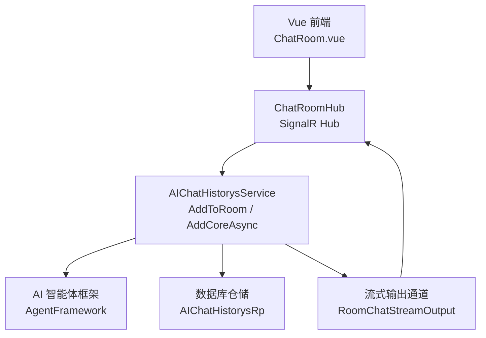
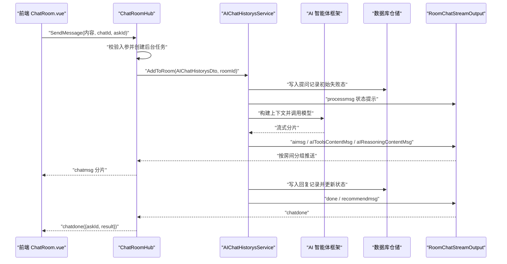
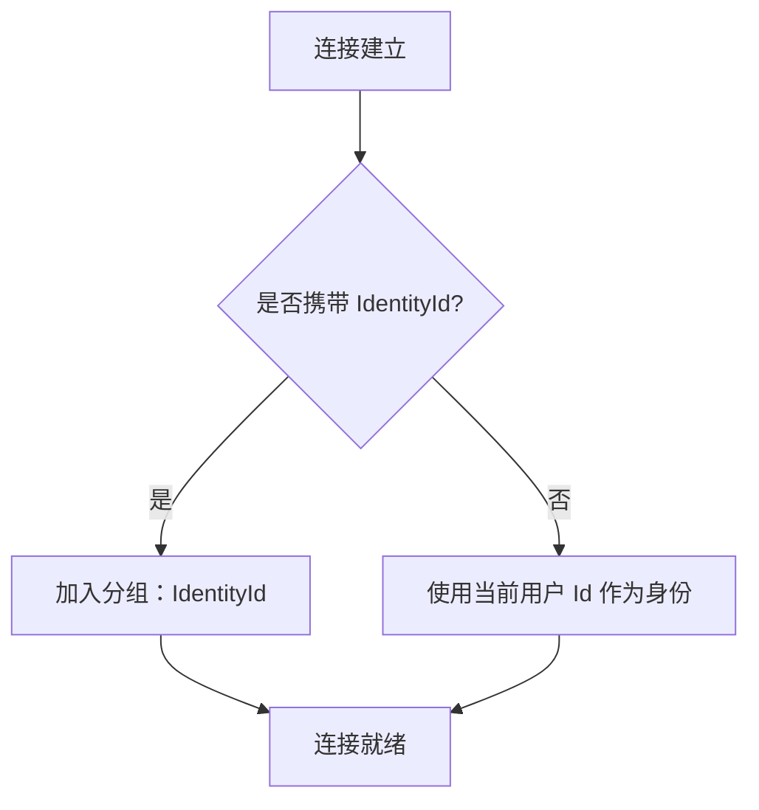
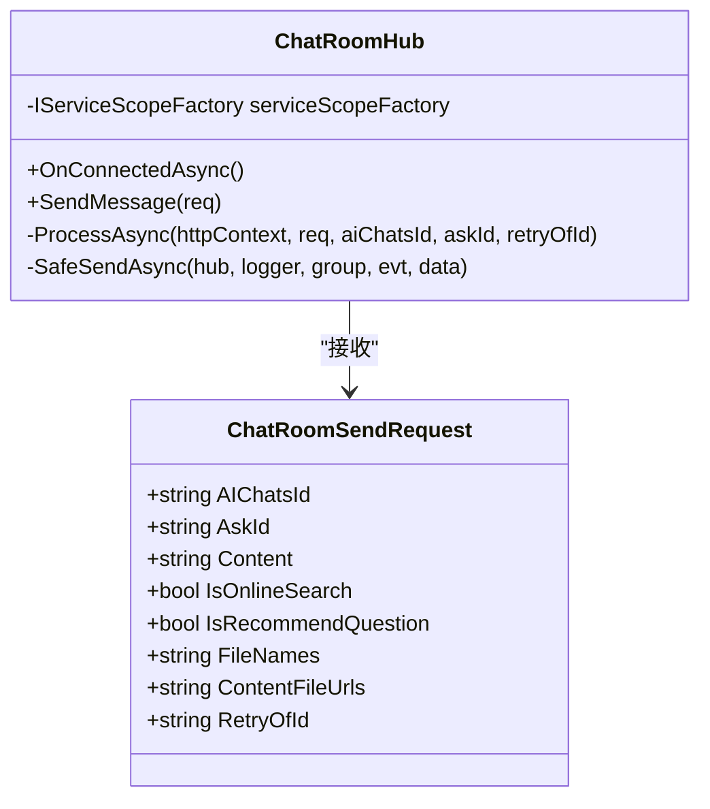
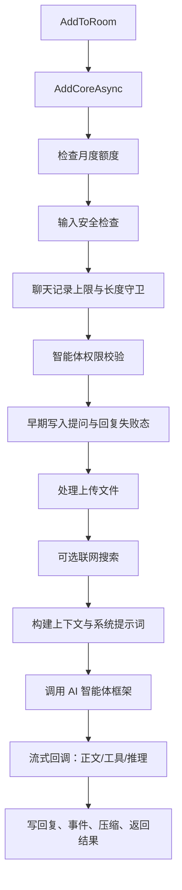
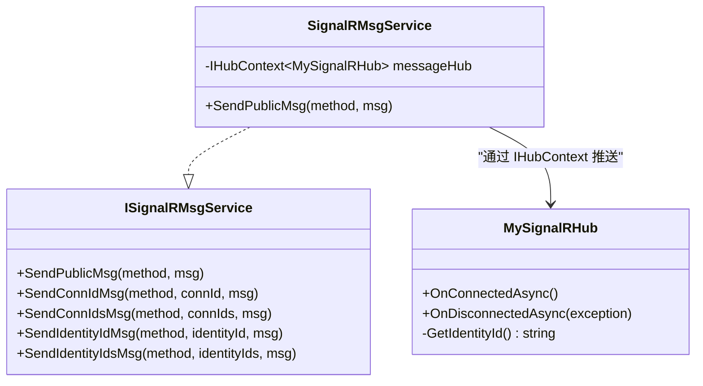
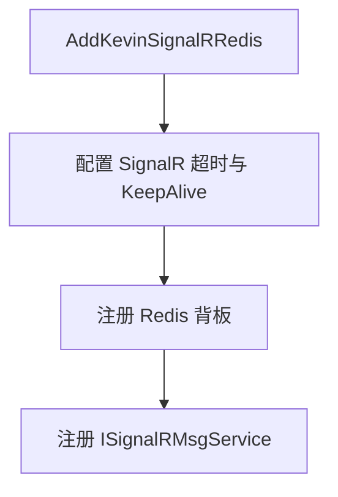
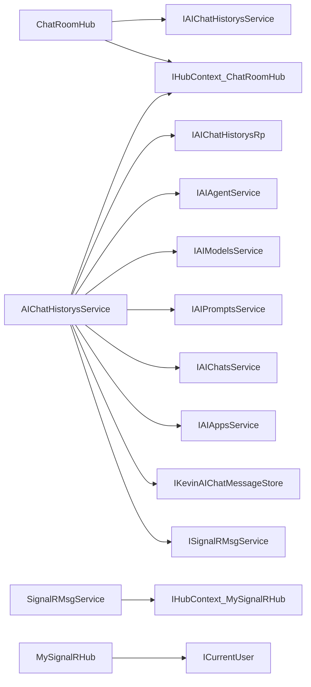

# 实时聊天室

<cite>
**本文引用的文件**   
- [ChatRoomHub.cs](file://Kevin/Application/Services/AI/ChatRoomHub.cs)
- [AIChatHistorysService.cs](file://Kevin/Application/Services/AI/AIChatHistorysService.cs)
- [MySignalRHub.cs](file://Kevin/kevin.Module/Kevin.SignalR/MySignalRHub.cs)
- [SignalRMsgService.cs](file://Kevin/kevin.Module/Kevin.SignalR/Service/SignalRMsgService.cs)
- [ISignalRMsgService.cs](file://Kevin/kevin.Module/Kevin.SignalR/Service/ISignalRMsgService.cs)
- [ServiceCollectionExtensions.cs](file://Kevin/kevin.Module/Kevin.SignalR/ServiceCollectionExtensions.cs)
- [MessageController.cs](file://Kevin/ Kevin.Web.Basics/Controllers/MessageController.cs)
- [SignalRController.cs](file://Kevin/ Kevin.Web.Basics/Controllers/SignalRController.cs)
- [ChatRoom.vue](file://vue/kevin.web.vue/src/pages/ai/ChatRoom.vue)
</cite>

## 目录
1. [简介](#简介)
2. [项目结构中的实时聊天位置](#项目结构中的实时聊天位置)
3. [核心组件总览](#核心组件总览)
4. [架构与数据流](#架构与数据流)
5. [详细组件分析](#详细组件分析)
6. [依赖关系分析](#依赖关系分析)
7. [性能与并发特性](#性能与并发特性)
8. [故障排查指南](#故障排查指南)
9. [结论](#结论)

## 简介
本文件聚焦“实时聊天室”能力，说明基于 SignalR 的一对一智能体聊天房间如何工作：前端建立 WebSocket 连接后进入以会话 Id 命名的分组，发送问题后立即返回确认；后端在独立作用域中异步处理，通过房间分组把流式分片、工具调用、推理过程、推荐问题和最终结果推回前端。该实现复用现有 AI 对话主流程，新增的“房间输出通道”只改变消息推送目标，不改动业务逻辑。

## 项目结构中的实时聊天位置
实时聊天室涉及三层：
- Web 层：`ChatRoomHub` 作为 SignalR Hub，负责接收前端问题、加入房间分组、桥接用户上下文并调用应用服务。
- 应用层：`AIChatHistorysService.AddToRoom` 复用 `AddCoreAsync` 完成额度校验、输入安全、文件处理、联网搜索、模型调用、落库和流式输出。
- 基础设施层：SignalR 模块提供通用 Hub、消息推送服务和 Redis 背板配置。

**图表来源**
- [ChatRoomHub.cs:13-16](file://Kevin/Application/Services/AI/ChatRoomHub.cs#L13-L16)
- [AIChatHistorysService.cs:184-195](file://Kevin/Application/Services/AI/AIChatHistorysService.cs#L184-L195)

**章节来源**
- [ChatRoomHub.cs:13-16](file://Kevin/Application/Services/AI/ChatRoomHub.cs#L13-L16)
- [AIChatHistorysService.cs:184-195](file://Kevin/Application/Services/AI/AIChatHistorysService.cs#L184-L195)

## 核心组件总览
| 组件 | 职责 | 关键行为 |
|---|---|---|
| `ChatRoomHub` | 一对一聊天室 Hub | 连接时按 `IdentityId` 加入分组；接收问题后立即返回 ack；后台异步处理并推送事件 |
| `AIChatHistorysService` | AI 对话主流程 | 统一处理提问、RAG、文件、联网、模型调用、回复落库；支持 SignalR、SSE、房间分组三种输出 |
| `MySignalRHub` | 通用 SignalR Hub | 从请求头或查询参数解析身份标识，并把连接加入身份分组 |
| `SignalRMsgService` | SignalR 消息推送服务 | 封装公告、私发、多连接、身份组推送，使用 SignalR 分组替代自维护映射表 |
| `ISignalRMsgService` | 推送接口 | 定义公共推送方法契约 |
| `ServiceCollectionExtensions` | SignalR 注册扩展 | 配置超时、KeepAlive、Redis 背板和推送服务 |
| `MessageController` | 消息管理 API | 公告、私信、系统消息分页、未读数、已读等 REST 接口 |
| `SignalRController` | SignalR 调试 API | 提供公告、私发等测试用 HTTP 接口 |
| `ChatRoom.vue` | 聊天室前端页面 | 选择智能体、建立连接、发送问题、路由流式分片、展示最终结果 |

**章节来源**
- [ChatRoomHub.cs:13-16](file://Kevin/Application/Services/AI/ChatRoomHub.cs#L13-L16)
- [AIChatHistorysService.cs:36-94](file://Kevin/Application/Services/AI/AIChatHistorysService.cs#L36-L94)
- [MySignalRHub.cs:8-34](file://Kevin/kevin.Module/Kevin.SignalR/MySignalRHub.cs#L8-L34)
- [SignalRMsgService.cs:7-30](file://Kevin/kevin.Module/Kevin.SignalR/Service/SignalRMsgService.cs#L7-L30)
- [ISignalRMsgService.cs:6-47](file://Kevin/kevin.Module/Kevin.SignalR/Service/ISignalRMsgService.cs#L6-L47)
- [ServiceCollectionExtensions.cs:9-32](file://Kevin/kevin.Module/Kevin.SignalR/ServiceCollectionExtensions.cs#L9-L32)
- [MessageController.cs:16-24](file://Kevin/ Kevin.Web.Basics/Controllers/MessageController.cs#L16-L24)
- [SignalRController.cs:10-19](file://Kevin/ Kevin.Web.Basics/Controllers/SignalRController.cs#L10-L19)
- [ChatRoom.vue:1-18](file://vue/kevin.web.vue/src/pages/ai/ChatRoom.vue#L1-L18)

## 架构与数据流
### 端到端时序

**图表来源**
- [ChatRoomHub.cs:52-75](file://Kevin/Application/Services/AI/ChatRoomHub.cs#L52-L75)
- [ChatRoomHub.cs:79-130](file://Kevin/Application/Services/AI/ChatRoomHub.cs#L79-L130)
- [AIChatHistorysService.cs:190-195](file://Kevin/Application/Services/AI/AIChatHistorysService.cs#L190-L195)
- [AIChatHistorysService.cs:269-396](file://Kevin/Application/Services/AI/AIChatHistorysService.cs#L269-L396)
- [AIChatHistorysService.cs:517-546](file://Kevin/Application/Services/AI/AIChatHistorysService.cs#L517-L546)
- [AIChatHistorysService.cs:594-630](file://Kevin/Application/Services/AI/AIChatHistorysService.cs#L594-L630)

### 房间分组与身份标识
- 连接建立时，`ChatRoomHub` 从 Query 参数读取 `IdentityId`，并将其作为房间分组名。
- 普通 SignalR 推送使用 `MySignalRHub`，身份标识优先来自请求头 `IdentityId`，其次来自 Query，最后回退到当前用户 Id。
- 推送目标统一使用 SignalR 分组，避免自行维护身份到连接的映射表。

**图表来源**
- [ChatRoomHub.cs:29-43](file://Kevin/Application/Services/AI/ChatRoomHub.cs#L29-L43)
- [MySignalRHub.cs:36-55](file://Kevin/kevin.Module/Kevin.SignalR/MySignalRHub.cs#L36-L55)
- [MySignalRHub.cs:61-75](file://Kevin/kevin.Module/Kevin.SignalR/MySignalRHub.cs#L61-L75)

**章节来源**
- [ChatRoomHub.cs:29-43](file://Kevin/Application/Services/AI/ChatRoomHub.cs#L29-L43)
- [MySignalRHub.cs:36-55](file://Kevin/kevin.Module/Kevin.SignalR/MySignalRHub.cs#L36-L55)
- [MySignalRHub.cs:61-75](file://Kevin/kevin.Module/Kevin.SignalR/MySignalRHub.cs#L61-L75)

## 详细组件分析

### ChatRoomHub：聊天室入口与并行处理
`ChatRoomHub` 是一个一对一智能体聊天 Hub，核心设计点如下：
- 连接阶段：根据 Query 中的 `IdentityId` 加入分组，使后续所有分片都推给该会话。
- 接收阶段：`SendMessage` 只做轻量校验，立即返回 `Task.CompletedTask`，避免阻塞同一连接的串行派发。
- 后台处理：通过 `IServiceScopeFactory` 创建独立作用域，注入 `IAIChatHistorysService`、`IHubContext<ChatRoomHub>` 和日志，再调用 `AddToRoom`。
- 错误处理：业务异常转为 `chaterror` 事件，非业务异常仅记录日志，不冒泡导致连接异常中断。
- 雪花 Id：前端传入的长整型 Id 以字符串形式传输，服务端解析为 long，避免 JavaScript number 精度丢失。

**图表来源**
- [ChatRoomHub.cs:20-27](file://Kevin/Application/Services/AI/ChatRoomHub.cs#L20-L27)
- [ChatRoomHub.cs:52-75](file://Kevin/Application/Services/AI/ChatRoomHub.cs#L52-L75)
- [ChatRoomHub.cs:79-130](file://Kevin/Application/Services/AI/ChatRoomHub.cs#L79-L130)
- [ChatRoomHub.cs:147-166](file://Kevin/Application/Services/AI/ChatRoomHub.cs#L147-L166)

**章节来源**
- [ChatRoomHub.cs:13-16](file://Kevin/Application/Services/AI/ChatRoomHub.cs#L13-L16)
- [ChatRoomHub.cs:29-43](file://Kevin/Application/Services/AI/ChatRoomHub.cs#L29-L43)
- [ChatRoomHub.cs:52-75](file://Kevin/Application/Services/AI/ChatRoomHub.cs#L52-L75)
- [ChatRoomHub.cs:79-130](file://Kevin/Application/Services/AI/ChatRoomHub.cs#L79-L130)
- [ChatRoomHub.cs:147-166](file://Kevin/Application/Services/AI/ChatRoomHub.cs#L147-L166)

### AIChatHistorysService：聊天室复用主流程
`AIChatHistorysService` 是 AI 对话的核心服务，聊天室走的是 `AddToRoom`，其关键路径如下：
- 前置校验：月度 Token 额度、输入安全、聊天记录上限、单条消息长度、智能体权限。
- 重试机制：若携带 `RetryOfId`，先软删上次失败的提问及之后回复，再正常处理。
- 早期落库：提问和回复都先以失败态落库，成功后再改为成功态，保证失败可重试。
- 流式输出：通过 `outputFactory` 构造输出通道；聊天室使用 `RoomChatStreamOutput`，按房间分组推送。
- 模型调用：支持 OpenAI、智谱、AzureOpenAI 等兼容协议，回调包括正文、工具内容、推理过程和外部工具调用。
- 收尾：推荐问题、Token 事件、消息压缩、最终结果返回。

**图表来源**
- [AIChatHistorysService.cs:190-195](file://Kevin/Application/Services/AI/AIChatHistorysService.cs#L190-L195)
- [AIChatHistorysService.cs:269-396](file://Kevin/Application/Services/AI/AIChatHistorysService.cs#L269-L396)
- [AIChatHistorysService.cs:436-454](file://Kevin/Application/Services/AI/AIChatHistorysService.cs#L436-L454)
- [AIChatHistorysService.cs:493-570](file://Kevin/Application/Services/AI/AIChatHistorysService.cs#L493-L570)
- [AIChatHistorysService.cs:594-630](file://Kevin/Application/Services/AI/AIChatHistorysService.cs#L594-L630)

**章节来源**
- [AIChatHistorysService.cs:36-94](file://Kevin/Application/Services/AI/AIChatHistorysService.cs#L36-L94)
- [AIChatHistorysService.cs:184-202](file://Kevin/Application/Services/AI/AIChatHistorysService.cs#L184-L202)
- [AIChatHistorysService.cs:269-396](file://Kevin/Application/Services/AI/AIChatHistorysService.cs#L269-L396)
- [AIChatHistorysService.cs:493-570](file://Kevin/Application/Services/AI/AIChatHistorysService.cs#L493-L570)
- [AIChatHistorysService.cs:594-630](file://Kevin/Application/Services/AI/AIChatHistorysService.cs#L594-L630)

### MySignalRHub 与 SignalR 推送服务
`MySignalRHub` 是通用 SignalR Hub，负责身份解析和分组管理；`SignalRMsgService` 提供公告、私发、多连接、身份组推送能力。两者共同特点是：
- 身份标识优先来自请求头 `IdentityId`，其次来自 Query，最后回退到当前用户 Id。
- 连接加入分组后，由 SignalR 与 Redis 背板维护归属，连接断开自动回收。
- 不再维护“身份→连接”的全量映射表，避免读放大、并发覆盖和死连接问题。

**图表来源**
- [MySignalRHub.cs:8-34](file://Kevin/kevin.Module/Kevin.SignalR/MySignalRHub.cs#L8-L34)
- [MySignalRHub.cs:36-55](file://Kevin/kevin.Module/Kevin.SignalR/MySignalRHub.cs#L36-L55)
- [MySignalRHub.cs:61-85](file://Kevin/kevin.Module/Kevin.SignalR/MySignalRHub.cs#L61-L85)
- [ISignalRMsgService.cs:6-47](file://Kevin/kevin.Module/Kevin.SignalR/Service/ISignalRMsgService.cs#L6-L47)
- [SignalRMsgService.cs:7-30](file://Kevin/kevin.Module/Kevin.SignalR/Service/SignalRMsgService.cs#L7-L30)

**章节来源**
- [MySignalRHub.cs:8-34](file://Kevin/kevin.Module/Kevin.SignalR/MySignalRHub.cs#L8-L34)
- [MySignalRHub.cs:61-85](file://Kevin/kevin.Module/Kevin.SignalR/MySignalRHub.cs#L61-L85)
- [ISignalRMsgService.cs:6-47](file://Kevin/kevin.Module/Kevin.SignalR/Service/ISignalRMsgService.cs#L6-L47)
- [SignalRMsgService.cs:7-30](file://Kevin/kevin.Module/Kevin.SignalR/Service/SignalRMsgService.cs#L7-L30)

### SignalR 配置与连接保活
SignalR 模块通过扩展方法注册：
- 设置客户端超时间隔和服务端 KeepAlive 间隔，适配长连接场景。
- 启用 StackExchange.Redis 背板，配置频道、默认库、密码、端点和重试策略。
- 注册 `ISignalRMsgService` 为 Scoped 服务。

**图表来源**
- [ServiceCollectionExtensions.cs:9-32](file://Kevin/kevin.Module/Kevin.SignalR/ServiceCollectionExtensions.cs#L9-L32)

**章节来源**
- [ServiceCollectionExtensions.cs:9-32](file://Kevin/kevin.Module/Kevin.SignalR/ServiceCollectionExtensions.cs#L9-L32)

### 消息管理与 SignalR 调试接口
`MessageController` 提供消息管理的 REST 接口，包括公告、私信、系统消息分页、未读数统计和已读标记。`SignalRController` 提供 SignalR 相关的调试接口，便于管理员或测试调用公告、私发等方法。

**章节来源**
- [MessageController.cs:16-24](file://Kevin/ Kevin.Web.Basics/Controllers/MessageController.cs#L16-L24)
- [MessageController.cs:33-137](file://Kevin/ Kevin.Web.Basics/Controllers/MessageController.cs#L33-L137)
- [SignalRController.cs:10-19](file://Kevin/ Kevin.Web.Basics/Controllers/SignalRController.cs#L10-L19)

### 前端聊天室页面
`ChatRoom.vue` 是聊天室前端实现，主要行为：
- 选择智能体后新建聊天室，建立 SignalR 连接。
- 发送问题时携带 `chatId`、`askId`、文件信息、联网搜索和推荐问题开关。
- 根据事件类型将流式分片追加到对应气泡，最终由 `chatdone` 定稿。
- 对失败状态同步到提问气泡，提供重试入口。

**章节来源**
- [ChatRoom.vue:1-18](file://vue/kevin.web.vue/src/pages/ai/ChatRoom.vue#L1-L18)
- [ChatRoom.vue:266-296](file://vue/kevin.web.vue/src/pages/ai/ChatRoom.vue#L266-L296)

## 依赖关系分析

**图表来源**
- [ChatRoomHub.cs:1-10](file://Kevin/Application/Services/AI/ChatRoomHub.cs#L1-L10)
- [ChatRoomHub.cs:79-95](file://Kevin/Application/Services/AI/ChatRoomHub.cs#L79-L95)
- [AIChatHistorysService.cs:36-94](file://Kevin/Application/Services/AI/AIChatHistorysService.cs#L36-L94)
- [SignalRMsgService.cs:19-30](file://Kevin/kevin.Module/Kevin.SignalR/Service/SignalRMsgService.cs#L19-L30)
- [MySignalRHub.cs:12-17](file://Kevin/kevin.Module/Kevin.SignalR/MySignalRHub.cs#L12-L17)

**章节来源**
- [ChatRoomHub.cs:1-10](file://Kevin/Application/Services/AI/ChatRoomHub.cs#L1-L10)
- [ChatRoomHub.cs:79-95](file://Kevin/Application/Services/AI/ChatRoomHub.cs#L79-L95)
- [AIChatHistorysService.cs:36-94](file://Kevin/Application/Services/AI/AIChatHistorysService.cs#L36-L94)
- [SignalRMsgService.cs:19-30](file://Kevin/kevin.Module/Kevin.SignalR/Service/SignalRMsgService.cs#L19-L30)
- [MySignalRHub.cs:12-17](file://Kevin/kevin.Module/Kevin.SignalR/MySignalRHub.cs#L12-L17)

## 性能与并发特性
- 并行提问：`SendMessage` 不 await 整个处理流程，而是 fire-and-forget 启动后台任务，释放 SignalR 派发循环，使同一连接上的多个问题真正并行。
- 独立作用域：每个后台任务创建独立 DI scope，避免 DbContext、用户上下文、日志等共享状态互相干扰。
- 尽力而为推送：`SafeSendAsync` 捕获推送异常并记录日志，不因单个客户端断开影响其他客户端。
- 长连接保活：SignalR 配置了较长的客户端超时和服务端 KeepAlive，配合 Redis 背板支持多实例部署。
- 流式输出：正文、工具内容、推理过程、推荐问题都以事件形式逐步下发，减少首屏等待时间。

[本节为通用性能讨论，不直接分析具体代码行]

## 故障排查指南
| 现象 | 可能原因 | 排查建议 |
|---|---|---|
| 前端收到 `chaterror` | 业务异常：内容为空、权限不足、额度用完、聊天记录达上限 | 查看 `UserFriendlyException.Message`，检查智能体权限、额度配置、消息限制 |
| 前端长时间无响应 | 后台任务未执行或模型调用卡住 | 检查 SignalR 连接状态、Redis 背板配置、模型服务连通性 |
| 雪花 Id 精度丢失 | 前端传 number 而非字符串 | 确保 `AIChatsId`、`AskId`、`RetryOfId` 以字符串传输 |
| 推送不到指定用户 | 身份标识解析错误或连接已断开 | 检查请求头或 Query 中的 `IdentityId`，确认连接仍在分组内 |
| SSE 或 SignalR 被反向代理缓冲 | Nginx 或网关默认缓冲 | 确认响应头 `X-Accel-Buffering=no` 和长连接配置 |

**章节来源**
- [ChatRoomHub.cs:117-130](file://Kevin/Application/Services/AI/ChatRoomHub.cs#L117-L130)
- [AIChatHistorysService.cs:271-323](file://Kevin/Application/Services/AI/AIChatHistorysService.cs#L271-L323)
- [ServiceCollectionExtensions.cs:16-31](file://Kevin/kevin.Module/Kevin.SignalR/ServiceCollectionExtensions.cs#L16-L31)

## 结论
实时聊天室以 `ChatRoomHub` 为入口，复用 `AIChatHistorysService` 的完整 AI 对话主流程，并通过房间分组把流式分片精准推回前端。该方案在保证高并发、可重试、可观测的同时，避免了重复实现业务逻辑，也避免了自维护身份映射带来的复杂性和一致性风险。对于需要扩展新输出协议的场景，可通过 `AddWithStreamOutput` 接入自定义输出通道，保持主流程稳定。