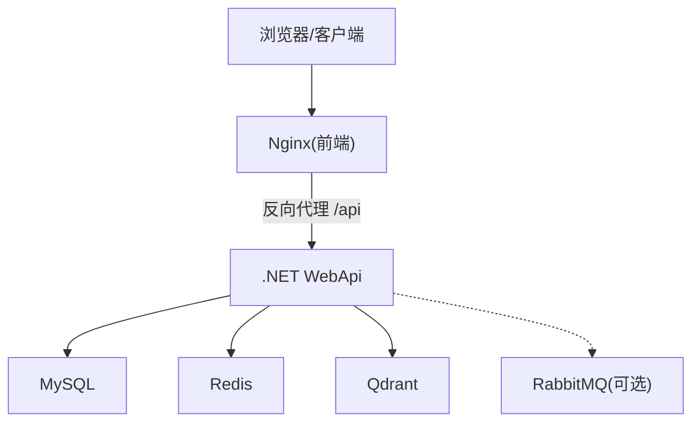
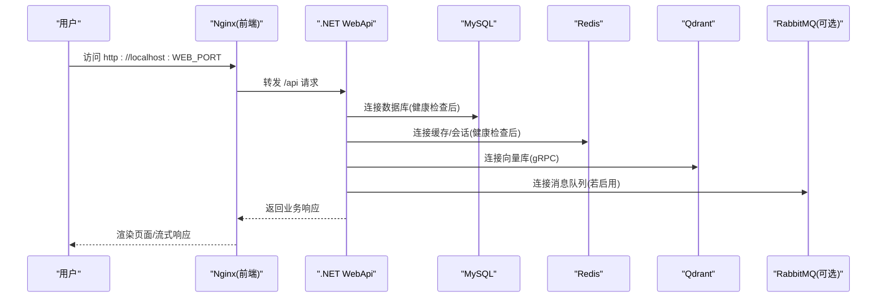
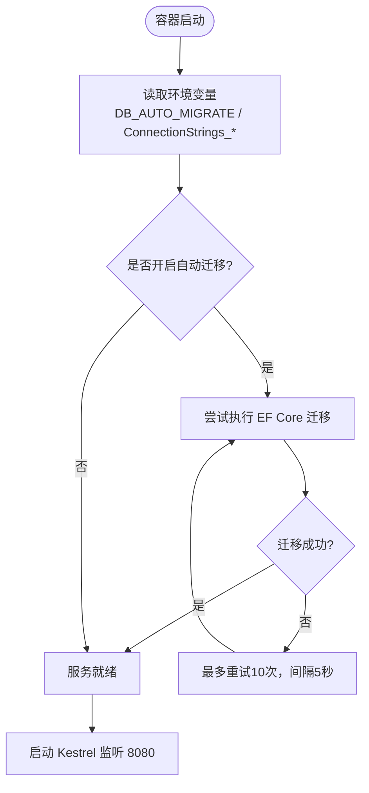
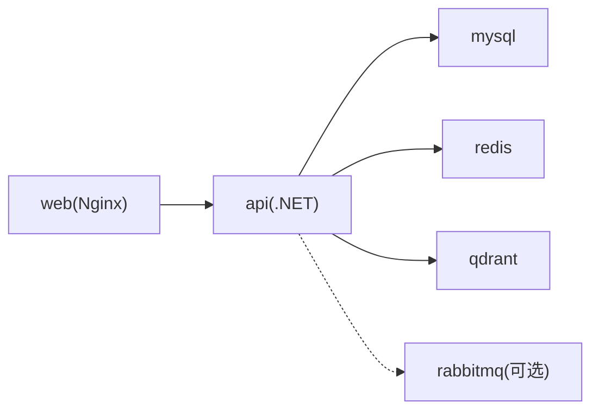

# Docker Compose一键部署

<cite>
**本文引用的文件**   
- [docker-compose.yml](file://docker-compose.yml)
- [App/WebApi/Dockerfile](file://App/WebApi/Dockerfile)
- [vue/kevin.web.vue/Dockerfile](file://vue/kevin.web.vue/Dockerfile)
- [App/WebApi/Program.cs](file://App/WebApi/Program.cs)
- [Kevin/kevin.Module/Kevin.Common/Helper/EnvironmentConfigHelper.cs](file://Kevin/kevin.Module/Kevin.Common/Helper/EnvironmentConfigHelper.cs)
- [Doc/项目相关/docker说明.txt](file://Doc/项目相关/docker说明.txt)
- [Doc/项目相关/环境变量设置.txt](file://Doc/项目相关/环境变量设置.txt)
</cite>

## 目录
1. [简介](#简介)
2. [项目结构](#项目结构)
3. [核心组件](#核心组件)
4. [架构总览](#架构总览)
5. [详细组件分析](#详细组件分析)
6. [依赖关系分析](#依赖关系分析)
7. [性能与容量建议](#性能与容量建议)
8. [故障排查指南](#故障排查指南)
9. [结论](#结论)
10. [附录：常用命令与环境变量](#附录常用命令与环境变量)

## 简介
本仓库提供基于 Docker Compose 的一键部署方案，将前端（Vue + Nginx）、后端（.NET WebApi）、MySQL、Redis、Qdrant 以及可选的 RabbitMQ 统一编排。默认端口已避开本机常见服务端口，避免与本地 MySQL、Redis、VS 调试等冲突；同时支持通过 .env 覆盖账号密码、端口和镜像版本，便于在开发、测试、生产环境复用同一套编排。

## 项目结构
从容器化视角，关键产物如下：
- 后端 API：由 App/WebApi/Dockerfile 构建，运行 ASP.NET Core 应用，监听 8080 端口。
- 前端 Web：由 vue/kevin.web.vue/Dockerfile 构建，使用 Node 编译 Vue 静态资源，再由 Nginx 托管并反向代理 /api 到后端。
- 数据与中间件：MySQL、Redis、Qdrant 作为持久化或缓存服务；RabbitMQ 为可选组件。
- 编排配置：docker-compose.yml 定义服务、网络、卷、健康检查与启动顺序。

图表来源
- [docker-compose.yml:24-200](file://docker-compose.yml#L24-L200)
- [App/WebApi/Dockerfile:4-8](file://App/WebApi/Dockerfile#L4-L8)
- [vue/kevin.web.vue/Dockerfile:22-25](file://vue/kevin.web.vue/Dockerfile#L22-L25)

章节来源
- [docker-compose.yml:1-213](file://docker-compose.yml#L1-L213)
- [App/WebApi/Dockerfile:1-72](file://App/WebApi/Dockerfile#L1-L72)
- [vue/kevin.web.vue/Dockerfile:1-26](file://vue/kevin.web.vue/Dockerfile#L1-L26)

## 核心组件
- 数据库层：MySQL 8.0，utf8mb4 字符集，时区 +08:00，最大包大小提升以承载 AI 对话长文本。
- 缓存与会话：Redis 7-alpine，启用密码与 AOF 持久化，用于缓存、分布式锁、SignalR 背板与 Hangfire。
- 向量库：Qdrant，gRPC 端口供后端 RAG 检索使用。
- 后端 API：ASP.NET Core 10.0 运行时，自动迁移数据库（可开关），挂载日志与上传文件卷。
- 前端 Web：Node 20 构建 Vue 静态资源，Nginx 托管并提供反向代理。
- 消息队列（可选）：RabbitMQ 3.13-management-alpine，需显式启用 profile mq。

章节来源
- [docker-compose.yml:28-102](file://docker-compose.yml#L28-L102)
- [docker-compose.yml:104-178](file://docker-compose.yml#L104-L178)
- [docker-compose.yml:180-200](file://docker-compose.yml#L180-L200)

## 架构总览
下图展示容器间通信、端口映射与依赖关系。API 启动时会等待 MySQL、Redis 健康就绪，并在需要时执行 EF Core 迁移。

图表来源
- [docker-compose.yml:104-178](file://docker-compose.yml#L104-L178)
- [App/WebApi/Program.cs:93-116](file://App/WebApi/Program.cs#L93-L116)

## 详细组件分析

### 后端 API 容器
- 构建阶段：SDK 镜像内还原 NuGet 包并发布，仅拷贝必要 csproj 以提升缓存命中率。
- 运行阶段：ASP.NET Core 10.0 基础镜像，暴露 8080 端口，强制监听 http://+:8080。
- 数据卷：/app/Log 与 /app/KevinFlies 分别用于日志与上传文件，需在宿主机保留。
- 启动逻辑：
  - 初始化日志与全局异常处理。
  - 根据环境变量 DB_AUTO_MIGRATE 决定是否在启动阶段执行 EF Core 迁移，包含有限次重试以应对数据库尚未就绪。
  - 线程池最小工作线程数下限提升，缓解同步调用导致的积压问题。
  - 堆硬限制设置为 2GB，满足 AI 场景内存需求。

图表来源
- [App/WebApi/Program.cs:25-40](file://App/WebApi/Program.cs#L25-L40)
- [App/WebApi/Program.cs:90-121](file://App/WebApi/Program.cs#L90-L121)

章节来源
- [App/WebApi/Dockerfile:1-72](file://App/WebApi/Dockerfile#L1-L72)
- [App/WebApi/Program.cs:1-132](file://App/WebApi/Program.cs#L1-L132)

### 前端 Web 容器
- 构建阶段：Node 20-alpine 安装依赖并构建 Vue 静态资源，支持通过构建参数 VUE_APP_API_BASE_URL 控制是否同源部署。
- 运行阶段：Nginx 托管 dist 目录，并将 /api 请求反向代理到 api 容器。
- 构建优化：NODE_OPTIONS 增大 Node 堆空间，npm 源默认使用国内镜像加速。

章节来源
- [vue/kevin.web.vue/Dockerfile:1-26](file://vue/kevin.web.vue/Dockerfile#L1-L26)

### 数据与中间件
- MySQL：utf8mb4 字符集与时区配置，max_allowed_packet 提升至 64M，适合存储 AI 对话长文本。
- Redis：启用密码与 AOF 持久化，用于缓存、分布式锁、SignalR 背板与 Hangfire。
- Qdrant：HTTP 控制台与 gRPC 端口分别映射，后端通过 gRPC 进行向量检索。
- RabbitMQ：通过 profiles ["mq"] 控制按需启动，默认不阻塞主流程。

章节来源
- [docker-compose.yml:28-102](file://docker-compose.yml#L28-L102)
- [docker-compose.yml:180-200](file://docker-compose.yml#L180-L200)

## 依赖关系分析
- 服务依赖：
  - api 依赖 mysql、redis、qdrant 健康状态，rabbitmq 为非必需依赖。
  - web 依赖 api 启动完成。
- 网络与端口：
  - 自定义桥接网络 kevin-net 隔离各容器。
  - 宿主机端口映射避开常见端口：MySQL 13306、Redis 16379、Qdrant HTTP 16333/gRPC 16334、API 19901、Web 8080。
- 数据持久化：
  - 各服务均使用命名卷保存数据，down 不会丢失数据，除非显式加 -v。

图表来源
- [docker-compose.yml:104-178](file://docker-compose.yml#L104-L178)
- [docker-compose.yml:202-213](file://docker-compose.yml#L202-L213)

章节来源
- [docker-compose.yml:104-178](file://docker-compose.yml#L104-L178)
- [docker-compose.yml:202-213](file://docker-compose.yml#L202-L213)

## 性能与容量建议
- 线程池与异步：
  - 程序已将最小工作线程数下限提升到 200，缓解同步调用导致的线程饥饿；建议持续将同步 IO 改为异步调用。
- 内存与 GC：
  - 堆硬限制设为 2GB，AI 场景下更稳定；如出现 OOM，可在容器层面调整内存上限。
- 数据库包大小：
  - max_allowed_packet=64M 适配 AI 对话日志长文本；如需更大内容，可继续调大。
- 构建缓存：
  - Dockerfile 先拷贝 csproj 再 restore，提高增量构建速度；新增/删除项目时需同步维护清单。
- 前端构建：
  - NODE_OPTIONS 增大 Node 堆空间，避免构建阶段内存不足。

[本节为通用建议，不直接分析具体文件]

## 故障排查指南
- 数据库迁移失败：
  - 现象：启动时报错无法连接数据库或迁移失败。
  - 原因：MySQL 尚未就绪或连接字符串错误。
  - 处理：确认 mysql 健康检查通过；检查 ConnectionStrings__dbConnection 中的 host、port、database、user、password；必要时将 DB_AUTO_MIGRATE 设为 false 并手工初始化。
- Redis 连接失败：
  - 现象：缓存、SignalR、Hangfire 报错。
  - 原因：REDIS_PASSWORD 不一致或 redis 未启动。
  - 处理：核对 docker-compose.yml 中 REDIS_PASSWORD 与 ConnectionStrings__redisConnection/HangfireRedisSetting__RedisConnectionString 一致；查看 redis 健康检查。
- Qdrant 不可用：
  - 现象：RAG 检索失败。
  - 原因：Qdrant gRPC 端口不通或 URL 配置错误。
  - 处理：确认 Qdrant 容器健康；检查 QdrantClientSetting__Url 是否为 http://qdrant:6334。
- 前端无法访问后端：
  - 现象：浏览器打开页面但接口 404 或跨域。
  - 原因：VUE_APP_API_BASE_URL 为空时走同源，Nginx 反向代理规则需生效；若直连后端，需传入绝对地址。
  - 处理：检查 nginx.conf 与 VUE_APP_API_BASE_URL；确保 web 端口映射正确。
- RabbitMQ 未启用：
  - 现象：消息队列相关功能不可用。
  - 原因：未启用 mq profile。
  - 处理：使用 docker compose --profile mq up -d 启动；核对 RabbitMQ 用户名、密码与 VirtualHost。

章节来源
- [App/WebApi/Program.cs:93-116](file://App/WebApi/Program.cs#L93-L116)
- [docker-compose.yml:114-154](file://docker-compose.yml#L114-L154)
- [Doc/项目相关/docker说明.txt:1-44](file://Doc/项目相关/docker说明.txt#L1-L44)

## 结论
该编排方案通过 Docker Compose 将前后端与数据/中间件服务统一拉起，具备以下优势：
- 一键部署：一条命令即可构建并启动全部服务。
- 环境隔离：默认端口避开本机常用端口，减少冲突。
- 可扩展：RabbitMQ 可按需启用，不影响主流程。
- 可观测：健康检查与日志卷便于排障与运维。
- 可演进：EF Core 自动迁移简化首次部署与升级流程。

[本节为总结性内容，不直接分析具体文件]

## 附录：常用命令与环境变量

### 常用命令
- 首次构建并后台启动全部服务：docker compose up -d --build
- 只重建/重启后端：docker compose up -d --build api
- 跟踪后端日志：docker compose logs -f api
- 停止并删除容器（数据卷保留）：docker compose down
- 停止并删除容器及数据卷（谨慎）：docker compose down -v
- 额外启动 RabbitMQ：docker compose --profile mq up -d

章节来源
- [docker-compose.yml:1-20](file://docker-compose.yml#L1-L20)

### 环境变量与覆盖
- 宿主机端口：MYSQL_PORT、REDIS_PORT、QDRANT_HTTP_PORT、QDRANT_GRPC_PORT、API_PORT、WEB_PORT
- 认证信息：MYSQL_ROOT_PASSWORD、MYSQL_DATABASE、REDIS_PASSWORD、RABBITMQ_USER、RABBITMQ_PASSWORD
- 行为开关：DB_AUTO_MIGRATE=true/false
- 前端构建参数：VUE_APP_API_BASE_URL、NPM_REGISTRY

章节来源
- [docker-compose.yml:14-19](file://docker-compose.yml#L14-L19)
- [docker-compose.yml:38-41](file://docker-compose.yml#L38-L41)
- [docker-compose.yml:62-66](file://docker-compose.yml#L62-L66)
- [docker-compose.yml:114-131](file://docker-compose.yml#L114-L131)
- [docker-compose.yml:163-167](file://docker-compose.yml#L163-L167)
- [Doc/项目相关/环境变量设置.txt:1-16](file://Doc/项目相关/环境变量设置.txt#L1-L16)