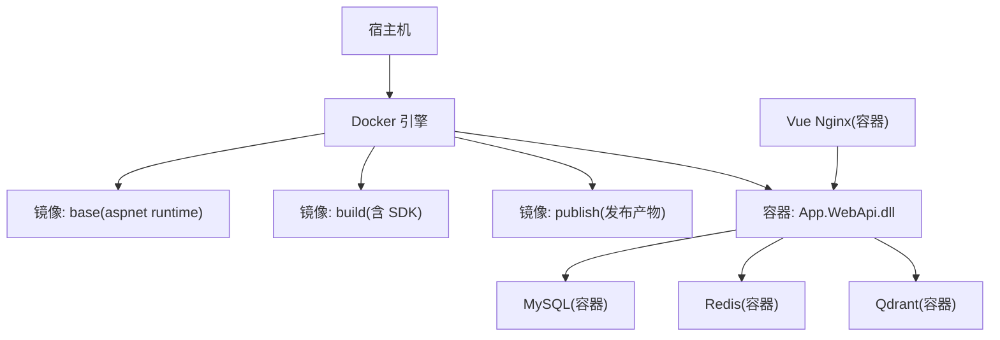
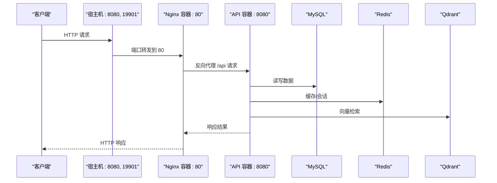
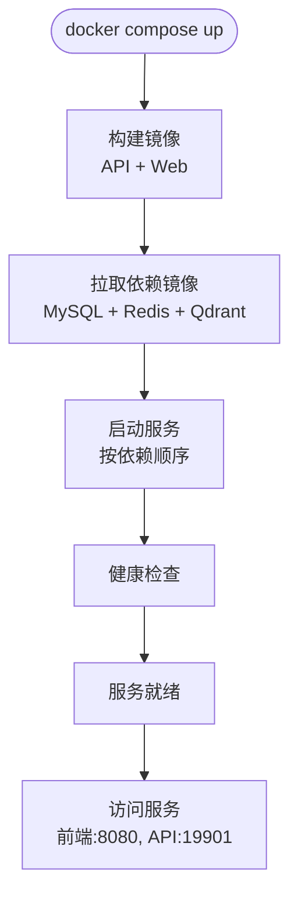
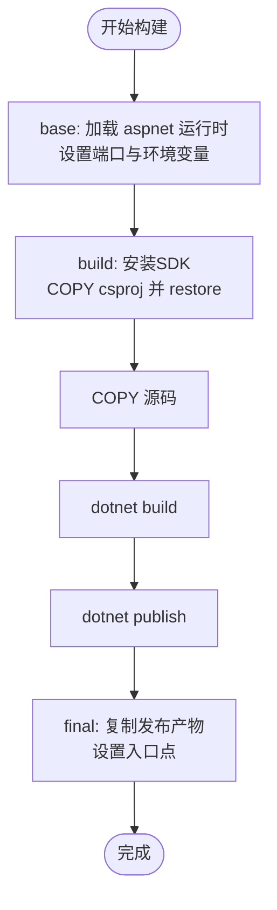
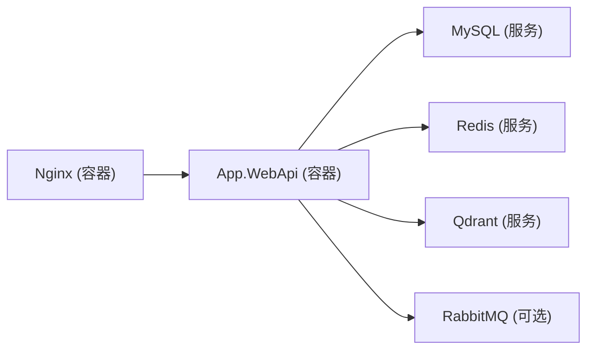

# Docker容器化部署

<cite>
**本文引用的文件**
- [docker-compose.yml](file://docker-compose.yml)
- [App/WebApi/Dockerfile](file://App/WebApi/Dockerfile)
- [.dockerignore](file://.dockerignore)
- [App/WebApi/appsettings.json](file://App/WebApi/appsettings.json)
- [README.md](file://README.md)
- [Doc/项目相关/docker说明.txt](file://Doc/项目相关/docker说明.txt)
</cite>

## 更新摘要
**变更内容**
- 新增完整的Docker Compose一键部署支持，包含MySQL、Redis、Qdrant、前端Nginx等服务编排
- 简化多服务部署流程，提供标准化的环境配置和端口管理
- 保持原有的Dockerfile构建方式，支持独立镜像构建
- 增强健康检查和依赖管理服务启动顺序

## 目录
1. [简介](#简介)
2. [项目结构](#项目结构)
3. [核心组件](#核心组件)
4. [架构总览](#架构总览)
5. [详细组件分析](#详细组件分析)
6. [依赖关系分析](#依赖关系分析)
7. [性能与资源优化](#性能与资源优化)
8. [故障排查指南](#故障排查指南)
9. [结论](#结论)
10. [附录：构建与运行命令、编排示例](#附录构建与运行命令编排示例)

## 简介
本文件面向 NetCoreKevin 框架的容器化部署，重点说明多阶段 Dockerfile 构建流程、基础镜像选择、依赖安装、应用编译与发布优化；解释容器环境变量（如 ASPNETCORE_URLS 端口、ASPNETCORE_ENVIRONMENT）与运行时用户权限管理；描述 .dockerignore 的作用与优化策略；提供完整的镜像构建命令、容器运行参数、网络配置；给出基于 Docker Compose 的 MySQL、Redis、Qdrant、前端 Nginx、后端 API 服务编排示例；并总结生产环境最佳实践（镜像安全扫描、资源限制与健康检查）。

**更新** 新增了完整的Docker Compose一键部署支持，简化了多服务部署流程。

## 项目结构
- Web API 入口位于 App/WebApi，包含 Dockerfile、配置文件与启动逻辑。
- 解决方案包含多个模块（Domain/Application/Infrastructure/Module 等），Dockerfile 通过精确 COPY 仅引入必要的 csproj 以利用缓存加速 restore/build。
- 根目录提供 docker-compose.yml，实现一键部署完整的服务栈。
- 根目录提供 .dockerignore，用于排除不必要的构建上下文内容，减小镜像体积。
- Vue 前端位于 vue/kevin.web.vue，包含独立的 Dockerfile 和 Nginx 配置。



**图表来源**
- [docker-compose.yml:24-213](file://docker-compose.yml#L24-L213)
- [App/WebApi/Dockerfile:3-72](file://App/WebApi/Dockerfile#L3-L72)

**章节来源**
- [App/WebApi/Dockerfile:1-72](file://App/WebApi/Dockerfile#L1-L72)
- [.dockerignore:1-25](file://.dockerignore#L1-L25)
- [docker-compose.yml:1-213](file://docker-compose.yml#L1-L213)

## 核心组件
- **多阶段构建**
  - base：使用 aspnet 运行时镜像，暴露 8080 端口，设置监听地址与环境变量，非 root 用户运行。
  - build：使用 SDK 镜像，关闭遥测与全球化不变量，COPY 必要 csproj 后执行 dotnet restore，再复制源码并构建。
  - publish：在 build 基础上发布为自包含/可移植输出（UseAppHost=false）。
  - final：从 base 阶段复制发布产物，设置工作目录与入口点。
- **Docker Compose 编排**
  - mysql：MySQL 8.0 主数据库，配置 utf8mb4 字符集和时区。
  - redis：Redis 7 Alpine 版本，启用密码认证和持久化。
  - qdrant：向量数据库，用于 RAG 知识库检索。
  - api：.NET WebApi 后端服务，依赖上述三个服务。
  - web：Vue 前端 + Nginx 反向代理。
  - rabbitmq：可选的消息队列服务（通过 profile 控制）。
- **环境变量**
  - ASPNETCORE_URLS：强制 Kestrel 监听 http://+:8080。
  - ASPNETCORE_ENVIRONMENT：控制开发/测试/生产行为（由 Program 与环境读取）。
  - 连接字符串和环境配置通过环境变量注入。
- **运行时用户**
  - 使用 $APP_UID 切换至非 root 用户，提升安全性。
- **忽略规则**
  - .dockerignore 排除 .git、bin/obj、IDE 配置、node_modules、其他 Dockerfile/compose 等，减少上下文大小与误拷贝风险。

**章节来源**
- [App/WebApi/Dockerfile:3-72](file://App/WebApi/Dockerfile#L3-L72)
- [docker-compose.yml:24-213](file://docker-compose.yml#L24-L213)
- [.dockerignore:1-25](file://.dockerignore#L1-L25)

## 架构总览
下图展示了容器内外的关键交互：Web API 通过环境变量与 appsettings 连接 MySQL、Redis 和 Qdrant，Kestrel 监听 8080 端口，前端 Nginx 反向代理到后端 API。



**图表来源**
- [docker-compose.yml:107-178](file://docker-compose.yml#L107-L178)
- [App/WebApi/Dockerfile:7-8](file://App/WebApi/Dockerfile#L7-L8)

## 详细组件分析

### Docker Compose 一键部署
**新增功能** Docker Compose 提供了完整的服务编排，支持一键启动所有依赖服务。

- **服务定义**
  - mysql：MySQL 8.0，配置 utf8mb4 字符集、时区、最大包大小等参数。
  - redis：Redis 7 Alpine，启用密码认证和 AOF 持久化。
  - qdrant：向量数据库，配置 gRPC 和 HTTP 端口。
  - api：.NET WebApi 后端，自动构建镜像，注入连接字符串和环境变量。
  - web：Vue 前端 + Nginx，构建前端静态资源并提供反向代理。
  - rabbitmq：可选消息队列，通过 `--profile mq` 启用。
- **网络配置**
  - 自定义网络 kevin-net，服务间通过服务名通信。
  - 端口映射避免与宿主机常用端口冲突。
- **数据持久化**
  - 使用命名卷存储数据库、缓存、向量数据和上传文件。
- **健康检查**
  - 各服务配置健康检查，确保依赖服务就绪后再启动。
- **环境变量管理**
  - 支持通过 .env 文件覆盖默认配置。
  - 敏感信息通过环境变量注入，不硬编码在配置中。



**图表来源**
- [docker-compose.yml:1-213](file://docker-compose.yml#L1-L213)

**章节来源**
- [docker-compose.yml:1-213](file://docker-compose.yml#L1-L213)

### 多阶段 Dockerfile 构建流程
- **基础镜像选择**
  - base 阶段采用 aspnet 运行时镜像，最小化运行依赖。
  - build 阶段采用 SDK 镜像，启用 DOTNET_CLI_TELEMETRY_OPTOUT 与 DOTNET_SYSTEM_GLOBALIZATION_INVARIANT 以提升构建速度与稳定性。
- **依赖安装与缓存优化**
  - 先 COPY 所有 csproj 文件，再执行 dotnet restore，充分利用 Docker 层缓存，避免每次构建都重新下载依赖。
- **应用编译与发布优化**
  - 构建阶段输出到 /app/build，发布阶段输出到 /app/publish，最终只将发布产物复制到 final 镜像，显著减小镜像体积。
  - 使用 UseAppHost=false 避免生成宿主包装器，进一步精简。
- **运行时用户与端口**
  - USER $APP_UID 确保以非 root 用户运行。
  - EXPOSE 8080 与 ENV ASPNETCORE_URLS=http://+:8080 保证容器内外端口一致且监听所有接口。



**图表来源**
- [App/WebApi/Dockerfile:11-72](file://App/WebApi/Dockerfile#L11-L72)

**章节来源**
- [App/WebApi/Dockerfile:1-72](file://App/WebApi/Dockerfile#L1-L72)

### 环境变量与运行时配置
- **ASPNETCORE_URLS**
  - 在 Dockerfile 的 base、build、final 三处设置，确保 Kestrel 始终监听 http://+:8080。
- **ASPNETCORE_ENVIRONMENT**
  - 通过环境变量切换 Development/Production，影响异常处理、日志级别等。
  - Program 中调用环境配置工具进行初始化。
- **连接字符串与外部服务**
  - appsettings.json 定义了 dbConnection 与 redisConnection，可在容器中以环境变量覆盖（例如 ConnectionStrings__dbConnection）。
  - ConsulSetting、RabbitMQ、Hangfire 等配置项可根据部署环境调整。
- **Docker Compose 环境变量**
  - 通过 docker-compose.yml 中的 environment 字段注入连接字符串和服务地址。
  - 支持通过 .env 文件覆盖默认值。

**章节来源**
- [App/WebApi/Dockerfile:7-8](file://App/WebApi/Dockerfile#L7-L8)
- [App/WebApi/Dockerfile:69-71](file://App/WebApi/Dockerfile#L69-L71)
- [App/WebApi/appsettings.json:14-17](file://App/WebApi/appsettings.json#L14-L17)
- [docker-compose.yml:114-154](file://docker-compose.yml#L114-L154)

### 运行时用户权限管理
- 使用 $APP_UID 切换到非 root 用户，降低容器被攻破后的影响面。
- 建议结合只读文件系统、最小权限原则挂载卷，避免写入敏感路径。

**章节来源**
- [App/WebApi/Dockerfile:69-70](file://App/WebApi/Dockerfile#L69-L70)

### .dockerignore 的作用与优化策略
- 排除 IDE 与版本控制相关文件（.vs、.git、*.user 等），避免污染构建上下文。
- 排除 bin/obj、node_modules、npm-debug.log 等中间产物，减少镜像体积与构建时间。
- 排除 docker-compose* 与 Dockerfile*，防止误将编排文件打包进镜像。
- 建议：
  - 保持 .dockerignore 与项目结构同步更新。
  - 对大型前端资源（如 vue/dist）也应纳入忽略列表，若不需要进入镜像。

**章节来源**
- [.dockerignore:1-25](file://.dockerignore#L1-L25)

### 健康检查与就绪探针
- 建议在容器层面增加健康检查，指向应用的健康端点（例如 /api/Test/HealthCheckGet 或自定义 /health）。
- 在 Kubernetes 或编排平台中，可通过 liveness/readiness 探针实现自动重启与服务摘流。
- Docker Compose 已为各服务配置健康检查，确保依赖服务就绪。

**章节来源**
- [App/WebApi/appsettings.json:53-58](file://App/WebApi/appsettings.json#L53-L58)
- [docker-compose.yml:46-51](file://docker-compose.yml#L46-L51)
- [docker-compose.yml:69-74](file://docker-compose.yml#L69-L74)
- [docker-compose.yml:95-100](file://docker-compose.yml#L95-L100)

## 依赖关系分析
- **应用对外部服务的依赖**
  - MySQL：通过 ConnectionStrings.dbConnection 配置。
  - Redis：通过 ConnectionStrings.redisConnection 及 Hangfire/SignalR 相关配置。
  - Qdrant：向量数据库，用于 RAG 知识库检索。
  - 可选：Consul、RabbitMQ、邮件、云存储等按配置启用。
- **容器网络**
  - 容器间通信建议使用自定义网络，通过服务名解析（Compose 场景）。
  - 宿主机端口映射：将容器的 8080 映射到宿主机指定端口。



**图表来源**
- [docker-compose.yml:24-213](file://docker-compose.yml#L24-L213)

**章节来源**
- [App/WebApi/appsettings.json:14-17](file://App/WebApi/appsettings.json#L14-L17)
- [App/WebApi/appsettings.json:94-99](file://App/WebApi/appsettings.json#L94-L99)
- [docker-compose.yml:24-213](file://docker-compose.yml#L24-L213)

## 性能与资源优化
- **构建优化**
  - 使用多阶段构建，仅将运行时所需文件放入 final 镜像。
  - 先恢复依赖再复制源码，最大化利用缓存。
  - 禁用遥测与设置不变文化，提升构建速度。
- **运行时优化**
  - 固定监听端口 8080，便于反向代理统一入口。
  - 使用非 root 用户运行，提高安全性。
  - 合理设置 GCHeapHardLimit（已在 Program 中设置堆硬限制）。
- **资源限制**
  - 在生产环境中为容器设置 CPU 与内存限制，避免单实例占用过多资源。
- **镜像安全**
  - 定期扫描镜像漏洞，及时更新基础镜像。
  - 最小化基础镜像，移除不必要工具与调试信息。

**章节来源**
- [App/WebApi/Dockerfile:11-72](file://App/WebApi/Dockerfile#L11-L72)

## 故障排查指南
- **无法访问服务**
  - 检查容器端口映射是否正确（宿主机端口 -> 容器 8080）。
  - 确认 ASPNETCORE_URLS 是否设置为 http://+:8080。
- **数据库/Redis/Qdrant 连接失败**
  - 核对连接字符串中的主机名、端口、密码。
  - 在 Compose 环境下，使用服务名作为主机名（如 mysql、redis、qdrant）。
- **权限问题**
  - 确认以非 root 用户运行，必要时调整卷挂载权限。
- **日志定位**
  - 查看容器日志：docker logs <容器名>。
  - 应用日志路径与级别由 log4net 与 appsettings 控制。
- **Docker Compose 常见问题**
  - 端口冲突：修改 .env 文件中的端口配置。
  - 镜像拉取失败：检查网络连接或配置镜像加速器。
  - 服务启动失败：查看具体服务的日志输出。

**章节来源**
- [App/WebApi/Dockerfile:7-8](file://App/WebApi/Dockerfile#L7-L8)
- [App/WebApi/appsettings.json:14-17](file://App/WebApi/appsettings.json#L14-L17)
- [docker-compose.yml:1-213](file://docker-compose.yml#L1-L213)

## 结论
NetCoreKevin 的容器化方案采用标准的多阶段构建，结合 .dockerignore 优化上下文，确保镜像体积小、构建快、运行安全。通过 Docker Compose 实现了完整的一键部署体验，包含 MySQL、Redis、Qdrant、前端 Nginx 和后端 API 服务。环境变量与配置分离支持多环境部署。在生产环境建议加入镜像扫描、资源限制与健康检查，进一步提升可靠性与安全性。

**更新** 新增的 Docker Compose 一键部署功能大大简化了部署流程，开发者只需一条命令即可启动完整的服务栈。

## 附录：构建与运行命令、编排示例

### Docker Compose 一键部署
**新增功能** 推荐使用 Docker Compose 进行一键部署：

```bash
# 首次构建并启动所有服务
docker compose up -d --build

# 只启动服务（不重新构建）
docker compose up -d

# 停止所有服务
docker compose down

# 停止并删除数据卷（谨慎使用）
docker compose down -v

# 只重建后端服务
docker compose up -d --build api

# 查看服务状态
docker compose ps

# 查看服务日志
docker compose logs -f api
```

### 访问地址
| 服务 | 地址 |
|------|------|
| 管理后台（前端） | http://localhost:8080 |
| API / Swagger | http://localhost:19901/swagger |
| Hangfire 面板 | http://localhost:19901/pchangfire |
| Qdrant 控制台 | http://localhost:16333/dashboard |
| MySQL | 127.0.0.1:13306 |
| Redis | 127.0.0.1:16379 |

### 可选服务
```bash
# 启动 RabbitMQ（需要消息队列功能）
docker compose --profile mq up -d

# 访问 RabbitMQ 管理界面
# http://localhost:15672
```

### 环境变量配置
创建 `.env` 文件来覆盖默认配置：

```ini
WEB_PORT=8080               # 前端入口
API_PORT=19901              # 后端 / Swagger
MYSQL_PORT=13306
REDIS_PORT=16379
MYSQL_ROOT_PASSWORD=admin123
REDIS_PASSWORD=123456
DB_AUTO_MIGRATE=true        # 启动时自动执行数据库迁移
TAG=latest                  # 镜像 tag
```

### 传统 Docker 命令
如果需要单独构建和运行镜像：

```bash
# 构建 API 镜像
docker build -t netcorekevin-webapi:latest -f App/WebApi/Dockerfile .

# 运行 API 容器
docker run -d --name webapi -p 8080:8080 \
  -e ASPNETCORE_ENVIRONMENT=Development \
  -e ConnectionStrings__dbConnection="server=mysql;port=3306;database=kevin_app;user id=root;password=admin123;" \
  netcorekevin-webapi:latest
```

### 生产最佳实践
- **镜像安全扫描**：使用 Trivy、Docker Scout 等工具定期扫描。
- **资源限制**：为容器设置 CPU/内存上限，避免资源争用。
- **健康检查**：为容器添加健康检查端点，编排平台据此判断存活与就绪。
- **日志与监控**：集中收集日志，接入监控系统（Prometheus/Grafana）。
- **数据备份**：定期备份 MySQL、Redis、Qdrant 的数据卷。
- **网络安全**：配置防火墙规则，只开放必要的端口。

**章节来源**
- [docker-compose.yml:1-213](file://docker-compose.yml#L1-L213)
- [App/WebApi/Dockerfile:1-72](file://App/WebApi/Dockerfile#L1-L72)
- [README.md:173-292](file://README.md#L173-L292)
- [Doc/项目相关/docker说明.txt:1-44](file://Doc/项目相关/docker说明.txt#L1-L44)