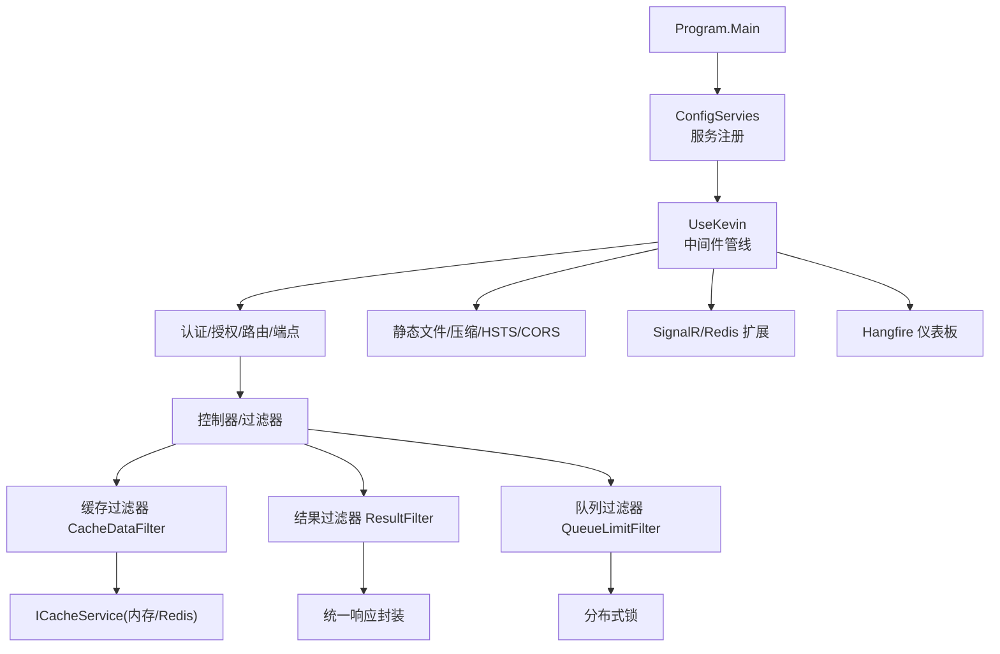
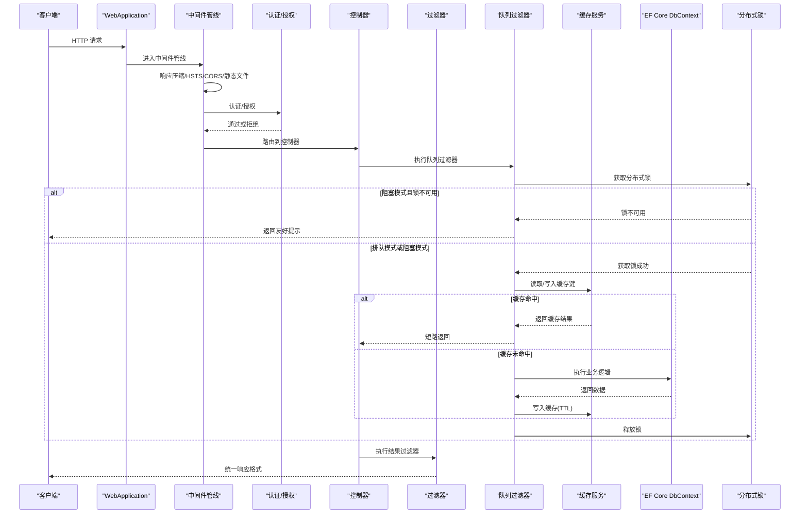
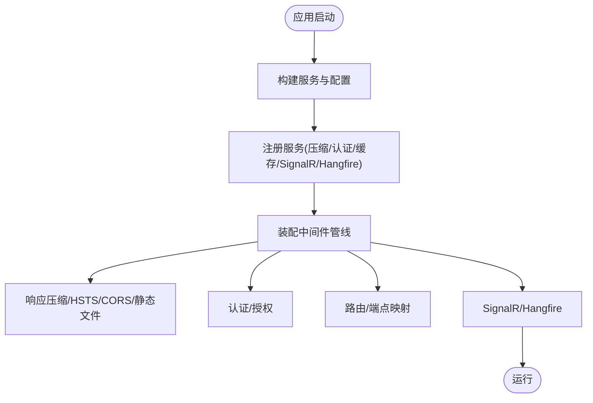
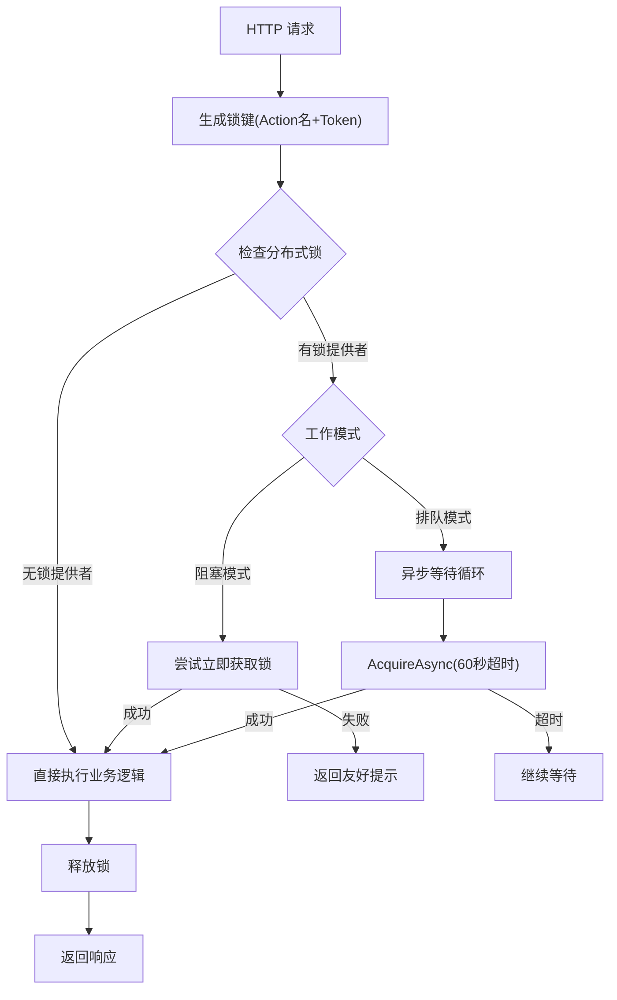
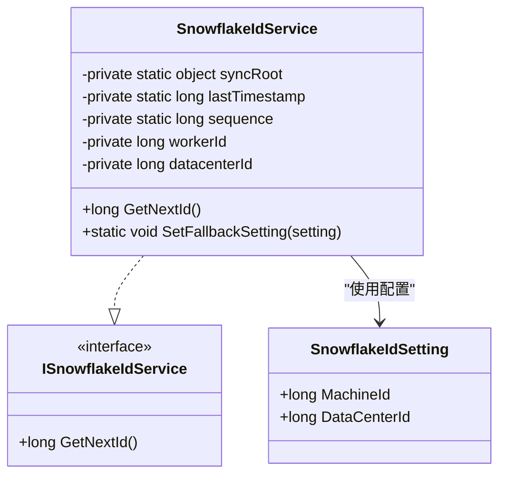
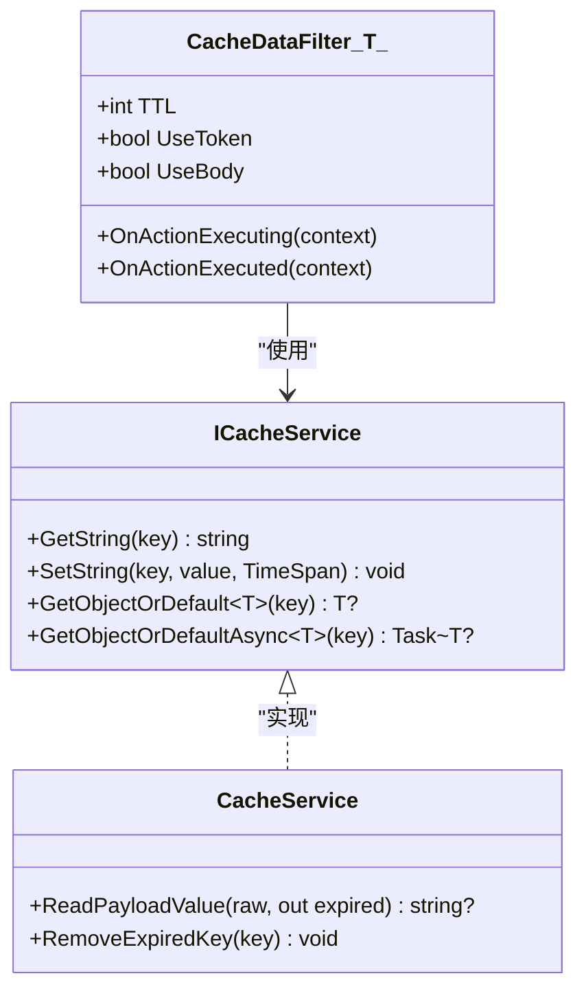
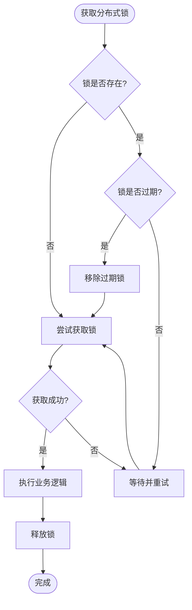
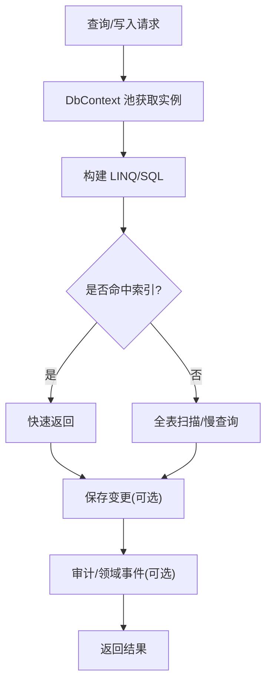
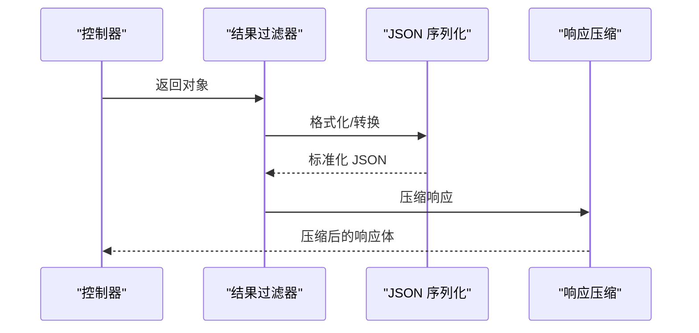
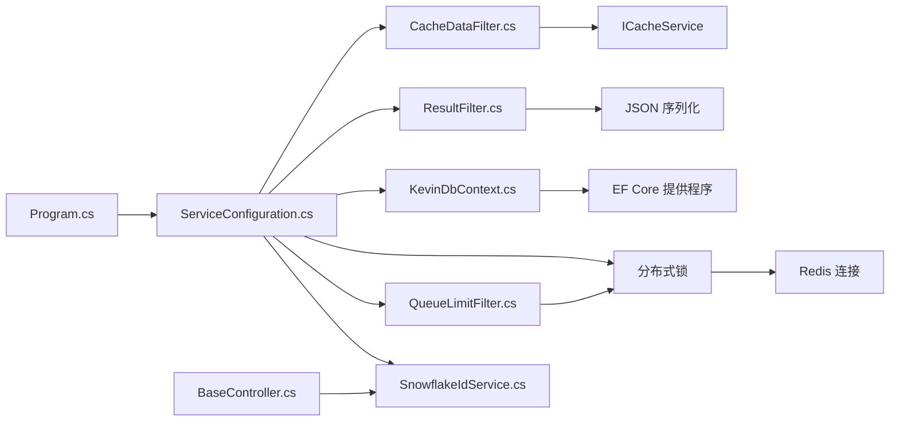

# 性能优化

<cite>
**本文引用的文件**
- [Program.cs](file://App/WebApi/Program.cs)
- [ServiceConfiguration.cs](file://Kevin/Kevin.Web.Basics/Extensions/ServiceConfiguration.cs)
- [KevinDbContext.cs](file://Kevin/Kevin.EntityFrameworkCore/Database/KevinDbContext.cs)
- [CacheDataFilter.cs](file://Kevin/Kevin.Web.Basics/Filters/CacheDataFilter.cs)
- [ResultFilter.cs](file://Kevin/Kevin.Web.Basics/Filters/ResultFilter.cs)
- [appsettings.json](file://App/WebApi/appsettings.json)
- [ServiceCollectionExtensions.cs（SignalR）](file://Kevin/kevin.Module/Kevin.SignalR/ServiceCollectionExtensions.cs)
- [ServiceCollectionExtensions.cs（分布式锁）](file://Kevin/kevin.Module/kevin.DistributedLock/ServiceCollectionExtensions.cs)
- [CacheService.cs](file://Kevin/kevin.Module/kevin.Cache/Service/CacheService.cs)
- [ICacheService.cs](file://Kevin/kevin.Module/kevin.Cache/Service/ICacheService.cs)
- [QueueLimitFilter.cs](file://Kevin/Kevin.Web.Basics/Filters/QueueLimitFilter.cs)
- [SnowflakeIdService.cs](file://Kevin/kevin.Module/Kevin.SnowflakeId/Service/SnowflakeIdService.cs)
- [ServiceCollectionExtensions.cs（雪花ID）](file://Kevin/kevin.Module/Kevin.SnowflakeId/ServiceCollectionExtensions.cs)
- [BaseController.cs](file://Kevin/Kevin.Web.Basics/Controllers/BaseController.cs)
</cite>

## 更新摘要
**变更内容**
- QueueLimitFilter 完全重写为异步 Action 过滤器，消除了线程饥饿问题，支持阻塞模式和排队模式
- SnowflakeIdService 修复了高并发重复 ID 生成问题，使用静态共享状态确保唯一性
- 增强了分布式锁系统，添加了自动过期设置（2小时）以防止任务异常执行时锁的累积
- 增强了缓存服务，包括智能过期处理和默认值检索方法

## 目录
1. [简介](#简介)
2. [项目结构](#项目结构)
3. [核心组件](#核心组件)
4. [架构总览](#架构总览)
5. [详细组件分析](#详细组件分析)
6. [依赖关系分析](#依赖关系分析)
7. [性能注意事项](#性能注意事项)
8. [故障排查指南](#故障排查指南)
9. [结论](#结论)
10. [附录](#附录)

## 简介
本指南面向 NetCoreKevin 框架的性能优化，覆盖应用启动优化、中间件注册顺序、缓存策略（内存与 Redis）、数据库连接池与 EF Core 查询优化、API 响应优化（序列化、压缩、分页）、异步编程模式与并发提升，以及性能监控与瓶颈分析方法。内容基于仓库中的实际实现进行说明，并提供可操作的配置建议与流程图示。

## 项目结构
- Web 入口：Program.cs 负责环境初始化、日志、服务构建、异常处理、堆限制设置与中间件管线装配。
- 服务与中间件注册：ServiceConfiguration.cs 集中完成 JSON 压缩、Kestrel/IISServer 选项、CORS、认证授权、控制器、缓存、分布式锁、SignalR、Hangfire、消息队列等服务的注入与 Use 管线配置。
- 数据访问：KevinDbContext.cs 提供 EF Core 上下文、模型配置、拦截器、默认索引字段、多租户与乐观并发处理。
- API 过滤器：CacheDataFilter.cs 提供接口级缓存；ResultFilter.cs 统一返回格式与错误码包装；QueueLimitFilter.cs 提供请求队列控制。
- 配置：appsettings.json 包含数据库连接串、Redis、SignalR、CORS、Hangfire、JWT、默认索引字段等关键配置项。



图表来源
- [Program.cs:23-85](file://App/WebApi/Program.cs#L23-L85)
- [ServiceConfiguration.cs:48-347](file://Kevin/Kevin.Web.Basics/Extensions/ServiceConfiguration.cs#L48-L347)

章节来源
- [Program.cs:23-85](file://App/WebApi/Program.cs#L23-L85)
- [ServiceConfiguration.cs:48-347](file://Kevin/Kevin.Web.Basics/Extensions/ServiceConfiguration.cs#L48-L347)

## 核心组件
- 应用启动与中间件管线
  - Program.cs 中启用日志、构建服务、设置 GC 堆硬限制、调用 UseKevin 装配中间件。
  - ServiceConfiguration.cs 中集中注册响应压缩、Kestrel/IISServer 同步 IO 允许、请求体大小限制、HSTS、CORS、认证授权、控制器、JSON 序列化选项、缓存、分布式锁、SignalR、Hangfire、消息队列等。
- 缓存
  - 内存缓存通过 AddKevinMemoryCache 注入；分布式锁通过 Redis 注入；SignalR 使用 Redis 作为后端。
  - CacheDataFilter 提供接口级缓存，支持 TTL、是否使用 Token、是否读取 Body 参与键生成。
  - **新增**：缓存服务现在包含智能过期处理和默认值检索方法，提供更好的容错能力。
- 请求队列控制
  - **全新**：QueueLimitFilter 完全重写为异步 Action 过滤器，实现了两种工作模式：
    - 阻塞模式：立即拒绝重复请求，返回友好提示
    - 排队模式：异步等待锁，不占用线程池线程，避免线程饥饿
  - 支持按 Action 名称和可选 Token 区分请求，使用分布式锁确保同一时刻只有一个请求执行。
- 分布式 ID 生成
  - **修复**：SnowflakeIdService 修复了高并发重复 ID 生成问题，使用静态共享状态确保唯一性。
  - 所有实例共享相同的 lastTimestamp、sequence 和 syncRoot 锁对象，防止多线程环境下产生重复 ID。
  - 支持进程内直接 new 实例和 DI 容器注入两种方式，确保配置一致性。
- 数据库与 EF Core
  - KevinDbContext 配置 MySQL 提供程序、迁移程序集、调试拦截器、默认索引字段、自动表名/列名规则、外键级联禁用、种子数据、领域事件发布、乐观并发 RowVersion、多租户 TenantId 注入。
  - 连接池通过 AddDbContextPool 配置池大小。
- API 响应
  - ResultFilter 统一返回结构，处理 null 值、错误码包装、流式文件排除。
  - JSON 序列化自定义转换器与编码器，控制深度与缩进。

章节来源
- [Program.cs:23-85](file://App/WebApi/Program.cs#L23-L85)
- [ServiceConfiguration.cs:48-347](file://Kevin/Kevin.Web.Basics/Extensions/ServiceConfiguration.cs#L48-L347)
- [CacheDataFilter.cs:17-125](file://Kevin/Kevin.Web.Basics/Filters/CacheDataFilter.cs#L17-L125)
- [QueueLimitFilter.cs:13-130](file://Kevin/Kevin.Web.Basics/Filters/QueueLimitFilter.cs#L13-L130)
- [SnowflakeIdService.cs:6-122](file://Kevin/kevin.Module/Kevin.SnowflakeId/Service/SnowflakeIdService.cs#L6-L122)
- [KevinDbContext.cs:83-133](file://Kevin/Kevin.EntityFrameworkCore/Database/KevinDbContext.cs#L83-L133)
- [KevinDbContext.cs:165-305](file://Kevin/Kevin.EntityFrameworkCore/Database/KevinDbContext.cs#L165-L305)
- [KevinDbContext.cs:405-484](file://Kevin/Kevin.EntityFrameworkCore/Database/KevinDbContext.cs#L405-L484)
- [ResultFilter.cs:13-153](file://Kevin/Kevin.Web.Basics/Filters/ResultFilter.cs#L13-L153)
- [appsettings.json:12-15](file://App/WebApi/appsettings.json#L12-L15)
- [appsettings.json:99-99](file://App/WebApi/appsettings.json#L99-L99)

## 架构总览
下图展示从请求进入至响应返回的关键路径，包括中间件顺序、过滤器、缓存与数据库交互。



图表来源
- [ServiceConfiguration.cs:296-347](file://Kevin/Kevin.Web.Basics/Extensions/ServiceConfiguration.cs#L296-L347)
- [CacheDataFilter.cs:31-125](file://Kevin/Kevin.Web.Basics/Filters/CacheDataFilter.cs#L31-L125)
- [QueueLimitFilter.cs:32-101](file://Kevin/Kevin.Web.Basics/Filters/QueueLimitFilter.cs#L32-L101)
- [ResultFilter.cs:111-153](file://Kevin/Kevin.Web.Basics/Filters/ResultFilter.cs#L111-L153)

## 详细组件分析

### 应用启动与中间件顺序优化
- 启动阶段
  - Program.cs 设置环境变量、日志、构建服务、GC 堆硬限制、调用 UseKevin。
- 服务注册阶段（ServiceConfiguration.ConfigServies）
  - 响应压缩、表单长度限制、Kestrel/IISServer 同步 IO 允许、最大请求体大小、HSTS、CORS、认证授权、控制器、JSON 序列化选项、内存缓存、分布式锁、SignalR、Hangfire、消息队列等。
- 中间件管线阶段（ServiceConfiguration.UseKevin）
  - 响应压缩、HSTS、CORS、HTTPS 重定向、静态文件、Swagger、路由、认证、授权、端点映射、SignalR Redis 扩展、Hangfire 仪表板。
- 优化要点
  - 将压缩、HSTS、CORS、静态文件放在认证之前以减少重复处理。
  - 认证/授权必须在路由之后、端点映射之前。
  - SignalR 与 Hangfire 在管线末尾启用，避免影响常规 API。



图表来源
- [Program.cs:23-85](file://App/WebApi/Program.cs#L23-L85)
- [ServiceConfiguration.cs:48-347](file://Kevin/Kevin.Web.Basics/Extensions/ServiceConfiguration.cs#L48-L347)

章节来源
- [Program.cs:23-85](file://App/WebApi/Program.cs#L23-L85)
- [ServiceConfiguration.cs:48-347](file://Kevin/Kevin.Web.Basics/Extensions/ServiceConfiguration.cs#L48-L347)

### 请求队列控制（QueueLimitFilter）
- **全新功能**：异步 Action 过滤器
  - 完全重写为 IAsyncActionFilter，消除了线程饥饿问题。
  - 支持两种工作模式：
    - **阻塞模式**（IsBlock=true）：无法立即获取锁时立即返回友好提示
    - **排队模式**（IsBlock=false）：异步等待锁，单次等待 60 秒，超时继续下一轮等待
  - 使用分布式锁确保同一 Action 同一时刻只放行一个请求。
  - 支持按 Action 名称和可选 Token 区分请求，使用 MD5 哈希生成锁键。
- 线程安全设计
  - 使用 await 关键字确保异步操作不会阻塞线程池线程。
  - 在 finally 块中确保锁的正确释放。
  - 捕获 OperationCanceledException 处理客户端断开连接的情况。
- 使用示例
  ```csharp
  [HttpPost("SensitiveOperation")]
  [QueueLimitFilter(IsBlock = true, UseToken = true)]
  public async Task<IActionResult> SensitiveOperation()
  {
      // 业务逻辑
  }
  ```



图表来源
- [QueueLimitFilter.cs:32-101](file://Kevin/Kevin.Web.Basics/Filters/QueueLimitFilter.cs#L32-L101)

章节来源
- [QueueLimitFilter.cs:13-130](file://Kevin/Kevin.Web.Basics/Filters/QueueLimitFilter.cs#L13-L130)

### 分布式 ID 生成（SnowflakeIdService）
- **修复**：高并发重复 ID 生成问题
  - 使用静态共享状态确保多线程环境下的唯一性。
  - 所有实例共享相同的 lastTimestamp、sequence 和 syncRoot 锁对象。
  - 避免了多个实例各自持有独立状态导致的重复 ID 问题。
- 配置管理
  - 支持通过 IOptionsMonitor<SnowflakeIdSetting> 动态配置机器标识和数据中心标识。
  - 提供 SetFallbackSetting 方法用于无 DI 上下文时的兜底配置。
  - 启动时自动同步配置到静态快照，确保所有实例配置一致。
- 算法实现
  - 标准雪花算法：时间戳 + 数据中心ID + 节点ID + 序列号。
  - 毫秒级时间戳，每毫秒最多生成 4096 个唯一 ID（12位序列号）。
  - 时钟回拨保护机制，抛出异常防止时间回退导致的 ID 冲突。



图表来源
- [SnowflakeIdService.cs:6-122](file://Kevin/kevin.Module/Kevin.SnowflakeId/Service/SnowflakeIdService.cs#L6-L122)
- [ISnowflakeIdService.cs:3-10](file://Kevin/kevin.Module/Kevin.SnowflakeId/Service/ISnowflakeIdService.cs#L3-L10)
- [SnowflakeIdSetting.cs:3-14](file://Kevin/kevin.Module/Kevin.SnowflakeId/Models/SnowflakeIdSetting.cs#L3-L14)

章节来源
- [SnowflakeIdService.cs:6-122](file://Kevin/kevin.Module/Kevin.SnowflakeId/Service/SnowflakeIdService.cs#L6-L122)
- [ServiceCollectionExtensions.cs（雪花ID）:9-18](file://Kevin/kevin.Module/Kevin.SnowflakeId/ServiceCollectionExtensions.cs#L9-L18)
- [BaseController.cs:133-141](file://Kevin/Kevin.Web.Basics/Controllers/BaseController.cs#L133-L141)

### 缓存策略配置（内存与 Redis）
- 内存缓存
  - 通过 AddKevinMemoryCache 注入，适用于轻量级、进程内缓存场景。
- Redis 缓存
  - 分布式锁通过 Redis 注入；SignalR 使用 Redis 作为后端；CacheDataFilter 通过 ICacheService 读写字符串缓存。
- 接口级缓存过滤器
  - CacheDataFilter<T> 支持 TTL、是否使用 Token、是否读取 Body 参与键生成；命中时直接返回 ObjectResult，未命中则执行后写入缓存。
- **新增**：智能过期处理
  - CacheService 现在包含智能过期处理机制，自动检测和处理过期的缓存项。
  - 提供了默认值检索方法 GetObjectOrDefault<T>() 和 GetObjectOrDefaultAsync<T>()，在缓存不存在或过期时返回默认值而不是抛出异常。
- 配置参数
  - appsettings.json 中 Redis 连接串、SignalR Redis 配置（端口、密码、默认库、配置通道）。



图表来源
- [CacheDataFilter.cs:17-125](file://Kevin/Kevin.Web.Basics/Filters/CacheDataFilter.cs#L17-L125)
- [CacheService.cs:158-187](file://Kevin/kevin.Module/kevin.Cache/Service/CacheService.cs#L158-L187)
- [ICacheService.cs:60-74](file://Kevin/kevin.Module/kevin.Cache/Service/ICacheService.cs#L60-L74)
- [appsettings.json:12-15](file://App/WebApi/appsettings.json#L12-L15)
- [appsettings.json:37-45](file://App/WebApi/appsettings.json#L37-L45)

章节来源
- [CacheDataFilter.cs:17-125](file://Kevin/Kevin.Web.Basics/Filters/CacheDataFilter.cs#L17-L125)
- [CacheService.cs:158-187](file://Kevin/kevin.Module/kevin.Cache/Service/CacheService.cs#L158-L187)
- [ICacheService.cs:60-74](file://Kevin/kevin.Module/kevin.Cache/Service/ICacheService.cs#L60-L74)
- [appsettings.json:12-15](file://App/WebApi/appsettings.json#L12-L15)
- [appsettings.json:37-45](file://App/WebApi/appsettings.json#L37-L45)

### 分布式锁系统增强
- **新增**：自动过期设置
  - 分布式锁系统现在配置了2小时的自动过期时间，防止任务异常执行时锁永久占用。
  - 通过 RedisDistributedSynchronizationOptionsBuilder 配置 Expiry(TimeSpan.FromHours(2))。
- 锁类型支持
  - 支持分布式锁、信号锁和读写锁三种类型，均配置相同的过期策略。
- 错误处理
  - 添加了异常捕获和错误日志记录，便于问题诊断。



图表来源
- [ServiceCollectionExtensions.cs:31-50](file://Kevin/kevin.Module/kevin.DistributedLock/ServiceCollectionExtensions.cs#L31-L50)

章节来源
- [ServiceCollectionExtensions.cs:31-50](file://Kevin/kevin.Module/kevin.DistributedLock/ServiceCollectionExtensions.cs#L31-L50)

### 数据库连接池与 EF Core 查询优化
- 连接池
  - 使用 AddDbContextPool 配置 DbContext 池大小，减少频繁创建销毁开销。
- 默认索引字段
  - 通过 DBDefaultHasIndexFields 配置常用字段自动添加索引，提升查询性能。
- 模型与查询优化
  - 关闭外键级联删除，避免意外级联更新带来的性能损耗。
  - 使用调试拦截器记录 SQL，便于定位慢查询。
  - 按需开启懒加载代理（当前注释），避免 N+1 问题。
- 批量与事务
  - SaveChangesWithSaveLog 用于审计日志；业务层可使用批量插入/更新（如 EF Core 扩展）减少往返次数。
- 多租户与乐观并发
  - 新增时注入 TenantId；修改时更新 RowVersion 以支持乐观并发。



图表来源
- [ServiceConfiguration.cs:355-374](file://Kevin/Kevin.Web.Basics/Extensions/ServiceConfiguration.cs#L355-L374)
- [KevinDbContext.cs:83-133](file://Kevin/Kevin.EntityFrameworkCore/Database/KevinDbContext.cs#L83-L133)
- [KevinDbContext.cs:165-305](file://Kevin/Kevin.EntityFrameworkCore/Database/KevinDbContext.cs#L165-L305)
- [KevinDbContext.cs:405-484](file://Kevin/Kevin.EntityFrameworkCore/Database/KevinDbContext.cs#L405-L484)
- [appsettings.json:99-99](file://App/WebApi/appsettings.json#L99-L99)

章节来源
- [ServiceConfiguration.cs:355-374](file://Kevin/Kevin.Web.Basics/Extensions/ServiceConfiguration.cs#L355-L374)
- [KevinDbContext.cs:83-133](file://Kevin/Kevin.EntityFrameworkCore/Database/KevinDbContext.cs#L83-L133)
- [KevinDbContext.cs:165-305](file://Kevin/Kevin.EntityFrameworkCore/Database/KevinDbContext.cs#L165-L305)
- [KevinDbContext.cs:405-484](file://Kevin/Kevin.EntityFrameworkCore/Database/KevinDbContext.cs#L405-L484)
- [appsettings.json:99-99](file://App/WebApi/appsettings.json#L99-L99)

### API 响应优化（序列化、压缩、分页）
- 序列化
  - 自定义 DateTime/Long 转换器，设置 JSON 编码器与最大深度，控制输出格式与安全性。
- 压缩传输
  - 启用响应压缩，减少网络传输体积。
- 分页查询
  - 建议在应用层使用 Skip/Take 实现分页，避免全表扫描；结合默认索引字段提升分页性能。
- 统一响应
  - ResultFilter 统一返回结构，处理 null 值与错误码，便于前端解析与错误提示。



图表来源
- [ServiceConfiguration.cs:108-116](file://Kevin/Kevin.Web.Basics/Extensions/ServiceConfiguration.cs#L108-L116)
- [ServiceConfiguration.cs:296-300](file://Kevin/Kevin.Web.Basics/Extensions/ServiceConfiguration.cs#L296-L300)
- [ResultFilter.cs:111-153](file://Kevin/Kevin.Web.Basics/Filters/ResultFilter.cs#L111-L153)

章节来源
- [ServiceConfiguration.cs:108-116](file://Kevin/Kevin.Web.Basics/Extensions/ServiceConfiguration.cs#L108-L116)
- [ServiceConfiguration.cs:296-300](file://Kevin/Kevin.Web.Basics/Extensions/ServiceConfiguration.cs#L296-L300)
- [ResultFilter.cs:111-153](file://Kevin/Kevin.Web.Basics/Filters/ResultFilter.cs#L111-L153)

### 异步编程与并发能力提升
- 异步模式
  - 控制器与服务层应使用 async/await，避免阻塞线程；在外部调用中合理使用 ConfigureAwait(false) 减少上下文切换开销。
- 连接与资源管理
  - 合理配置 Kestrel/IISServer 的同步 IO 与请求体大小，避免大请求导致的线程阻塞。
- 信号保持
  - SignalR 配置客户端超时与服务端保活间隔，确保长连接稳定性。
- **新增**：异步缓存操作
  - 缓存服务现在提供 GetStringAsync()、GetObjectOrDefaultAsync<T>() 等异步方法，避免阻塞线程池线程。
- **全新**：队列过滤器的异步设计
  - QueueLimitFilter 完全采用异步模式，使用 await 关键字确保不阻塞线程池线程。
  - 排队模式下使用异步等待锁，避免传统同步等待造成的线程饥饿问题。

章节来源
- [ServiceConfiguration.cs:62-71](file://Kevin/Kevin.Web.Basics/Extensions/ServiceConfiguration.cs#L62-L71)
- [ServiceCollectionExtensions.cs（SignalR）:16-25](file://Kevin/kevin.Module/Kevin.SignalR/ServiceCollectionExtensions.cs#L16-L25)
- [ICacheService.cs:53-74](file://Kevin/kevin.Module/kevin.Cache/Service/ICacheService.cs#L53-L74)
- [QueueLimitFilter.cs:32-101](file://Kevin/Kevin.Web.Basics/Filters/QueueLimitFilter.cs#L32-L101)

### 性能监控与瓶颈分析
- 监控工具
  - Hangfire Dashboard：查看任务执行情况与队列状态。
  - Redis 监控：使用 Redis Insight 或类似工具观察缓存命中率与连接数。
  - MySQL 监控：结合 Prometheus + Grafana 观察慢查询与连接池使用情况。
- 分析方法
  - 通过 EF Core 调试拦截器捕获 SQL，识别慢查询与缺失索引。
  - 使用缓存过滤器统计命中率，评估缓存有效性。
  - 关注 GC 堆硬限制与内存使用，避免频繁分配导致抖动。
  - **新增**：监控分布式锁的使用情况和过期行为。
  - **新增**：监控 QueueLimitFilter 的锁获取情况和排队延迟。

章节来源
- [ServiceConfiguration.cs:338-344](file://Kevin/Kevin.Web.Basics/Extensions/ServiceConfiguration.cs#L338-L344)
- [KevinDbContext.cs:117-123](file://Kevin/Kevin.EntityFrameworkCore/Database/KevinDbContext.cs#L117-L123)
- [appsettings.json:16-20](file://App/WebApi/appsettings.json#L16-L20)

## 依赖关系分析
- 服务注册与中间件依赖
  - Program.cs 依赖 ServiceConfiguration 完成服务与中间件装配。
  - ServiceConfiguration 依赖缓存、分布式锁、SignalR、Hangfire、消息队列等模块。
- 过滤器与缓存依赖
  - CacheDataFilter 依赖 ICacheService；ResultFilter 依赖 JSON 序列化与统一响应结构。
  - **新增**：QueueLimitFilter 依赖分布式锁提供程序。
- 数据库依赖
  - KevinDbContext 依赖 EF Core 提供程序、拦截器、配置与默认索引字段。
- **新增**：雪花 ID 依赖
  - BaseController 和其他组件依赖 ISnowflakeIdService 生成唯一 ID。



图表来源
- [Program.cs:23-85](file://App/WebApi/Program.cs#L23-L85)
- [ServiceConfiguration.cs:48-347](file://Kevin/Kevin.Web.Basics/Extensions/ServiceConfiguration.cs#L48-L347)
- [CacheDataFilter.cs:17-125](file://Kevin/Kevin.Web.Basics/Filters/CacheDataFilter.cs#L17-L125)
- [ResultFilter.cs:13-153](file://Kevin/Kevin.Web.Basics/Filters/ResultFilter.cs#L13-L153)
- [KevinDbContext.cs:83-133](file://Kevin/Kevin.EntityFrameworkCore/Database/KevinDbContext.cs#L83-L133)
- [ServiceCollectionExtensions.cs（分布式锁）:31-50](file://Kevin/kevin.Module/kevin.DistributedLock/ServiceCollectionExtensions.cs#L31-L50)
- [QueueLimitFilter.cs:13-130](file://Kevin/Kevin.Web.Basics/Filters/QueueLimitFilter.cs#L13-L130)
- [SnowflakeIdService.cs:6-122](file://Kevin/kevin.Module/Kevin.SnowflakeId/Service/SnowflakeIdService.cs#L6-L122)
- [BaseController.cs:133-141](file://Kevin/Kevin.Web.Basics/Controllers/BaseController.cs#L133-L141)

章节来源
- [Program.cs:23-85](file://App/WebApi/Program.cs#L23-L85)
- [ServiceConfiguration.cs:48-347](file://Kevin/Kevin.Web.Basics/Extensions/ServiceConfiguration.cs#L48-L347)
- [CacheDataFilter.cs:17-125](file://Kevin/Kevin.Web.Basics/Filters/CacheDataFilter.cs#L17-L125)
- [ResultFilter.cs:13-153](file://Kevin/Kevin.Web.Basics/Filters/ResultFilter.cs#L13-L153)
- [KevinDbContext.cs:83-133](file://Kevin/Kevin.EntityFrameworkCore/Database/KevinDbContext.cs#L83-L133)

## 性能注意事项
- 启动优化
  - 最小化启动时反射与初始化逻辑；按需启用模块（如 MCP、AI 相关服务）。
  - 合理设置 GC 堆硬限制，避免 OOM。
- 中间件顺序
  - 压缩、HSTS、CORS、静态文件应在认证之前；认证/授权在路由之后。
- 缓存策略
  - 热点数据优先使用内存缓存；跨进程共享使用 Redis；注意 TTL 与键设计。
  - **新增**：使用 GetObjectOrDefault<T>() 方法处理可能不存在的缓存项，提高代码健壮性。
- 请求队列控制
  - **全新**：对于敏感操作使用 QueueLimitFilter 防止重复请求和并发问题。
  - 选择合适的模式：阻塞模式适合需要立即响应的场景，排队模式适合可以等待的场景。
  - 合理设置 UseToken 参数，按用户或会话隔离请求。
- 分布式 ID 生成
  - **修复**：SnowflakeIdService 已修复高并发重复 ID 问题，确保全局唯一性。
  - 正确配置 MachineId 和 DataCenterId，避免不同实例间的 ID 冲突。
- 数据库优化
  - 为高频查询字段添加索引；使用分页与投影减少数据传输；避免 N+1 查询。
- API 响应
  - 启用响应压缩；控制 JSON 深度与缩进；统一响应结构便于前端处理。
- 异步与并发
  - 全面使用异步；避免同步阻塞；合理配置连接超时与保活间隔。
  - **新增**：QueueLimitFilter 的异步设计避免了线程饥饿问题。
- **新增**：分布式锁优化
  - 利用2小时自动过期机制防止锁累积；监控锁的使用情况；合理设置业务逻辑的执行时间。

## 故障排查指南
- 缓存异常
  - 检查 ICacheService 注入是否正确；确认 Redis 连接串与权限；查看 CacheDataFilter 的 TTL 与键生成逻辑。
  - **新增**：检查智能过期处理是否正常工作；验证 GetObjectOrDefault<T>() 方法的返回值。
- 数据库连接失败
  - 检查 appsettings.json 中 dbConnection 与 DBDefaultHasIndexFields；确认 MySQL 服务状态与权限。
- SignalR 连接问题
  - 检查 SignalrRdisSetting 配置；确认 Redis 端口、密码、默认库与配置通道。
- Hangfire 任务失败
  - 检查 HangfireRedisSetting 与用户凭据；查看仪表板任务日志。
- **新增**：分布式锁问题
  - 检查 Redis 连接状态；确认2小时过期配置是否正确；监控锁的获取和释放情况。
  - 如果锁被永久占用，检查是否有异常任务未正确释放锁。
- **新增**：QueueLimitFilter 问题
  - 检查分布式锁提供程序是否正确注入；确认 IsBlock 和 UseToken 配置是否符合预期。
  - 如果请求长时间等待，检查排队模式的超时配置和业务逻辑执行时间。
- **新增**：SnowflakeIdService 问题
  - 检查 MachineId 和 DataCenterId 配置是否唯一；确认没有重复的实例配置。
  - 如果出现重复 ID，检查是否有多个实例使用了相同的配置。

章节来源
- [CacheDataFilter.cs:72-76](file://Kevin/Kevin.Web.Basics/Filters/CacheDataFilter.cs#L72-L76)
- [CacheService.cs:158-187](file://Kevin/kevin.Module/kevin.Cache/Service/CacheService.cs#L158-L187)
- [appsettings.json:12-15](file://App/WebApi/appsettings.json#L12-L15)
- [appsettings.json:37-45](file://App/WebApi/appsettings.json#L37-L45)
- [appsettings.json:16-20](file://App/WebApi/appsettings.json#L16-L20)
- [ServiceCollectionExtensions.cs（分布式锁）:31-50](file://Kevin/kevin.Module/kevin.DistributedLock/ServiceCollectionExtensions.cs#L31-L50)
- [QueueLimitFilter.cs:32-101](file://Kevin/Kevin.Web.Basics/Filters/QueueLimitFilter.cs#L32-L101)
- [SnowflakeIdService.cs:84-108](file://Kevin/kevin.Module/Kevin.SnowflakeId/Service/SnowflakeIdService.cs#L84-L108)

## 结论
NetCoreKevin 框架在启动、中间件、缓存、数据库、API 响应与异步方面提供了完善的性能优化基础。通过合理配置服务与中间件、启用缓存与压缩、优化 EF Core 查询与索引、统一响应格式与异步编程，可以显著提升系统吞吐与响应速度。结合监控工具与瓶颈分析方法，持续优化关键路径，确保生产环境的稳定与高效。

**最新更新**：QueueLimitFilter 的异步重写彻底解决了线程饥饿问题，SnowflakeIdService 的高并发修复确保了分布式 ID 的唯一性，分布式锁的自动过期机制进一步提升了系统的稳定性和容错能力。这些改进特别在处理高并发和异常任务时能够有效防止资源泄漏和性能退化。

## 附录
- 关键配置项
  - 数据库连接串：dbConnection
  - Redis 连接串：redisConnection
  - 默认索引字段：DBDefaultHasIndexFields
  - SignalR Redis 配置：SignalrRdisSetting
  - Hangfire 配置：HangfireSetting、HangfireRedisSetting
  - CORS 配置：CorsSetting
  - JWT 配置：Jwt
  - **新增**：分布式锁过期时间：2小时（自动配置）
  - **新增**：雪花 ID 配置：MachineId、DataCenterId

章节来源
- [appsettings.json:12-15](file://App/WebApi/appsettings.json#L12-L15)
- [appsettings.json:16-20](file://App/WebApi/appsettings.json#L16-L20)
- [appsettings.json:29-35](file://App/WebApi/appsettings.json#L29-L35)
- [appsettings.json:37-45](file://App/WebApi/appsettings.json#L37-L45)
- [appsettings.json:46-50](file://App/WebApi/appsettings.json#L46-50)
- [appsettings.json:99-99](file://App/WebApi/appsettings.json#L99-L99)
- [ServiceCollectionExtensions.cs（分布式锁）:36-37](file://Kevin/kevin.Module/kevin.DistributedLock/ServiceCollectionExtensions.cs#L36-L37)
- [SnowflakeIdSetting.cs:3-14](file://Kevin/kevin.Module/Kevin.SnowflakeId/Models/SnowflakeIdSetting.cs#L3-L14)